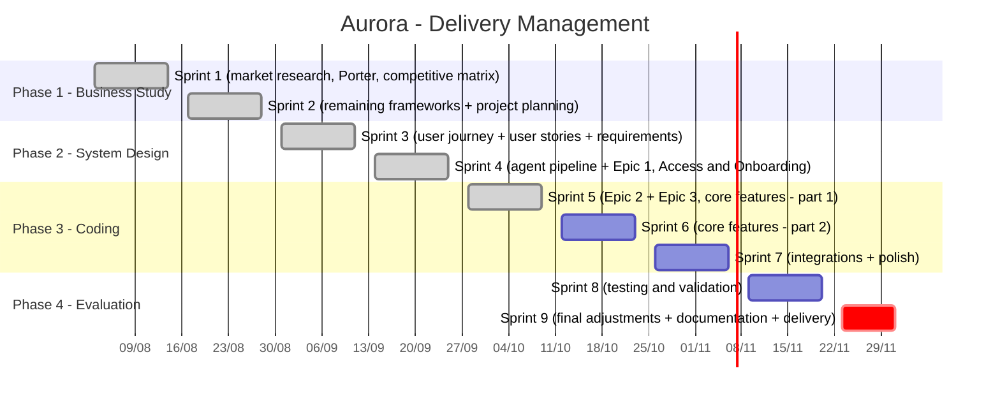

# Aurora

## Project Objective
Creator media infrastructure for the mid-market: Aurora treats a curated pool of nano and micro creators as one media unit that a brand can plan and buy, with an advantage built on the supply side by treating creators as customers instead of anonymous supply.

<p align="center">


</p>

## What is Aurora

Brands already know that nano and micro creators convert better than big influencers, but running a campaign through hundreds of small creators at once is more coordination than most teams can handle. Existing platforms solved this for enterprise brands, but left the mid-market and the creators themselves underserved.

Aurora is a technology platform that lets a brand define a budget, an audience, and a message once, then handles matching creators to the campaign, running it day to day, checking brand safety with AI assistance, and paying every creator in the pool, built specifically for the underserved middle of the market.

## Project Status

All nine planned epics are merged to `main` and implemented end to end (backend, frontend, and database): Access and Onboarding, Campaign Planning and Pool Buying, Creator Matching and Curation, Brand Safety, Briefing and Content Workflow, Payments and Financial Transparency, Analytics and Reporting, Creator Recruitment and Growth, and Agency Multi-Client Operations. The cumulative automated suite stands at 518 backend tests and 208 frontend tests, all passing. A same-day remediation pass (ADR-0063/ADR-0064) also closed the single most-repeated critical finding across every epic's own review — tenant-context row-level security never actually engaging at runtime — and a related RolesGuard authorization bypass; see [docs/remediation/tenant-isolation-rls-and-roles-guard/summary.md](docs/remediation/tenant-isolation-rls-and-roles-guard/summary.md) for what that fix does and does not yet prove.

See [docs/implementation.md](docs/implementation.md) for how Epics 1-3 were built and how to run and test them, each epic's own section below for Epics 4-9, and [docs/module-2a-2026-report.md](docs/module-2a-2026-report.md) for a single, end-to-end report covering the whole project (market research through implementation, known issues included) — or just click the live demo below.

**Live demo scope note:** the deployed environment below was last redeployed when `main` contained only Epics 1-3; it does not yet reflect Epics 4-9 or the remediation pass. See [docs/deployment.md](docs/deployment.md).

**Live demo:** [aurora-kaiane.vercel.app](https://aurora-kaiane.vercel.app) (frontend) — backend API docs at [aurora-production-b051.up.railway.app/api/docs](https://aurora-production-b051.up.railway.app/api/docs). See [docs/deployment.md](docs/deployment.md) for how it's hosted and its availability window (it's a free trial on the backend host, not indefinite — see that doc before grading after early November 2026).

### For graders: what to test

The script below exercises Epics 1-3 only (the three epics the live demo deployment currently reflects). Epics 4-9 are implemented and tested on `main`, each documented in its own section below, but are not yet part of this walkthrough or the live deployment.

Two accounts are seeded and ready to log in with, no sign-up needed:

| Role | Email |
|---|---|
| Brand owner (Marina) | `marina.demo.aurora@gmail.com` |
| Agency admin (Renata) | `renata.demo.aurora@gmail.com` |

Passwords are not published in this repository. Ask the author for them directly.

A short script to exercise all three epics:

1. **Log in as Marina** (brand). Land on `/app/brand-profile` — edit and save it.
2. Go to **Campanhas** → **Nova campanha**. Fill in budget (≥ R$ 2.000), geography (try `BR-SP`), interests (try `skincare`), a message, pick a deliverable format, set a start/end date, save.
3. Open the campaign → **Solicitar cotação** (polls for a few seconds) → **Confirmar compra** (locks the price).
4. Click **Ver shortlist** → **Gerar shortlist**. Creators get ranked by fit score, with the specific attributes each one matched. Approve or reject a few.
5. Go to **Lista de Exclusão** and add one, to see it's scoped for future shortlists only, not retroactive.
6. **Log out, log in as Renata** (agency). Go to **Clientes** → **Novo cliente** to create a client account, then open it.
7. Repeat steps 2-4 for the client account (campaign → quote → confirm → shortlist). Then try the **agency override** on that shortlist — remove a system-ranked creator, add one of your own — and note it locks the shortlist and flags the pool if it drops below the guaranteed minimum.
8. Back on Marina's side, try pausing/cancelling a confirmed campaign from its detail page, saving it as a template, and instantiating a new campaign from that template.

**What's a known limitation, not a bug**, if you run into it:
- A campaign can't reach `active` state yet (no `CONFIRMED → ACTIVE` trigger exists), so the shortlist "lock" is only reachable through the agency override path above, not through normal activation. This also means `pause`/`resume` are unreachable through the normal lifecycle.
- Automatic budget reallocation (toggle in the campaign detail page) saves correctly but never actually reallocates, since it depends on a social-platform metrics feed that's out of scope until a later epic.
- Verification/invitation emails don't arrive in an inbox (console-log stub); this doesn't block grading since both demo accounts are pre-verified.

**What's a known, disclosed bug, not a limitation** — tracked in full in [docs/remediation/tenant-isolation-rls-and-roles-guard/summary.md](docs/remediation/tenant-isolation-rls-and-roles-guard/summary.md):
- A creator cannot decline a campaign opportunity: the underlying shortlist entry is always locked by the time an opportunity exists, and a database trigger rejects the required update.
- Whether row-level security has ever actually been enforced by the database is **unconfirmed**: the app may have always connected to Postgres as a superuser with implicit `BYPASSRLS`, which would make every RLS policy a no-op regardless of the application-layer fix this period added. Verify with `SELECT rolsuper, rolbypassrls FROM pg_roles WHERE rolname = 'aurora';` before treating tenant isolation as proven.
- Geography, age range, and gender targeting in the matching engine always report a match regardless of the creator's actual data, since the minimal creator entity carries none of it.

Full technical detail — what was built per epic, every ADR, test results, and the complete list of known limitations — is in [docs/implementation.md](docs/implementation.md). Each epic's [reviewer summary](docs/epics/) opens with a short TL;DR if you want the headline before the full audit.

- ✅ **Sprint 1** — Initial market research and business analysis (industry context, the problem, the solution, and the competitive landscape)
- ✅ **Sprint 2** — Business analysis complete (Competitive Matrix, Porter's Five Forces, Gap Analysis, SWOT, Risk Matrix, Personas, Value Proposition Canvas, and Revenue and Cost Structure)
- ✅ **Sprint 3** — Product requirements complete (user journeys, 47 user stories, 60 functional and 36 non-functional requirements, with full traceability)
- ✅ **Sprint 4** — System design finalized, the agent pipeline that builds every epic from here on defined, and Epic 1 (Access and Onboarding) built end to end ahead of schedule: authentication, tenant isolation, RBAC, brand profile, team invitations, and agency client management, backend and frontend, with live API docs and a passing backend test suite (see the reviewer's summary for known gaps, including the frontend test environment and tenant isolation enforcement)
- ✅ **Sprint 5** — Epic 2 (Campaign Planning and Pool Buying) and Epic 3 (Creator Matching and Curation) built end to end with the same pipeline, ahead of the original one-epic-per-sprint pace: async quoting and budget reallocation for E2, a real creator-matching engine (replacing E2's stub) and shortlist/exclusion/opportunity flows for E3. Both pass their full automated test suites (116 backend + 32 frontend tests combined) and are merged to `main`. Deployed live and tested end to end by hand afterward, which surfaced and fixed several real bugs the automated pipeline missed — see [docs/implementation.md](docs/implementation.md) section 9 and the "For graders" section below.
- ✅ **Sprint 6 (Epics 4-9)** — Brand Safety, Briefing and Content Workflow, Payments and Financial Transparency, Analytics and Reporting, Creator Recruitment and Growth, and Agency Multi-Client Operations, built end to end with the same pipeline, bringing the cumulative suite to 518 backend + 208 frontend tests, all passing. See each epic's own section below and [docs/module-2a-2026-report.md](docs/module-2a-2026-report.md) for the full account.
- ✅ **Sprint 6 (remediation)** — a same-day fix for the single most-repeated critical finding across every epic's own review (tenant-context RLS never engaging at runtime) plus a related RolesGuard authorization bypass, with its own disclosed open items. See [docs/remediation/tenant-isolation-rls-and-roles-guard/summary.md](docs/remediation/tenant-isolation-rls-and-roles-guard/summary.md).
- ⏳ **Next** — closing the open items named throughout this README and in the remediation summary (CI, real-Postgres integration tests, the BYPASSRLS check, and the other disclosed bugs), and redeploying the live demo to reflect Epics 4-9

## Project Roadmap

The Aurora project is organized into four phases (business study, system design, coding, and evaluation) with deliverables broken down into roughly two-week sprints, running from August 3 to December 1, 2026.

- Phase 1 (business study) is already complete, covered in Sprints 1 and 2, spanning market research, Porter's Five Forces, the competitive matrix, gap analysis, SWOT, the risk matrix, and initial personas.
- Phase 2 (system design) begins, with two sprints dedicated to mapping the user journey and user stories, followed by defining the functional and non-functional requirements.
- Phase 3 (coding) is the longest stretch: three sprints, the first two building out the core features and the third for integrations and polish.
- Phase 4 (evaluation) closes out the schedule with a sprint for testing and validation, followed by a shorter final sprint for last adjustments, documentation, and delivery, keeping everything on track for the December 1 deadline.



## Repository Structure

```
.
├── .claude/agents/                    # One file per pipeline agent (see Agent Pipeline below)
├── backend/                           # NestJS API (auth, pricing, brand-profile, invitation, workspace, agency, campaign, matching, audit, jobs)
├── frontend/                          # React/Vite app consuming the API (public pages, protected app pages, creator-portal)
├── docker-compose.yml                 # PostgreSQL 16 + Redis 7 for local development
├── docs/
│   ├── business-analysis.md          # Market research and strategic frameworks
│   ├── product-requirements.md       # Journeys, user stories, FRs and NFRs
│   ├── architecture.md               # System design, ATAM, security, DevOps
│   ├── implementation.md             # Agent pipeline, every epic delivered so far, how to run and test them
│   ├── adr/                          # Architecture Decision Records, one per epic decision
│   ├── architecture/                 # Per-epic architecture docs (data model, API contracts)
│   ├── epics/                        # Per-epic stories and the reviewer's summary
│   └── images/                       # Diagrams and screenshots used in the docs
└── README.md
```

## Business Analysis

The full analysis lives in [docs/business-analysis.md](docs/business-analysis.md), organized into two parts:

**1. Research and Context** — industry context, the problem, the solution, and a map of the main market players (Creator Ads, Squid, Sandwiche, CreatorIQ, BR Media Group).

**2. Frameworks** — Competitive Matrix, Porter's Five Forces, Gap Analysis, SWOT, Risk Matrix, Personas, Value Proposition Canvas, and Revenue and Cost Structure.

## Product Requirements

The specification lives in [docs/product-requirements.md](docs/product-requirements.md). It converts the market gaps and customer pains from the business analysis into something buildable, as an unbroken chain: a journey phase exposes friction, a user story describes the behavior that removes it, and a requirement states it precisely enough to build and test.

**User Journeys** — the current experience of Marina (the brand), Duda (the creator), and Renata (the agency), phase by phase, with the friction points that justify every feature that follows.

**User Stories** — 47 stories across nine epics, prioritized with MoSCoW, with expanded Given/When/Then acceptance criteria for the six that carry the most weight.

**Functional Requirements** — 60 requirements across nine modules, each traced to the story it comes from.

**Non-Functional Requirements** — 36 requirements organized by quality attribute, each with a measurable target. These become the quality attribute scenarios evaluated in the architecture.

## Architecture

The system design lives in [docs/architecture.md](docs/architecture.md). Aurora is a modular monolith with asynchronous workers and externalized model inference — a decision driven by the mid-market economics rather than by preference, since an architecture that costs enterprise money to run would reproduce the very gap Aurora exists to close.

**Architecture Overview** — the style and why microservices were rejected, context and container views, the data model, and the technology stack with its rationale.

**ATAM** — the architecture stress-tested against eight quality attribute scenarios, producing the tradeoffs the design actually makes: integrity over cost on the payment path, cost over accuracy headroom on brand safety, and shared-schema tenancy over per-tenant isolation.

**Information Security** — STRIDE threat modeling, the security controls, and LGPD compliance, including the constraints that govern building profiles for creators who never registered.

**DevOps and CI/CD** — environments, pipeline, deployment and rollback, and the observability that makes every measurable requirement visible in production.

## Agent Pipeline

Starting in Sprint 4, every epic is built by a fixed sequence of specialized Claude Code agents rather than one agent doing everything end to end. Each agent has a narrow role, a fixed set of tools, and one kind of output, and each stage is auditable on its own before the next one starts.

| Stage | Agent | Output |
|---|---|---|
| 1 | `product-analyst` | User stories with Given/When/Then acceptance criteria, from an approved epic |
| 2 | `architect` | Stack, data model, API contracts, and one ADR per nontrivial decision |
| 3 | `backend-dev` / `frontend-dev` | The API, database schema, and UI implementing the approved contracts |
| 4 | `qa` | Automated tests per acceptance criterion, reported back to the owning dev |
| 5 | `reviewer` | The epic summary, checked against the ADRs and contracts, as the final gate before merge |

Stories and architecture each require human approval before the next stage proceeds, and nothing merges without the reviewer's summary. The full instructions for each agent are in `.claude/agents/`. The pipeline itself, and how it produced every epic so far, is documented in [docs/implementation.md](docs/implementation.md).

## Epic 1: Access and Onboarding

The first epic removes the enterprise sales cycle from onboarding: a brand or agency can sign up, verify their email, configure a workspace, invite teammates, and (for agencies) manage client accounts, all without a sales call. Built with NestJS and PostgreSQL on the backend and React on the frontend.

- **Stories:** [docs/epics/e1-access-onboarding/stories.md](docs/epics/e1-access-onboarding/stories.md)
- **Architecture and API contracts:** [docs/architecture/e1-access-onboarding.md](docs/architecture/e1-access-onboarding.md)
- **Decisions:** authentication strategy, tenant isolation via PostgreSQL row-level security, workspace-scoped RBAC, and the brand profile draft lifecycle, each in its own ADR under [docs/adr/](docs/adr)
- **What was built, tested, and any deviations from the design:** [docs/epics/e1-access-onboarding/summary.md](docs/epics/e1-access-onboarding/summary.md)
- **Run it locally and test it:** [docs/implementation.md](docs/implementation.md)

Alongside the build, three market validation interviews were conducted in the Brazilian creator economy (Creator Ads, from both a go-to-market and an operations perspective, and PlayNest) to check Aurora's pricing, segmentation, and agency-role hypotheses against practitioners. See [docs/implementation.md](docs/implementation.md#11-field-research-conducted-alongside-epic-1) for the interview guide and a summary of findings.

## Epic 2: Campaign Planning and Pool Buying

The second epic lets a brand define a campaign's budget, audience, and message once, see the matched creator pool's projected reach and price before committing, and buy that pool at one locked price instead of negotiating per creator. Built on the same NestJS/PostgreSQL backend and React frontend, on top of Epic 1. **Status: implemented, tested, and merged to `main`.**

- **Stories:** [docs/epics/e2-campaign-planning-pool-buying/stories.md](docs/epics/e2-campaign-planning-pool-buying/stories.md)
- **Architecture and API contracts:** [docs/architecture/e2-campaign-planning-pool-buying.md](docs/architecture/e2-campaign-planning-pool-buying.md)
- **Decisions:** pool allocation model, campaign state machine, budget reallocation bounds, pool-shortfall resolution criteria, minimum campaign budget, and template library scope, each in its own ADR under [docs/adr/](docs/adr) (0005-0010)
- **What was built, tested, and any deviations from the design:** [docs/epics/e2-campaign-planning-pool-buying/summary.md](docs/epics/e2-campaign-planning-pool-buying/summary.md)
- **Run it locally and test it:** [docs/implementation.md](docs/implementation.md)

## Epic 3: Creator Matching and Curation

The third epic replaces Epic 2's placeholder matching engine with a real one, ranking creators by audience fit, authenticity, engagement, and historical reliability, and lets a brand approve or reject individual creators, exclude specific creators or competitor-associated ones, and lets an agency override the shortlist with its own network. It also gives the creator (Duda) a minimal portal to accept or decline a campaign opportunity. **Status: implemented, tested, and merged to `main`.**

- **Stories:** [docs/epics/e3-creator-matching-curation/stories.md](docs/epics/e3-creator-matching-curation/stories.md)
- **Architecture and API contracts:** [docs/architecture/e3-creator-matching-curation.md](docs/architecture/e3-creator-matching-curation.md)
- **Decisions:** real matching engine scoring model, shortlist locking, the minimal creator entity, exclusion precedence, override sequencing, guaranteed-minimum advisory, authenticity-score policy, and additional-candidates top-up, each in its own ADR under [docs/adr/](docs/adr) (0011-0018)
- **What was built, tested, and any deviations from the design:** [docs/epics/e3-creator-matching-curation/summary.md](docs/epics/e3-creator-matching-curation/summary.md)
- **Run it locally and test it:** [docs/implementation.md](docs/implementation.md)

## Epic 4: Brand Safety

The fourth epic lets a brand define safety rules and prohibited topics, checks every submission at the message level with AI assistance before publication, and routes flagged content to a human for the final call rather than letting an automated check silently block legitimate content. **Status: implemented, tested, and merged to `main`.**

- **Stories:** [docs/epics/e4-brand-safety/stories.md](docs/epics/e4-brand-safety/stories.md)
- **Architecture and API contracts:** [docs/architecture/e4-brand-safety.md](docs/architecture/e4-brand-safety.md)
- **Decisions:** ruleset override precedence, the pluggable two-tier content-safety adapter, check-timeout handling, human review superseding automation, and lightweight post-publication monitoring, each in its own ADR under [docs/adr/](docs/adr) (0019-0024)
- **What was built, tested, and any deviations from the design:** [docs/epics/e4-brand-safety/summary.md](docs/epics/e4-brand-safety/summary.md)

## Epic 5: Briefing and Content Workflow

The fifth epic lets a brand send one structured briefing to the entire creator pool instead of repeating it per creator, and lets drafts move through an approve/reject cycle with a stated reason so revisions converge instead of looping silently. **Status: implemented, tested, and merged to `main`.**

- **Stories:** [docs/epics/e5-briefing-content-workflow/stories.md](docs/epics/e5-briefing-content-workflow/stories.md)
- **Architecture and API contracts:** [docs/architecture/e5-briefing-content-workflow.md](docs/architecture/e5-briefing-content-workflow.md)
- **Decisions:** version lineage via self-reference, review-decision separation from the safety queue, dual publication gates, and the review-deadline/escalation default, each in its own ADR under [docs/adr/](docs/adr) (0025-0032)
- **What was built, tested, and any deviations from the design:** [docs/epics/e5-briefing-content-workflow/summary.md](docs/epics/e5-briefing-content-workflow/summary.md)

## Epic 6: Payments and Financial Transparency

The sixth epic gives a brand one consolidated invoice for the whole pool instead of hundreds of individual ones, and gives each creator a visible, itemized breakdown of what they're owed and when, with no real Brazilian PSP/Pix integration bound yet (explicitly a pilot-stage placeholder). **Status: implemented, tested, and merged to `main`.**

- **Stories:** [docs/epics/e6-payments-financial-transparency/stories.md](docs/epics/e6-payments-financial-transparency/stories.md)
- **Architecture and API contracts:** [docs/architecture/e6-payments-financial-transparency.md](docs/architecture/e6-payments-financial-transparency.md)
- **Decisions:** no live payout processor in pilot, and the money-safety transaction model, each in its own ADR under [docs/adr/](docs/adr) (0033-0043)
- **What was built, tested, and any deviations from the design:** [docs/epics/e6-payments-financial-transparency/summary.md](docs/epics/e6-payments-financial-transparency/summary.md)

## Epic 7: Analytics and Reporting

The seventh epic gives a brand one dashboard of results by creator and by pool instead of assembling metrics from several platforms, and an exportable report built to support an ROI argument to a CMO or CFO. **Status: implemented, tested, and merged to `main`.**

- **Stories:** [docs/epics/e7-analytics-reporting/stories.md](docs/epics/e7-analytics-reporting/stories.md)
- **Architecture and API contracts:** [docs/architecture/e7-analytics-reporting.md](docs/architecture/e7-analytics-reporting.md)
- **Decisions:** the social-metrics adapter remaining a stub in pilot, and the agency branding surface, each in its own ADR under [docs/adr/](docs/adr) (0044-0048)
- **What was built, tested, and any deviations from the design:** [docs/epics/e7-analytics-reporting/summary.md](docs/epics/e7-analytics-reporting/summary.md)

## Epic 8: Creator Recruitment and Growth

The eighth epic gives creators real self-registration, email verification, social-account linking, a media kit, and rate preferences, and replaces Epic 3's pilot creator-ID-only login with the creator portal's real authentication. **Status: implemented, tested, and merged to `main`.**

- **Stories:** [docs/epics/e8-creator-recruitment-growth/stories.md](docs/epics/e8-creator-recruitment-growth/stories.md)
- **Architecture and API contracts:** [docs/architecture/e8-creator-recruitment-growth.md](docs/architecture/e8-creator-recruitment-growth.md)
- **Decisions:** OAuth token storage via envelope encryption, among others, each in its own ADR under [docs/adr/](docs/adr) (0049-0058)
- **What was built, tested, and any deviations from the design:** [docs/epics/e8-creator-recruitment-growth/summary.md](docs/epics/e8-creator-recruitment-growth/summary.md)

## Epic 9: Agency Multi-Client Operations

The ninth and final epic gives an agency a client-context selector, the ability to copy templates across clients, white-label branding, an audit-log viewer, and a token-gated public share link for client reports — closing a cross-tenant IDOR and a cache-staleness bug in that share-link mechanism before merge. **Status: implemented, tested, and merged to `main`.**

- **Stories:** [docs/epics/e9-agency-multi-client-operations/stories.md](docs/epics/e9-agency-multi-client-operations/stories.md)
- **Architecture and API contracts:** [docs/architecture/e9-agency-multi-client-operations.md](docs/architecture/e9-agency-multi-client-operations.md)
- **Decisions:** client-context selector and campaign attribution, among others, each in its own ADR under [docs/adr/](docs/adr) (0059-0062)
- **What was built, tested, and any deviations from the design:** [docs/epics/e9-agency-multi-client-operations/summary.md](docs/epics/e9-agency-multi-client-operations/summary.md). This is the project's closing assessment across all nine epics.

## Tenant Isolation Remediation

A same-day, cross-cutting fix (not tied to a single epic) for the single most-repeated critical finding across every epic review above: tenant-context row-level security was correctly specified in every migration since Epic 1 but never actually engaged at runtime, and a related RolesGuard bug let a creator-portal token skip role checks on brand-scoped routes. **Status: implemented, unit-tested (518/518 passing), independently reviewed — but not yet proven against a real PostgreSQL instance, and a new, unconfirmed hypothesis about the app's database role could make the whole fix moot. Read the summary before treating tenant isolation as solved.**

- **Decisions:** [docs/adr/0063-tenant-context-engagement-via-post-guard-interceptor.md](docs/adr/0063-tenant-context-engagement-via-post-guard-interceptor.md) and [docs/adr/0064-roles-guard-fail-closed-on-unresolved-account.md](docs/adr/0064-roles-guard-fail-closed-on-unresolved-account.md)
- **What was built, tested, and what remains open:** [docs/remediation/tenant-isolation-rls-and-roles-guard/summary.md](docs/remediation/tenant-isolation-rls-and-roles-guard/summary.md)

## Institution

This project is developed as part of the undergraduate program at [Inteli](https://www.inteli.edu.br/).
