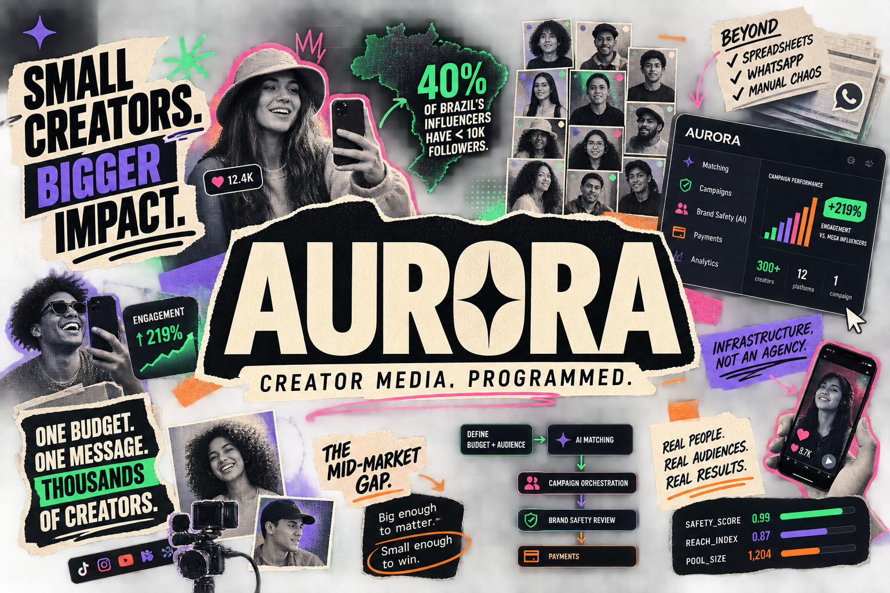
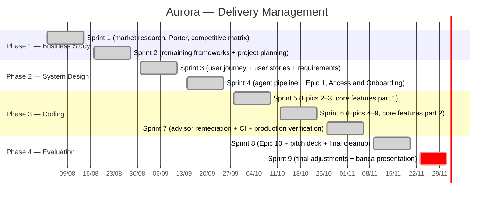

# Aurora

Aurora treats a curated pool of nano and micro creators as one media unit that a brand can plan and buy, with an advantage built on the supply side by treating creators as customers instead of anonymous supply.

  

---

## Project Status

Ten epics, all merged to `main`. Cumulative automated suite: **523 backend tests · 218 frontend tests · all passing**.

- ✅ **Sprint 1** — Market research and business analysis (industry context, the problem, the solution, competitive landscape)
- ✅ **Sprint 2** — Business analysis complete (Competitive Matrix, Porter's Five Forces, Gap Analysis, SWOT, Risk Matrix, Personas, Value Proposition Canvas, Revenue and Cost Structure)
- ✅ **Sprint 3** — Product requirements complete (user journeys, 47 user stories, 60 FRs, 36 NFRs, full traceability)
- ✅ **Sprint 4** — System design finalized, agent pipeline defined, Epic 1 (Access and Onboarding) built end to end: auth, tenant isolation, RBAC, brand profile, team invitations, agency client management
- ✅ **Sprint 5** — Epic 2 (Campaign Planning and Pool Buying) and Epic 3 (Creator Matching and Curation) built end to end: async quoting, budget allocation, real matching engine, shortlist, exclusions, agency override, creator opportunity portal
- ✅ **Sprint 6** — Epics 4–9 built end to end: Brand Safety, Briefing and Content Workflow, Payments and Financial Transparency, Analytics and Reporting, Creator Recruitment and Growth, Agency Multi-Client Operations. 508 backend + 208 frontend tests passing
- ✅ **Sprint 7** — Advisor remediation closed (Tiers 0–3): BYPASSRLS root cause confirmed and fixed (Railway role switched to `aurora_app`, `NOBYPASSRLS`), cross-tenant isolation proven in production; CI pipelines added (GitHub Actions + GitLab CI); real-Postgres integration harness added; creator seed scripts added; MFA activation UI delivered. 523 backend + 218 frontend tests passing
- ✅ **Sprint 8** — Epic 10 (AI Creator Demo): live Claude API integration across fit score explanations, brand safety semantic check, and creator briefing assistant (SSE streaming). Pitch deck (interactive HTML). Final documentation cleanup
- ⏳ **Sprint 9** — Final adjustments, banca presentation (2026-11-27)

## Project Roadmap

---

## Documentation

| Document | Contents |
|---|---|
| [Orquestração de agentes](docs/agent-orchestration.md) | How the agent pipeline works, what each agent does, how to run and test |
| [Análise de negócios](docs/business-analysis.md) | Creator economy, Porter's Five Forces, SWOT, Gap Analysis, Personas, Revenue model |
| [Requisitos de produto](docs/product-requirements.md) | User journeys, 47 user stories, 60 FRs, 36 NFRs |
| [Arquitetura](docs/architecture.md) | Design decisions, ATAM, security, DevOps |
| [ADRs](docs/adr/) | 68 Architecture Decision Records (ADR-0001 to ADR-0068) |
| [Pitch deck](docs/pitch/pitch-deck.html) | Interactive deck — market, solution, demo, next steps |
| [Pesquisa de campo](docs/field-research/) | Interview analyses — Creator Ads and PlayNest (internal only) |

---

## Epic Summaries

| Epic | Name | Summary |
|---|---|---|
| E1 | Access and Onboarding | [summary](docs/epics/e1-access-onboarding/summary.md) |
| E2 | Campaign Planning and Pool Buying | [summary](docs/epics/e2-campaign-planning-pool-buying/summary.md) |
| E3 | Creator Matching and Curation | [summary](docs/epics/e3-creator-matching-curation/summary.md) |
| E4 | Brand Safety | [summary](docs/epics/e4-brand-safety/summary.md) |
| E5 | Briefing and Content Workflow | [summary](docs/epics/e5-briefing-content-workflow/summary.md) |
| E6 | Payments and Financial Transparency | [summary](docs/epics/e6-payments-financial-transparency/summary.md) |
| E7 | Analytics and Reporting | [summary](docs/epics/e7-analytics-reporting/summary.md) |
| E8 | Creator Recruitment and Growth | [summary](docs/epics/e8-creator-recruitment-growth/summary.md) |
| E9 | Agency Multi-Client Operations | [summary](docs/epics/e9-agency-multi-client-operations/summary.md) |
| E10 | AI Creator Demo | [summary](docs/epics/e10-ai-creator-demo/summary.md) |

---

## Agent Pipeline

Every epic was built by a fixed sequence of specialized Claude Code agents. Each agent has a narrow role, a fixed set of tools, and one kind of output. Two human gates enforce the sequence — nothing moves forward without approval.

| Stage | Agent | Output | Gate |
|---|---|---|---|
| 1 | `product-analyst` | User stories with Given/When/Then criteria | Human approves before stage 2 |
| 2 | `architect` | Data model, API contracts, ADRs | Human approves before stage 3 |
| 3 | `backend-dev` / `frontend-dev` | Implementation on the feature branch | `qa` must pass |
| 4 | `qa` | Automated tests per acceptance criterion | Up to 2 fix rounds |
| 5 | `reviewer` | Epic summary in APA style, deviations flagged | Human approves before merge |

Full pipeline documentation and how to run the project: [`docs/agent-orchestration.md`](docs/agent-orchestration.md). Agent instructions: [`.claude/agents/`](.claude/agents/).

---

## Live Demo

| | |
|---|---|
| Frontend | [aurora-kaiane.vercel.app](https://aurora-kaiane.vercel.app) |
| API (Swagger) | [aurora-production-b051.up.railway.app/api/docs](https://aurora-production-b051.up.railway.app/api/docs) |

---

## Stack

| Layer | Technology |
|---|---|
| Backend | NestJS · TypeScript · PostgreSQL 16 · Redis |
| Frontend | React · Vite · TypeScript |
| AI | Claude (Anthropic) — brand safety and fit score |
| Infrastructure | Railway · Vercel · GitHub Actions CI · GitLab CI |

---

**Author:** Kaiane Souza Cordeiro · kaiane.cordeiro@sou.inteli.edu.br  
**Institution:** [Inteli — Instituto de Tecnologia e Liderança](https://www.inteli.edu.br/)
