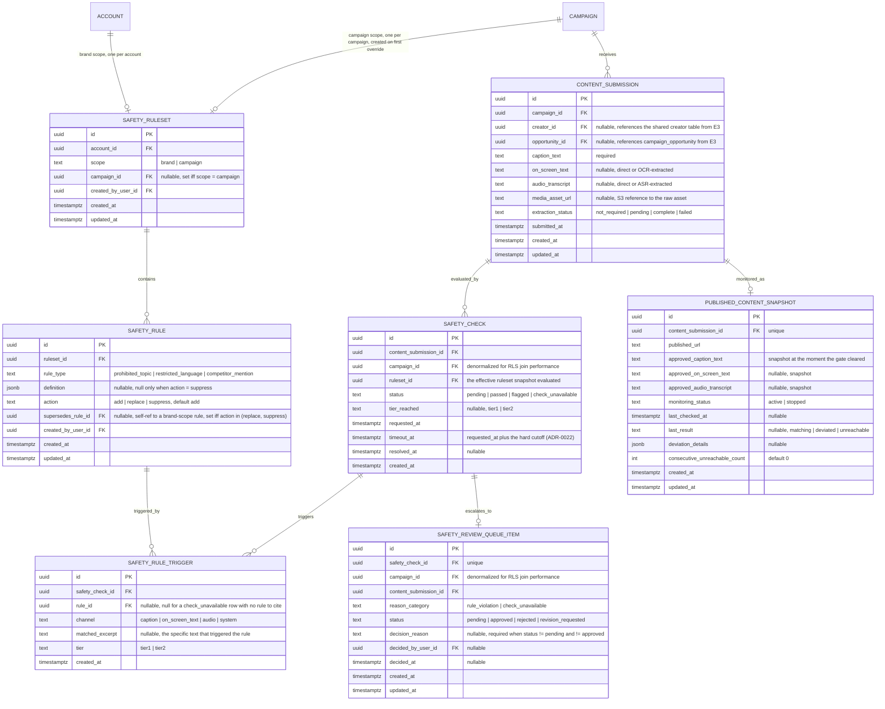

# E4 -- Brand Safety: Technical Architecture

## 1. Overview

This document specifies the data model, API contracts, and behavioral rules for Epic E4 (Brand Safety). It covers four user stories: US-15 (define brand safety rules, with per-campaign override), US-16 (message-level check before publication), US-16b (monitor published content for deviations, Could priority), and US-17 (flagged content routed to a human decision).

All decisions here build on the foundation established in [Aurora's Architecture](../architecture.md) and on [E1](./e1-access-onboarding.md) (tenancy, RBAC, RLS), [E2](./e2-campaign-planning-pool-buying.md) (campaign lifecycle, the adapter-behind-a-DI-token pattern), and [E3](./e3-creator-matching-curation.md) (the minimal-entity-ahead-of-a-later-epic precedent, the creator-portal auth pattern). The stack is not re-decided here: NestJS modular monolith, PostgreSQL with RLS keyed on `account_id`, Redis for queues/caching, S3-compatible object storage, and the **inference adapter boundary** that `docs/architecture.md` section 2.1 already commits to for "matching and brand safety."

E4 is implemented as a new backend module, `brand-safety`, alongside `auth`, `pricing`, `brand-profile`, `invitation`, `workspace`, `agency`, `audit`, `jobs`, `campaign`, and `matching`. It:

- **Introduces** the ruleset, rule, content-submission, safety-check, rule-trigger, review-queue, and monitoring-snapshot tables. None of these exist yet.
- **Implements** the two-tier model cascade (Claude Haiku screen, Claude Opus escalation) that `docs/architecture.md` QAS-02 already committed to at the whole-platform level, behind a new `ContentSafetyAdapter` interface analogous to `campaign`'s `MatchingEngineAdapter` (E2 section 3.3.1, ADR-0011's precedent). This is this epic's answer to NFR-29.
- **Introduces** a minimal `content_submission` entity, since E5 (Briefing and Content Workflow, which owns the full `SUBMISSION` entity per `docs/architecture.md`'s top-level ERD and FR-39) has not shipped yet. This follows the exact precedent E3 set with its minimal `creator` entity (ADR-0013): E4 defines the smallest submission shape its own pipeline needs, explicitly designed for E5 to extend rather than replace (see ADR-0020).
- **Exposes** the gate and the monitoring hand-off as the two integration points a future E5 architecture must call into (FR-33 and FR-42 respectively), without building either side of E5 itself.
- **Reuses** the `account_id`-scoped RLS pattern and tenant-context middleware from E1, the `audit` module for every ruleset/check/review event, the `jobs` module (Bull/Redis) for asynchronous checks and the monitoring cron, on a new `brand-safety` queue alongside `campaign`, `matching`, and `email`. It reuses E3's `creator-portal` auth guard for the one creator-facing endpoint this epic needs before E5 ships a real draft-submission flow.

**Governing NFRs for every endpoint in this epic:**

| NFR | Target | How this design meets it |
|---|---|---|
| NFR-03 | Verdict p95 ≤ 5 minutes per submission | Checks run asynchronously (202 + poll, same pattern as E2's quote and E3's shortlist). The two-tier cascade keeps the common path (tier-1 only) fast; only the ambiguous ~15% (per `docs/architecture.md` R-01) pay tier-2's latency. A hard 10-minute timeout, well above the 5-minute p95 target, bounds the worst case without itself causing spurious timeouts inside the window NFR-03 already tolerates for its slow tail (ADR-0022). |
| NFR-29 | Safety model replaceable without campaign/payment code changes or a migration | All scoring/judgment logic sits behind `ContentSafetyAdapter`, a new interface owned by `brand-safety` and consumed by no other module. `campaign` and the (not-yet-built) payment module never read `safety_rule`, `safety_check`, or `safety_rule_trigger` directly -- the only surface they can depend on is `BrandSafetyGateService`'s two public methods (section 3.6). Swapping models, tiers, or prompts means changing the adapter implementation and a DI binding, exactly as E3's `RealMatchingEngineAdapter` did for matching (ADR-0021). |
| NFR-34 | Cost must not scale linearly with pool size | The two-tier cascade and the cached ruleset prefix (`docs/architecture.md` QAS-02, Table 5) are this epic's primary mechanism: cost per campaign grows sublinearly in pool size because the expensive prefix is paid once per campaign, not once per creator. The post-publication monitor (US-16b) deliberately never re-runs the full cascade on a schedule -- it does one cheap reachability-and-caption fetch per published post, explicitly avoiding an O(pool size) recurring cost (ADR-0024). |

---

## 2. Data Model

### 2.1 Entity-Relationship Diagram



### 2.2 Entity Descriptions

**SAFETY_RULESET.** The container Marina's rules live in. A `scope = brand` row is created the first time an account saves any brand-level rule (lazily, not at account creation -- mirroring `brand_profile`'s draft lifecycle from E1). A `scope = campaign` row is created the first time a campaign-level override is saved (section 2.3 of the stories doc, US-15 scenario 2); a campaign with no override has no row here at all, and its *effective* ruleset is simply the brand ruleset, unmodified. This directly implements ADR-0019's decision on override semantics: overriding is rule-level, not whole-ruleset replacement.

**SAFETY_RULE.** One row per rule. `rule_type` is one of the three FR-31 names: `prohibited_topic`, `restricted_language`, `competitor_mention`. `definition` is a typed JSON payload specific to the type (section 2.3). Brand-scope rules always have `action = 'add'` and `supersedes_rule_id = null` -- a brand ruleset has no concept of "overriding itself." A campaign-scope rule is one of:
- `action = 'add'`: a rule that exists *only* for this campaign, with no brand-level counterpart (a genuinely new, campaign-specific prohibition).
- `action = 'replace'`: this campaign evaluates a different `definition` for the same conceptual rule, identified by `supersedes_rule_id` pointing at the brand rule it replaces. The brand rule itself, and every other campaign, is untouched (US-15 scenario 2).
- `action = 'suppress'`: this campaign turns a specific brand rule off entirely (the co-branded-partner-is-not-actually-a-competitor case from US-15 scenario 2's example), without needing to supply a replacement definition. `definition` is `null` for a suppressed rule.

**CONTENT_SUBMISSION.** The minimal entity E4 needs to anchor a safety check. It is **not** owned long-term by E4: E5 (FR-39, "the system shall accept content drafts from creators and retain every submitted version") will own the full draft/version/review lifecycle. For the gap before E5 ships, `content_submission` rows are created either by the one creator-portal intake endpoint this epic exposes (section 3.3) or, once E5 exists, directly by E5's draft-submission code calling `brand-safety`'s exported service rather than going through HTTP at all (see ADR-0020 and section 3.6). `media_asset_url` plus `extraction_status` exist because on-screen text and audio are not always supplied as text directly -- when a creator submits a raw video/image asset, an OCR/ASR extraction step (section 4) populates `on_screen_text`/`audio_transcript` before the safety check can run; when text is supplied directly (as it will be once E5's structured draft form exists), `extraction_status = 'not_required'` and the check runs immediately.

**SAFETY_CHECK.** One row per check *attempt* against a submission (a submission can be rechecked -- e.g., after a `check_unavailable` resolution, or if resubmitted content replaces a prior draft once E5 exists -- so this is not unique per submission). `ruleset_id` records exactly which ruleset (brand, or the campaign's override ruleset if one exists) was evaluated, so a later rule change never silently reinterprets a past verdict (this intentionally leaves PRD open question 2 -- whether a ruleset change retroactively re-checks already-passed content -- unresolved, consistent with the stories document; it is not addressed by this epic). `status = 'pending'` while the cascade runs; `'passed'` when no rule triggers; `'flagged'` when at least one rule triggers in at least one channel; `'check_unavailable'` when the cascade cannot produce a verdict before `timeout_at` (ADR-0022). `tier_reached` records whether the verdict came from the fast screen alone or required escalation, which is the data NFR-34's cost tracking and R-01's escalation-rate monitoring (per `docs/architecture.md` section 3.4) both read.

**SAFETY_RULE_TRIGGER.** One row per (rule, channel) combination that fired on a given check. A check with violations in two channels, or two different rules both triggering, produces multiple rows -- this is what lets US-16 scenario 2 ("citing the specific channel and rule") and US-17 scenario 2 ("lists every rule triggered, not just the first one found") both hold structurally rather than by convention. `channel = 'system'` with `rule_id = null` is the one special case: it is written (exactly once) when a check resolves to `check_unavailable`, so the review queue has something to display that is honestly not a content violation (ADR-0022).

**SAFETY_REVIEW_QUEUE_ITEM.** Created automatically, in the same transaction that sets `safety_check.status` to `'flagged'` or `'check_unavailable'`. `reason_category` lets the frontend (and Marina) distinguish "this content violated a rule" from "the check itself could not complete" -- US-16's open question 3 explicitly asks for this distinction to be visible, not just internally tracked. `status` starts `'pending'` and is set by a human decision (section 3.5). `decision_reason` is required by the API layer (not a DB constraint, since the requirement is conditional on `status`) whenever `status` is `'rejected'` or `'revision_requested'`, reusing the stated-reason obligation the stories document points to (FR-40, shared with E5's US-19/US-33).

**PUBLISHED_CONTENT_SNAPSHOT.** Created once, when the (future) E5 publication-recording code calls `BrandSafetyGateService.recordPublication` (section 3.6) after a submission's gate has cleared. `approved_*` fields are a snapshot taken at that moment -- the fixed baseline US-16b compares live content against. `monitoring_status` can be set to `'stopped'` (no delete) if a campaign is cancelled or the post is confirmed permanently removed, so the periodic job does not keep checking a link everyone already knows is gone. There is deliberately no history table behind `last_result`/`deviation_details`: per the Could-priority scope of US-16b, each check overwrites the previous result rather than keeping a full timeline, which keeps the feature simple without inventing requirements the PRD does not state (open question 7).

### 2.3 Rule Definition Shapes

`SAFETY_RULE.definition` is typed per `rule_type`:

```json
// prohibited_topic
{ "topic": "testes em animais" }

// restricted_language
{ "pattern": "milagroso|cura garantida", "pattern_type": "keyword" }
// pattern_type: "keyword" (plain substring/phrase match, case-insensitive) or "regex"

// competitor_mention
{ "competitor_name": "Marca Rival Ltda", "aliases": ["Rival", "@marcarival"] }
```

Validation (enforced in the service layer before any row is written, never partially):

| `rule_type` | Rule | Error on failure |
|---|---|---|
| `prohibited_topic` | `topic` required, 2-200 characters | 422 `RULE_TOPIC_INVALID` |
| `restricted_language` | `pattern` required, 1-500 characters. If `pattern_type = 'regex'`, the pattern must compile (validated server-side against the regex engine used at check time) and must not be the empty pattern | 422 `RULE_PATTERN_INVALID`, message states which rule and why (e.g., "padrao de expressao regular invalido") |
| `competitor_mention` | `competitor_name` required, 2-200 characters, not purely numeric/symbolic. `aliases`, if present, each 2-200 characters | 422 `RULE_COMPETITOR_UNRESOLVED` |

This is the mechanism behind US-15 scenario 3: "a restricted-language pattern it cannot parse" is caught here, at save time, before the rule or anything else in the same request is persisted (section 3.1's bulk endpoints are transactional for exactly this reason).

### 2.4 Role Permissions (extends E1/E2/E3 tables)

| Permission | brand_owner | brand_manager | brand_analyst | agency_admin | agency_operator (own clients) |
|---|---|---|---|---|---|
| View brand/campaign ruleset | yes | yes | yes | yes | yes |
| Create/edit/delete brand-level rules | yes | yes | no | yes | yes |
| Create/edit/delete campaign-level overrides | yes | yes | no | yes | yes |
| Submit content for a check (creator-portal intake) | -- | -- | -- | -- | -- |
| View safety check status | yes | yes | yes | yes | yes |
| View human review queue | yes | yes | yes | yes | yes |
| Decide a flagged item (approve/reject/request revision) | yes | yes | no | yes | yes |
| View monitoring snapshots and deviations | yes | yes | yes | yes | yes |

`brand_analyst` is read-only across this epic, consistent with the "analyst never makes a brand-risk or financial decision" line E1/E2/E3 already drew. **The decision column is an architectural default, not a confirmed product decision**: PRD open question 5 explicitly leaves "which role may clear a flag" unresolved. This design reuses the same write-role set as every other brand-risk action in E2/E3 (campaign confirm, shortlist approve/reject) rather than inventing a fourth, narrower tier, because there is no signal in the PRD that flag clearance should be more restrictive than those. If product later decides otherwise, the write check is a single role-list change in the `brand-safety` module, not a schema change.

The creator-portal intake endpoint (section 3.3) authenticates with a creator JWT (reusing E3's `CreatorAuthGuard`), not an account role -- creators are not members of any account.

### 2.5 Row-Level Security

`safety_ruleset` carries `account_id` directly (both scopes -- a campaign-scope row's `account_id` is denormalized from the owning campaign at creation time, since a campaign never changes accounts):

```sql
ALTER TABLE safety_ruleset ENABLE ROW LEVEL SECURITY;
ALTER TABLE safety_ruleset FORCE ROW LEVEL SECURITY;

CREATE POLICY tenant_isolation ON safety_ruleset
  USING (account_id = current_setting('app.current_account_id')::uuid);
```

`safety_rule` joins via `ruleset_id`:

```sql
CREATE POLICY tenant_isolation ON safety_rule
  USING (
    ruleset_id IN (
      SELECT id FROM safety_ruleset
      WHERE account_id = current_setting('app.current_account_id')::uuid
    )
  );
```

`content_submission` joins via `campaign_id`, following E2/E3's join-based pattern:

```sql
CREATE POLICY tenant_isolation ON content_submission
  USING (
    campaign_id IN (
      SELECT id FROM campaign
      WHERE account_id = current_setting('app.current_account_id')::uuid
    )
  );
```

`safety_check` and `safety_review_queue_item` carry `campaign_id` directly (denormalized, same precedent as E3's `campaign_shortlist_entry`), so their policy avoids a second join:

```sql
CREATE POLICY tenant_isolation ON safety_check
  USING (
    campaign_id IN (
      SELECT id FROM campaign
      WHERE account_id = current_setting('app.current_account_id')::uuid
    )
  );

CREATE POLICY tenant_isolation ON safety_review_queue_item
  USING (
    campaign_id IN (
      SELECT id FROM campaign
      WHERE account_id = current_setting('app.current_account_id')::uuid
    )
  );
```

`safety_rule_trigger` joins via `safety_check_id`, and `published_content_snapshot` joins via `content_submission_id` -> `campaign_id`:

```sql
CREATE POLICY tenant_isolation ON safety_rule_trigger
  USING (
    safety_check_id IN (
      SELECT id FROM safety_check
      WHERE campaign_id IN (
        SELECT id FROM campaign
        WHERE account_id = current_setting('app.current_account_id')::uuid
      )
    )
  );

CREATE POLICY tenant_isolation ON published_content_snapshot
  USING (
    content_submission_id IN (
      SELECT id FROM content_submission
      WHERE campaign_id IN (
        SELECT id FROM campaign
        WHERE account_id = current_setting('app.current_account_id')::uuid
      )
    )
  );
```

The E1/E2/E3 CI check (every `account_id`-bearing or transitively-tenant-scoped table has a policy) is extended to cover all seven new tables.

### 2.6 Database Constraints

```sql
-- One brand-scope ruleset per account; one campaign-scope ruleset per campaign
ALTER TABLE safety_ruleset ADD CONSTRAINT chk_ruleset_scope
  CHECK (
    (scope = 'brand' AND campaign_id IS NULL)
    OR (scope = 'campaign' AND campaign_id IS NOT NULL)
  );

CREATE UNIQUE INDEX uq_brand_ruleset
  ON safety_ruleset (account_id) WHERE scope = 'brand';

CREATE UNIQUE INDEX uq_campaign_ruleset
  ON safety_ruleset (campaign_id) WHERE scope = 'campaign';

-- A suppressed or replaced rule must name what it supersedes; an added rule must not
ALTER TABLE safety_rule ADD CONSTRAINT chk_rule_action_reference
  CHECK (
    (action = 'add' AND supersedes_rule_id IS NULL)
    OR (action IN ('replace', 'suppress') AND supersedes_rule_id IS NOT NULL)
  );

-- A suppressed rule carries no definition of its own; every other rule must have one
ALTER TABLE safety_rule ADD CONSTRAINT chk_rule_definition_presence
  CHECK (
    (action = 'suppress' AND definition IS NULL)
    OR (action != 'suppress' AND definition IS NOT NULL)
  );

-- Only one open review item per check
ALTER TABLE safety_review_queue_item ADD CONSTRAINT uq_review_item_per_check
  UNIQUE (safety_check_id);

-- One monitoring snapshot per submission
ALTER TABLE published_content_snapshot ADD CONSTRAINT uq_snapshot_per_submission
  UNIQUE (content_submission_id);

-- A rule_trigger with channel = 'system' never names a rule, and vice versa
ALTER TABLE safety_rule_trigger ADD CONSTRAINT chk_trigger_system_has_no_rule
  CHECK (
    (channel = 'system' AND rule_id IS NULL)
    OR (channel != 'system' AND rule_id IS NOT NULL)
  );
```

`supersedes_rule_id` referencing a rule belonging to a *different* account's brand ruleset, or referencing a campaign-scope rule rather than a brand-scope one, is validated in the service layer at write time (a cross-table, cross-scope check Postgres cannot express declaratively without a trigger function; the service layer already has both rows in hand from the request, so this is simpler there than as a trigger, consistent with E2/E3's choice to put cross-row business rules in the application layer where a plain `CHECK` cannot reach).

### 2.7 Safety Check State Machine

```
(submission created) --> pending --[tier1 clear pass]--> passed
                            |
                            +--[tier1 ambiguous]--> tier2 --[no rule triggered]--> passed
                            |                          |
                            |                          +--[rule triggered]--> flagged --> review_queue_item (pending)
                            |
                            +--[tier1 clear violation]--> flagged --> review_queue_item (pending)
                            |
                            +--[timeout_at reached, no verdict]--> check_unavailable --> review_queue_item (pending)

review_queue_item: pending --> approved | rejected | revision_requested
```

`passed`, `flagged`, and `check_unavailable` are each terminal for the `safety_check` row itself (a new check attempt is a new row, never a reopened old one). A `review_queue_item`'s `approved` decision is what ultimately clears the publication gate for a `flagged` or `check_unavailable` submission (section 2.8); `passed` clears it without any human step at all.

### 2.8 The Publication Gate (FR-33)

There is exactly one place that answers "can this submission be published": `BrandSafetyGateService.getGateStatus(contentSubmissionId)` (section 3.6). It is computed, not stored, from the latest `safety_check` for the submission plus its `safety_review_queue_item` if one exists:

| Latest `safety_check.status` | `safety_review_queue_item.status` | Gate result |
|---|---|---|
| (none yet / still `pending`) | -- | **blocked** -- `pending` |
| `passed` | -- | **cleared** |
| `flagged` | `pending` | **blocked** -- `flagged` |
| `flagged` | `approved` | **cleared** (human override) |
| `flagged` | `rejected` or `revision_requested` | **blocked**, permanently for this submission |
| `check_unavailable` | `pending` | **blocked** -- `check_unavailable` |
| `check_unavailable` | `approved` | **cleared** (human override) |
| `check_unavailable` | `rejected` or `revision_requested` | **blocked**, permanently for this submission |

No row, no status, and no error state ever maps to "cleared" by default. This is deliberate and is what resolves PRD open question 3 (ADR-0022): a submission whose check cannot complete sits in exactly the same blocking posture as one that failed outright, because FR-33's framing is zero-tolerance about "has not passed," and a timeout is not a pass. It is also what makes US-17 scenario 3 (review queue unreachable) structurally safe without any special-case code -- if the queue's *read* API is degraded, the gate computation above is unaffected (it is a database read against tables that are not the queue UI), so a submission already sitting at `pending`/`blocked` stays `blocked` through an outage with no code path that flips it to cleared as a side effect.

---

## 3. API Contracts

### 3.1 Conventions

Identical to E1/E2/E3: base URL `https://api.aurora.com.br/v1`, JSON bodies, bearer JWT, `X-Account-Id` header for agency context, the same structured error shape (`code`, `message`, `details`), cursor pagination, ISO 8601 UTC timestamps. The creator-portal endpoint in this epic lives under `/v1/creator-portal/*`, authenticated with a creator JWT, per E3's convention.

### 3.2 Ruleset and Rule Endpoints (US-15)

#### GET /safety/rulesets/brand

Returns the current account's brand-level ruleset and its rules. Returns an empty rule list (not a 404) if no brand-level rule has ever been saved -- a brand ruleset conceptually always exists, just possibly empty, mirroring `brand_profile`'s draft-exists-by-implication pattern from E1.

**Required role:** Any authenticated member of the account (read).

**Success response (200 OK):**
```json
{
  "id": "rs-brand-001",
  "scope": "brand",
  "rules": [
    {
      "id": "rule-001",
      "rule_type": "competitor_mention",
      "definition": { "competitor_name": "Marca Rival Ltda", "aliases": ["Rival"] },
      "action": "add",
      "supersedes_rule_id": null,
      "created_at": "2026-09-10T10:00:00Z"
    }
  ],
  "updated_at": "2026-09-10T10:00:00Z"
}
```

---

#### POST /safety/rulesets/brand/rules

Creates a single brand-level rule.

**Required role:** `brand_owner`, `brand_manager`, `agency_admin`, `agency_operator` (with client access).

**Request:**
```json
{ "rule_type": "restricted_language", "definition": { "pattern": "cura garantida", "pattern_type": "keyword" } }
```

**Success response (201 Created):** The created rule, same shape as the array entries above.

**Behavior:** Validates per section 2.3's table. Lazily creates the `scope = brand` ruleset row if this account has none yet. Writes audit log `safety_rule.created`.

**Error responses:**
- 422 `RULE_PATTERN_INVALID` / `RULE_TOPIC_INVALID` / `RULE_COMPETITOR_UNRESOLVED`: states which validation failed. The existing ruleset is untouched (US-15 scenario 3).
- 403: insufficient role.

---

#### PATCH /safety/rulesets/brand/rules/:ruleId

Updates a brand-level rule. Partial update of `definition` only (`rule_type` and `action` are immutable after creation -- changing the *kind* of a rule is modeled as delete-and-recreate, not an in-place type change).

**Required role:** Same as POST.

**Behavior:** Re-validates the merged `definition` per section 2.3. On failure, the rule is left exactly as it was before the request (US-15 scenario 3). Writes audit log `safety_rule.updated`.

---

#### DELETE /safety/rulesets/brand/rules/:ruleId

**Required role:** Same as POST.

**Behavior:** Deletes the rule. If any campaign-scope rule has `supersedes_rule_id` pointing at this rule, that campaign override is left in place but becomes meaningless (it now supersedes nothing); the response includes `"affected_campaign_overrides": ["camp-1234-..."]` so the frontend can warn the caller, but the delete is not blocked by it -- a brand rule being removed is exactly the kind of brand-level decision that should not be held hostage by a campaign-level exception.

**Success response (204 No Content)**, or 200 with the `affected_campaign_overrides` warning payload if non-empty.

---

#### POST /safety/rulesets/brand/rules/bulk

Transactional, all-or-nothing batch of creates/updates/deletes. This is the endpoint that gives US-15 scenario 3 its exact guarantee: "never saves a partially invalid ruleset."

**Required role:** Same as POST.

**Request:**
```json
{
  "create": [{ "rule_type": "prohibited_topic", "definition": { "topic": "ingredientes sinteticos" } }],
  "update": [{ "id": "rule-001", "definition": { "competitor_name": "Marca Rival S.A." } }],
  "delete": ["rule-002"]
}
```

**Behavior:** Validates every item in `create` and `update` before writing anything. If any item fails validation, the entire request is rejected with 422, naming the specific failing item by its position/id, and **no row in the batch is written or deleted** -- the ruleset in effect before the request is unchanged (US-15 scenario 3's exact wording). Only on full validation success does the transaction commit. Writes one audit log entry, `safety_rules.bulk_updated`, carrying the full diff.

**Error responses:**
- 422: Same codes as the single-rule endpoints, with `details.failing_item` identifying which entry in the batch failed. No partial commit under any circumstance.

---

#### GET /campaigns/:id/safety-ruleset

Returns the campaign's **effective** ruleset: the brand ruleset with any campaign-scope `replace`/`suppress` rules applied, plus any campaign-scope `add` rules, computed at read time (never materialized, so a later brand-rule edit is reflected immediately in every campaign that has not specifically overridden it).

**Required role:** Any authenticated member with account access.

**Success response (200 OK):**
```json
{
  "campaign_id": "camp-1234-...",
  "has_override": true,
  "effective_rules": [
    {
      "id": "rule-001",
      "rule_type": "competitor_mention",
      "definition": { "competitor_name": "Marca Rival S.A." },
      "source": "brand"
    },
    {
      "id": "rule-override-010",
      "rule_type": "competitor_mention",
      "definition": null,
      "source": "campaign_override",
      "override_action": "suppress",
      "supersedes_rule_id": "rule-003",
      "note": "Regra de marca concorrente suspensa apenas para esta campanha"
    }
  ],
  "override_rule_ids": ["rule-override-010"]
}
```

`has_override` and the explicit `source`/`override_action` fields on each entry are what satisfy US-15 scenario 2's "makes clear in the campaign's safety settings that this campaign is running on an override rather than the inherited default" -- this is not left to the frontend to infer.

---

#### POST /campaigns/:id/safety-ruleset/overrides

Adds one campaign-level override or addition. Lazily creates the `scope = campaign` ruleset row on first call for a campaign.

**Required role:** `brand_owner`, `brand_manager`, `agency_admin`, `agency_operator` (with client access).

**Request (suppress a brand rule for this campaign, the co-branded-partner example):**
```json
{ "action": "suppress", "supersedes_rule_id": "rule-003" }
```

**Request (replace a brand rule's definition for this campaign only):**
```json
{ "action": "replace", "supersedes_rule_id": "rule-003", "rule_type": "competitor_mention", "definition": { "competitor_name": "Outra Marca" } }
```

**Request (campaign-only addition, no brand counterpart):**
```json
{ "action": "add", "rule_type": "prohibited_topic", "definition": { "topic": "promocao de desconto acima de 50%" } }
```

**Behavior:**
1. Validate `supersedes_rule_id` (when present) belongs to this account's **brand-scope** ruleset, not another campaign's override and not a different account's rule entirely. If invalid, 422 `INVALID_SUPERSEDES_REFERENCE`.
2. Validate `definition` per section 2.3 when `action != 'suppress'`.
3. Create the campaign-scope ruleset row if absent, then the rule row.
4. Write audit log `safety_rule.campaign_override_created`.

**Error responses:** Same validation codes as brand rules, plus `INVALID_SUPERSEDES_REFERENCE`.

---

#### PATCH /campaigns/:id/safety-ruleset/overrides/:ruleId · DELETE /campaigns/:id/safety-ruleset/overrides/:ruleId

Same shape and transactional-validation guarantee as the brand-rule equivalents. `DELETE` on an override simply removes the campaign-scope row -- the campaign's effective ruleset then reverts to the brand default for whatever that override had suppressed or replaced, with no separate "revert" action needed (the absence of an override row *is* the inherited state, by construction).

---

#### POST /campaigns/:id/safety-ruleset/overrides/bulk

Same all-or-nothing transactional semantics as `/safety/rulesets/brand/rules/bulk`, scoped to one campaign's override ruleset.

---

### 3.3 Content Submission Intake (US-16)

#### POST /creator-portal/content-submissions

The one creator-facing endpoint this epic exposes, so US-16 is testable end-to-end before E5 ships a real structured draft-submission flow. **Once E5 ships FR-39, its draft-submission code is expected to call `BrandSafetyGateService`'s internal interface directly (section 3.6) rather than this HTTP endpoint** -- this route exists for the gap period and for any manual/QA submission flow product wants in the interim, not as a long-lived public contract.

**Authentication:** Creator JWT (E3's `CreatorAuthGuard`).

**Request:**
```json
{
  "campaign_id": "camp-1234-...",
  "opportunity_id": "opp-001",
  "caption_text": "Esse serum mudou minha pele em 14 dias!",
  "on_screen_text": "RESULTADOS EM 14 DIAS",
  "audio_transcript": null,
  "media_asset_url": "s3://aurora-drafts/creator-9001/draft-01.mp4"
}
```

`caption_text` is required. `on_screen_text` and `audio_transcript` are optional -- if both are omitted and `media_asset_url` is present, extraction runs first (section 4); if `media_asset_url` is also absent, those channels are simply evaluated as empty (no on-screen text, no audio to check), which is a valid state for a caption-only submission.

**Success response (202 Accepted):**
```json
{
  "content_submission_id": "sub-5001",
  "safety_check_id": "chk-9001",
  "status": "pending",
  "poll_url": "/v1/safety/submissions/sub-5001/check"
}
```

**Behavior:**
1. Validate the creator holds an `accepted` `campaign_opportunity` for `opportunity_id` on this campaign (if provided) -- prevents a creator submitting content against a campaign they have no opportunity on.
2. Create the `content_submission` row. Set `extraction_status` per the rule above.
3. Create a `safety_check` row, `status = 'pending'`, `ruleset_id` = the campaign's effective ruleset snapshot resolved at this moment, `timeout_at = requested_at + 10 minutes` (ADR-0022).
4. If extraction is needed, enqueue `extract-content-channels` first; its completion enqueues `run-safety-check`. Otherwise enqueue `run-safety-check` directly.
5. Write audit log `content_submission.created`.

**Error responses:**
- 404 `OPPORTUNITY_NOT_FOUND`: no accepted opportunity for this creator on this campaign.
- 422: `caption_text` missing or empty.

---

#### GET /safety/submissions/:id/check

Polls the latest check's status. Available to the submitting creator (own submissions only) and to any authenticated account member with access to the submission's campaign.

**Success response (200 OK), pending:**
```json
{ "id": "chk-9001", "status": "pending", "requested_at": "2026-10-20T09:00:00Z" }
```

**Success response (200 OK), passed:**
```json
{ "id": "chk-9001", "status": "passed", "tier_reached": "tier1", "requested_at": "2026-10-20T09:00:00Z", "resolved_at": "2026-10-20T09:00:18Z" }
```

**Success response (200 OK), flagged (US-16 scenario 2):**
```json
{
  "id": "chk-9001",
  "status": "flagged",
  "tier_reached": "tier2",
  "triggered_rules": [
    {
      "rule_id": "rule-007",
      "rule_type": "restricted_language",
      "channel": "audio",
      "matched_excerpt": "resultado garantido em uma semana"
    }
  ],
  "requested_at": "2026-10-20T09:00:00Z",
  "resolved_at": "2026-10-20T09:02:40Z"
}
```
Note that `caption_text` and `on_screen_text` passed cleanly in this example and the overall result is still `flagged` -- a pass in two of three channels never produces an overall pass, exactly per US-16 scenario 2, because `status` is a single aggregate over all `safety_rule_trigger` rows for the check, not a per-channel vote.

**Success response (200 OK), check_unavailable:**
```json
{
  "id": "chk-9001",
  "status": "check_unavailable",
  "message": "A verificacao de seguranca da marca nao pode ser concluida a tempo. O conteudo permanece bloqueado para publicacao e foi enviado para revisao humana.",
  "requested_at": "2026-10-20T09:00:00Z",
  "resolved_at": "2026-10-20T09:10:00Z"
}
```

---

### 3.4 Review Queue Endpoints (US-17)

#### GET /safety/review-queue

Lists items in the human review queue for the current account.

**Required role:** Any authenticated member with account access (read; `brand_analyst` included).

**Query parameters:** `status` (default `pending`), `cursor`, `limit`.

**Success response (200 OK):**
```json
{
  "data": [
    {
      "id": "rq-001",
      "content_submission_id": "sub-5001",
      "campaign_id": "camp-1234-...",
      "campaign_name": "Lancamento Serum Vitamina C",
      "creator_display_name": "Duda Oliveira",
      "reason_category": "rule_violation",
      "triggered_rules": [
        { "rule_id": "rule-007", "rule_type": "restricted_language", "channel": "audio", "matched_excerpt": "resultado garantido em uma semana" },
        { "rule_id": "rule-009", "rule_type": "prohibited_topic", "channel": "caption", "matched_excerpt": "testado em animais" }
      ],
      "status": "pending",
      "created_at": "2026-10-20T09:02:40Z"
    }
  ],
  "pagination": { "next_cursor": null, "has_more": false }
}
```
Multiple `triggered_rules` entries on one item is exactly US-17 scenario 2 ("a submission triggers multiple rules at once ... lists every rule triggered").

**Error responses:**
- 503: backend/database unavailable. Returns the standard error shape with `code: "REVIEW_QUEUE_UNAVAILABLE"` and a pt-BR message instructing the user to retry; the frontend must render this as an explicit error state, never an empty list (US-17 scenario 3 -- "a clear error rather than a blank or misleadingly empty queue"). The underlying flagged content's gate status is entirely unaffected by this failure (section 2.8).

---

#### GET /safety/review-queue/:id

Full detail: the submission's caption/on-screen/audio text, every triggered rule with its full rule definition (not just the excerpt), and the check's `tier_reached`.

**Required role:** Same as list.

---

#### POST /safety/review-queue/:id/decide

**Required role:** `brand_owner`, `brand_manager`, `agency_admin`, `agency_operator` (with client access) -- see section 2.4's note on PRD open question 5.

**Request:**
```json
{ "decision": "rejected", "reason": "Linguagem de resultado garantido nao e permitida pelas normas de publicidade do setor" }
```
`decision` is one of `approved`, `rejected`, `revision_requested`. `reason` is required when `decision != 'approved'`.

**Success response (200 OK):**
```json
{ "id": "rq-001", "status": "rejected", "decided_at": "2026-10-20T11:00:00Z" }
```

**Behavior:**
1. Validate `reason` is present for non-`approved` decisions. If missing, 422 `REASON_REQUIRED`.
2. Validate the item is still `pending` (a second decision attempt on an already-decided item returns 409 `ALREADY_DECIDED`, preventing a stale frontend tab from double-submitting a decision).
3. Set `status`, `decided_by_user_id`, `decided_at`, `decision_reason`.
4. Write audit log `safety_review.decided`, carrying the full triggered-rules list in `metadata` for after-the-fact review of what Marina actually saw when she decided.
5. The underlying `safety_check.status` row is **never modified** -- the human decision lives entirely in `safety_review_queue_item` and is read by the gate computation (section 2.8) as an override, not a correction. This is what lets the automated verdict and the human verdict both remain part of the permanent record (consistent with `docs/architecture.md`'s framing of `SAFETY_VERDICT` as its own entity, never collapsed into the submission).

**Error responses:**
- 422 `REASON_REQUIRED`: reason missing on a non-approve decision.
- 409 `ALREADY_DECIDED`: item is not `pending`.
- 403: insufficient role.

---

### 3.5 Monitoring Endpoints (US-16b)

#### GET /safety/monitoring

Lists published-content snapshots and their current monitoring state for the account.

**Required role:** Any authenticated member with account access.

**Query parameters:** `campaign_id` (optional), `result` (optional filter: `matching` | `deviated` | `unreachable`), `cursor`, `limit`.

**Success response (200 OK):**
```json
{
  "data": [
    {
      "id": "snap-001",
      "content_submission_id": "sub-5001",
      "campaign_id": "camp-1234-...",
      "published_url": "https://instagram.com/p/abc123",
      "last_result": "deviated",
      "last_checked_at": "2026-10-20T06:00:00Z",
      "deviation_details": {
        "field": "caption_text",
        "approved": "Esse serum mudou minha pele em 14 dias!",
        "current": "Esse serum mudou minha pele em 14 dias! Link na bio com desconto de 70%"
      }
    }
  ],
  "pagination": { "next_cursor": null, "has_more": false }
}
```

**When `last_result = "unreachable"`:**
```json
{ "...": "...", "last_result": "unreachable", "deviation_details": { "reason": "link_unreachable_or_removed" }, "consecutive_unreachable_count": 2 }
```
`unreachable` and `deviated` are always distinguishable in the response, per US-16b scenario 3 -- a removed post is never reported as "still matching" merely because there is nothing left to compare.

---

#### GET /safety/monitoring/:id

Single snapshot detail, same shape as a list entry plus `approved_caption_text`/`approved_on_screen_text`/`approved_audio_transcript` for full context.

---

### 3.6 Integration Points for the Future E5 Architecture

Two public methods on an exported `BrandSafetyGateService` (owned by the `brand-safety` module) are the entire surface any other module -- including E5 once it exists, and the payments module once it exists -- is permitted to depend on. Neither `campaign` nor any future payment code may import `safety_check`, `safety_rule`, or `safety_review_queue_item` directly; this is the same "narrow interface, not a provider SDK" discipline `docs/architecture.md` section 2.1 already applies to the ledger and the matching adapter, extended here to brand safety's *output*, not just its model.

```typescript
interface BrandSafetyGateService {
  // FR-33's enforcement point. E5's publication-recording code (future FR-42)
  // must call this and refuse to record a publication when cleared = false,
  // regardless of who or what initiates the publish attempt (US-16 scenario 3).
  getGateStatus(contentSubmissionId: string): Promise<{
    cleared: boolean;
    blockingReason: 'pending' | 'flagged' | 'check_unavailable' | 'rejected' | 'revision_requested' | null;
  }>;

  // FR-42's completion hook. E5's publication-recording code calls this
  // immediately after it records a publication, so US-16b's monitoring job
  // has a baseline to compare against. E4 does not implement FR-42 itself --
  // this method only begins monitoring once E5 has already recorded the link.
  recordPublication(contentSubmissionId: string, publishedUrl: string): Promise<void>;
}
```

Until E5 ships, `recordPublication` is also reachable through a thin authenticated HTTP wrapper, `POST /safety/submissions/:id/record-publication` (same roles as campaign write access), so the monitoring feature (US-16b) and its demo/QA path do not have to wait on E5's existence either. The behavior is identical either way: the method itself re-checks `getGateStatus` and returns 409 `SAFETY_NOT_CLEARED` if the gate is not actually cleared, which is a deliberate defense-in-depth duplicate of FR-33's check at this second boundary -- a future E5 implementation calling this method is never trusted to have already enforced the gate correctly on its own.

---

## 4. Background Jobs

| Job | Queue | Trigger | Behavior |
|---|---|---|---|
| `extract-content-channels` | `brand-safety` | `content_submission` created with `media_asset_url` set and `on_screen_text`/`audio_transcript` both absent | Runs OCR against the media asset for on-screen text and ASR for audio, behind a `MediaExtractionAdapter` interface kept separate from `ContentSafetyAdapter` (extraction is a transcription concern, not a judgment one -- swapping an OCR/ASR provider never touches safety scoring code). On completion, sets `extraction_status = 'complete'` and enqueues `run-safety-check`. On failure, sets `extraction_status = 'failed'` and still enqueues `run-safety-check` with whatever channels did extract -- a failed extraction degrades to fewer channels checked, it never blocks the check from running at all (which would itself violate FR-33's zero-tolerance framing by letting a stuck extraction stand in for a pass). |
| `run-safety-check` | `brand-safety` | Submission ready for checking | Calls `ContentSafetyAdapter.evaluate` (ADR-0021) with the effective ruleset and all available channels. Tier-1 screens; ambiguous or clear-violation results route per the cascade in `docs/architecture.md` QAS-02. On a clear pass: `status = 'passed'`. On any triggered rule: `status = 'flagged'`, writes one `safety_rule_trigger` row per (rule, channel) hit, creates the review queue item. |
| `expire-pending-checks` | `scheduled` | Cron, every 2 minutes | Finds `safety_check` rows with `status = 'pending'` and `timeout_at < now()`. Sets `status = 'check_unavailable'`, writes the single `channel = 'system'` trigger row, creates the review queue item with `reason_category = 'check_unavailable'`. This is the sweeper that makes ADR-0022's decision concrete rather than aspirational -- a stuck check cannot sit `pending` forever and silently behave like neither a pass nor a fail. |
| `monitor-published-content` | `scheduled` | Cron, every 6 hours | For every `published_content_snapshot` with `monitoring_status = 'active'`, calls `LiveContentFetcher.fetchLiveCaption` (ADR-0024) and compares the result to `approved_caption_text`. Updates `last_result`, `last_checked_at`, `deviation_details` in place (no history kept, per section 2.2). Does **not** re-run the safety cascade or re-extract on-screen text/audio from the live post -- see ADR-0024 for why this stays deliberately shallow. |

---

## 5. Frontend Route Map

| Route | Auth | Description |
|---|---|---|
| `/app/safety/ruleset` | Auth (brand/agency) | Brand-level ruleset editor (US-15). List of rules by type, create/edit/delete forms per `rule_type`, inline validation errors from the 422 responses. |
| `/app/campaigns/:id/safety-ruleset` | Auth (brand/agency) | Campaign effective-ruleset view (US-15 scenario 2). Shows every rule with its `source` (`brand` or `campaign_override`) and `override_action` badge, add/replace/suppress controls scoped to this campaign only. |
| `/app/safety/review-queue` | Auth (brand/agency) | Review queue list (US-17). Shows `reason_category`, full triggered-rules list per item, decide actions (approve/reject/request revision with required reason). Renders an explicit error state on a 503, never an empty list. |
| `/app/safety/review-queue/:id` | Auth (brand/agency) | Flagged item detail: full submission content, full rule definitions, decision history if already decided. |
| `/app/safety/monitoring` | Auth (brand/agency) | Published-content monitoring list (US-16b). Filterable by campaign and result, distinct styling for `deviated` vs `unreachable`. |
| `/creator-portal/submissions/new` | Auth (creator) | Minimal content submission form (US-16), used during the gap before E5 ships its real draft flow: caption, on-screen text, audio transcript or media upload, campaign/opportunity selector. Polls `GET /safety/submissions/:id/check` until resolved. |

---

## 6. NFR Compliance Checklist

| NFR | How this design satisfies it |
|---|---|
| NFR-03 | Checks run asynchronously (202 + poll). The common case resolves at tier-1 only; only ambiguous content pays tier-2's latency. The 10-minute hard timeout sits meaningfully above the 5-minute p95 target so the timeout mechanism itself cannot be the thing that breaches NFR-03's tail allowance (ADR-0022). Submission-to-verdict duration is the production signal `docs/architecture.md` Table 14 already commits to monitoring for this exact NFR. |
| NFR-29 | `ContentSafetyAdapter` is the only place judgment logic lives (ADR-0021), consumed by nothing outside `brand-safety`. `campaign` and any future payment module depend only on `BrandSafetyGateService`'s two methods (section 3.6), which read computed state, never engine internals. Swapping the cascade's models, thresholds, or prompts changes the adapter and a DI binding -- no table in section 2 changes shape, and no other module's code changes, exactly mirroring E3's `RealMatchingEngineAdapter` precedent (ADR-0011) for the matching side of the same NFR. |
| NFR-34 | The two-tier cascade and cached ruleset prefix (`docs/architecture.md` QAS-02, Table 5) mean the expensive part of a check's cost (the cached prefix) is paid once per campaign, not once per creator, so the marginal cost of an additional creator in the pool is the cheap tier-1 pass alone for ~85% of submissions (per the modeled escalation rate, R-01). The monitoring job (US-16b) deliberately does one cheap fetch per published post per run, never a full re-check of the cascade, which is the mechanism that keeps a Could-priority feature from quietly becoming an O(pool size) recurring cost on top of the one-time check (ADR-0024). |

---

## 7. Open Questions Resolved

| PRD open question | Resolution | ADR |
|---|---|---|
| 1. Ruleset conflict resolution between brand- and campaign-level rules (US-15) | Rule-level supersession by explicit reference (`add`/`replace`/`suppress`), not whole-ruleset replacement and not an implicit field-by-field merge. This is an architectural decision filling a product gap, made because backend-dev needs one concrete rule to build against; it is not a substitute for product confirming the behavior later. | ADR-0019 |
| 3. Timeout or unavailability of the safety check itself, as distinct from a fail verdict (US-16) | Treated identically to a flag for publication-blocking purposes: a stuck check transitions to `check_unavailable` after a 10-minute hard timeout and is routed to the same human review queue, with a `reason_category` that honestly distinguishes "the engine could not finish" from "a rule was triggered." Publication stays blocked either way until a human clears it. | ADR-0022 |
| 2. Ruleset changes mid-campaign and already-submitted content (US-15) | Not resolved by this epic. `safety_check.ruleset_id` records which ruleset version was evaluated, which is the minimum needed for this question to be answerable later without a migration, but no retroactive re-check mechanism is built now. Left open per the stories document. | -- |
| 4. No stated SLA for human review itself (US-17) | Not resolved by this epic, per the stories document's own framing. The queue guarantees no auto-approve/auto-reject while unreviewed (section 2.8), which is the only behavior the PRD actually specifies. | -- |
| 5. Role restriction on who may clear a flag (US-17) | An architectural default is applied (section 2.4: same write-role set as other brand-risk actions), explicitly flagged as pending product confirmation, not a resolution of the open question itself. | -- |
| 6. Scope of "message level" analysis beyond text and audio (US-16) | Not addressed; this epic implements exactly the three channels FR-32 names. | -- |
| 7. Monitoring cadence, notification, and available actions for deviations (US-16b) | A 6-hour cadence is adopted as a pilot default (ADR-0024), explicitly open to revision. No notification channel beyond the listing endpoint is built, and no creator-facing takedown/revert action exists -- consistent with FR-35's Could priority and the stories document's framing of these as deferrable. | ADR-0024 (cadence only) |

---

## 8. Note on This Epic's Place in Figure 5's Cycle

`docs/product-requirements.md` Figure 5 draws the M6-M5 cycle as intentional: "content enters brand safety from the workflow and returns to it with a verdict, which is what makes the check a gate before publication rather than an audit after it." E4 ships before E5 in this build sequence, so this document necessarily builds the M5 side of that cycle first and stubs the one M6 entry point it needs (`POST /creator-portal/content-submissions`) to exercise it end-to-end. Nothing in this document attempts to build M6's side: the briefing, the draft review cycle, the publication-recording action, and the actual `SUBMISSION` entity with its full version history all remain E5's scope in full. The two places where E5 will need to reach into this epic's work are named explicitly in section 3.6 and nowhere else -- a future E5 architecture document should treat `BrandSafetyGateService` as a given interface, not redesign the gate.
