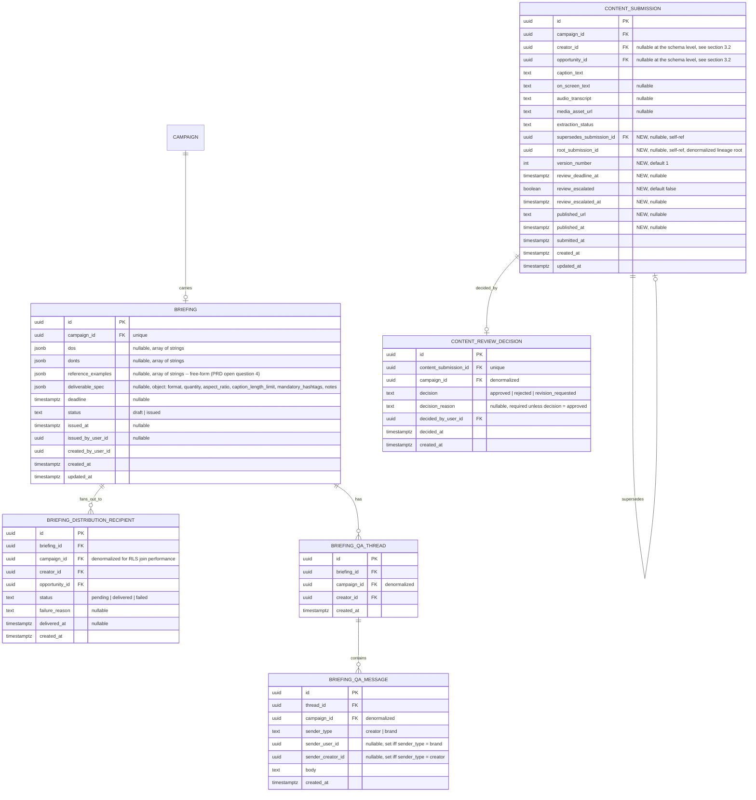

# E5 -- Briefing and Content Workflow: Technical Architecture

## 1. Overview

This document specifies the data model, API contracts, and behavioral rules for Epic E5 (Briefing and Content Workflow). It covers nine user stories: US-18a (compose a structured briefing), US-18b (distribute it to the pool in one action), US-30 (Duda receives the briefing), US-31 (briefing Q&A), US-32a (submit a draft with version retention), US-32b (review deadline and escalation), US-19 (Marina approves/rejects/requests revision, with a stated reason), US-33 (Duda receives the stated reason), and US-34 (confirm publication by submitting the live post link).

All decisions here build on the foundation established in [Aurora's Architecture](../architecture.md) and on [E1](./e1-access-onboarding.md) (tenancy, RBAC, RLS), [E2](./e2-campaign-planning-pool-buying.md) (campaign lifecycle), [E3](./e3-creator-matching-curation.md) (the minimal-entity-ahead-of-a-later-epic precedent, `campaign_opportunity`, the creator-portal auth pattern), and [E4](./e4-brand-safety.md) (the minimal `content_submission` entity, `BrandSafetyGateService`, the adapter-behind-a-DI-token pattern, the async job-plus-poll convention). The stack is **not** re-decided here: NestJS modular monolith, PostgreSQL with RLS keyed on `account_id` (plus the `app.creator_portal` escape hatch E3/E4 already established for creator-facing tables), Redis for queues/caching, S3-compatible object storage.

E5 is implemented as a new backend module, `content-workflow`, alongside `auth`, `pricing`, `brand-profile`, `invitation`, `workspace`, `agency`, `audit`, `jobs`, `campaign`, `matching`, and `brand-safety`. It:

- **Introduces** the briefing, briefing-distribution, briefing Q&A, and content-review-decision tables. None of these exist yet.
- **Extends** the existing `content_submission` table (E4, ADR-0020) with additive, nullable columns for version lineage, review deadline tracking, and publication recording. This is the exact seam ADR-0020 named as unresolved ("E5 will need to decide how its version history relates to the `content_submission` rows this epic already created") and this document resolves it (ADR-0025).
- **Retires** E4's stub creator-portal intake endpoint (`POST /creator-portal/content-submissions`, `ContentSubmissionIntakeController`), replacing it with `content-workflow`'s own controller at the same route, exactly as ADR-0020 anticipated ("this route exists for the gap period... not as a long-lived public contract").
- **Calls into** `BrandSafetyGateService.getGateStatus` and `BrandSafetyGateService.recordPublication` (both exported by `brand-safety`, unchanged) as the publication gate for US-34/FR-42, per section 3.6 of the E4 architecture document. **Does not reimplement either method.**
- **Requires one small, additive change** to `brand-safety.module.ts`: exporting `ContentSubmissionService` (extended, section 7) alongside the already-exported `BrandSafetyGateService`, so `content-workflow`'s draft-submission code populates `content_submission` through an in-process service call rather than HTTP, exactly as ADR-0020 anticipated (ADR-0032).
- **Reuses** the `account_id`-scoped RLS pattern, the `audit` module for every briefing/Q&A/review/publication event, and the `jobs` module (Bull/Redis) for asynchronous briefing distribution and deadline escalation, on a new `content-workflow` queue alongside `campaign`, `matching`, `brand-safety`, and `email`. It reuses E3's `CreatorAuthGuard` for every creator-facing endpoint.

**Governing NFRs for every endpoint in this epic (Table 15 of the PRD, plus the WCAG flag the stories document raises explicitly for US-18a and US-30):**

| NFR | Target | How this design meets it |
|---|---|---|
| NFR-04 | Read p95 ≤ 500 ms; write p95 ≤ 1,500 ms | Every synchronous endpoint in this epic is a small number of indexed reads/writes against rows already scoped by `campaign_id` or `creator_id` -- no endpoint makes a blocking external call. The one operation that fans out to up to 150 creators (briefing distribution, NFR-06) is split: validation and locking are synchronous (single-row read/update, well inside the write budget), and the actual per-creator notification fan-out runs in a background job, mirroring the exact async-dispatch pattern E2's quote, E3's shortlist, and E4's safety check already established, so a 150-recipient pool never makes the HTTP request itself slow. |
| NFR-25 | Creator-facing interfaces fully functional from 360 px viewport width | A frontend-practice obligation (consistent with `docs/architecture.md` section 1.2's framing). Section 6 of this document names every creator-facing route this epic adds so design review has a checklist: the briefing viewer, the Q&A thread, the draft-submission form, and the publication-confirmation form. |
| NFR-32 | Structured logs with a correlation identifier end to end, retained 30 days | Every state-changing action in this epic writes an audit log entry (briefing issued, distribution outcome, draft submitted, review decided, review escalated, publication confirmed), reusing the `audit` module every prior epic uses. The correlation id already attached by the platform-wide `CorrelationIdInterceptor` is propagated into the `content-workflow` queue's job payloads exactly as E2/E3/E4's background jobs already do, so Marina's one "issue briefing" click is traceable end to end through the asynchronous distribution fan-out, not just through the synchronous request that started it. |
| NFR-26 | WCAG 2.2 level AA, scoped by the PRD to onboarding, briefing, and payment flows (FR-08, FR-11, FR-36, FR-43); level A elsewhere | Per the epic header's resolution of the Table 14/Table 15 inconsistency (FR-36 is explicitly named in NFR-26's own target), **this epic's briefing composer (US-18a, brand side) and briefing viewer (US-30, creator side) routes must conform to WCAG 2.2 AA**, audited before launch -- not merely designed to it. Every other route this epic adds (Q&A thread, draft submission, review queue, publication confirmation) defaults to level A, consistent with NFR-26's "level A elsewhere" framing. Section 6 flags the two AA-scoped routes explicitly so this is not left to be inferred. |

---

## 2. Two Decision Records, Not One

This epic introduces a decision record (`content_review_decision`, US-19/US-33/FR-40) that is easy to confuse with E4's existing `safety_review_queue_item`, because both carry the same three-way vocabulary (`approved` / `rejected` / `revision_requested`) and the same stated-reason obligation (FR-40, which US-19/US-33 explicitly share with E4's US-17). They are deliberately **separate records answering separate questions**, and a submission can carry both at once, independently:

| | `safety_review_queue_item` (E4) | `content_review_decision` (E5, this epic) |
|---|---|---|
| Created | Automatically, only when the automated safety check flags content or times out (section 2.2 of the E4 doc) | Explicitly, by Marina (or a teammate), for **every** draft she reviews, regardless of whether brand safety ever flagged it |
| Answers | "Is this content safe to publish, per the brand's rules?" | "Is this draft the creative work the brand wants published?" |
| Absence means | The content passed brand safety automatically; no human was ever in the loop | The draft has not been reviewed yet (pending) |
| Read by | `BrandSafetyGateService.getGateStatus` (the FR-33 gate) | `content-workflow`'s own endpoints; also read by the FR-42 publication gate (section 5.6) |

A draft can be creatively approved by Marina while still blocked from publication because brand safety has not cleared it (or vice versa, flagged by safety while Marina has not yet looked at it at all). US-34's publication gate is the first point where both records are read together (ADR-0027) -- neither module reads the other's table directly before that point.

---

## 3. Data Model

### 3.1 Entity-Relationship Diagram



Rows and relationships shown in plain type (`CONTENT_SUBMISSION`'s existing fields) already exist, owned by E4 (ADR-0020). Fields marked **NEW** are this epic's additive extension. `BRIEFING`, `BRIEFING_DISTRIBUTION_RECIPIENT`, `BRIEFING_QA_THREAD`, `BRIEFING_QA_MESSAGE`, and `CONTENT_REVIEW_DECISION` are new tables this epic introduces.

### 3.2 Entity Descriptions

**BRIEFING.** One row per campaign (unique on `campaign_id`), mirroring `architecture.md`'s top-level ERD (`CAMPAIGN ||--|| BRIEFING : carries`). Created lazily on Marina's first save (same draft-lifecycle precedent as `brand_profile` and `safety_ruleset`). `dos`, `donts`, and `reference_examples` are each a JSON array of free-form strings -- PRD open question 4 leaves the exact shape of a "reference example" unspecified (link, uploaded asset, free text), so this design treats any non-empty string as valid rather than inventing a typed schema the PRD does not support; a URL and a plain-text description are both legitimate array entries. `deliverable_spec` is a free-form JSON object with one required sub-field (`format`) and any number of optional ones (`aspect_ratio`, `caption_length_limit`, `mandatory_hashtags`, `notes`, etc.) -- this is what lets US-30 scenario 2's "a required aspect ratio, a caption length limit, or a mandatory hashtag" live inside the deliverable specification itself rather than as a separate, ad hoc field per possible detail. `status` starts `draft` and becomes `issued`, permanently, the moment `POST /campaigns/:id/briefing/issue` succeeds (section 4.2) -- **a briefing is immutable once issued.** This is a deliberate reuse of the same precedent `campaign_opportunity`'s payout-immutability trigger and `campaign_shortlist`'s lock already set in E2/E3: once content a creator may be relying on has gone out, it does not change under them. If Marina needs to brief differently, product has not specified a re-issue flow, and this design does not invent one (recorded as an open item, section 8).

**BRIEFING_DISTRIBUTION_RECIPIENT.** A point-in-time snapshot of who the one issue action reached, and with what outcome, satisfying US-18b scenario 3's "reports which specific creators the briefing failed to reach." One row per creator who holds a `campaign_opportunity` row for the campaign at the moment of issuing, regardless of that opportunity's own `status` (pending, accepted, declined, or expired) -- this is what "the pool" means for distribution purposes, i.e., everyone the system has ever sent an opportunity to for this campaign, which is a superset of (and computed independently from) who currently has *view access* to the content (section 4.3, ADR-0029). `status` is `pending` immediately after the issue action creates the row, then `delivered` or `failed` once the background fan-out job resolves it (section 5). This table is never read by a creator directly; it exists for Marina's side of US-18b only.

**BRIEFING_QA_THREAD / BRIEFING_QA_MESSAGE.** One thread per (briefing, creator) pair, created lazily on that creator's first question -- this is the structure that makes US-31 scenario 2's privacy guarantee ("creator B does not see creator A's question") a property of the schema (a `WHERE creator_id = :creatorId` filter on the thread, never a shared row) rather than a convention enforced only in application code. `BRIEFING_QA_MESSAGE.sender_type` distinguishes a creator's question from a brand teammate's answer within the same thread; exactly one of `sender_user_id` / `sender_creator_id` is set, matching the same mutually-exclusive-pair pattern E4 used for `channel = 'system'` rows in `safety_rule_trigger`. There is no `answered` flag stored on the thread -- "unanswered" (US-31 scenario 3) is computed at read time as "the thread's last message has `sender_type = 'creator'`," which can never drift out of sync with the actual message history the way a cached boolean could.

**CONTENT_SUBMISSION (extended).** The fields already described in section 2.2 of the E4 architecture document are unchanged. This epic adds:
- `supersedes_submission_id` / `root_submission_id` / `version_number`: the version-lineage fields that resolve ADR-0020's named seam (ADR-0025). The **first** submission against an opportunity has `version_number = 1`, `supersedes_submission_id = null`, `root_submission_id = <its own id>`. Every **resubmission** sets `supersedes_submission_id` to the version it replaces, `version_number` to that version's `version_number + 1`, and copies `root_submission_id` forward unchanged -- so "every version of this draft" is always `WHERE root_submission_id = :rootId ORDER BY version_number`, with no recursive query needed.
- `review_deadline_at` / `review_escalated` / `review_escalated_at`: FR-41's fields (ADR-0030). Set once, at submission time; `review_escalated` flips exactly once, by the sweeper job (section 5), and is never un-set.
- `published_url` / `published_at`: FR-42's completion marker on the exact version that was confirmed (ADR-0027). Set once, by the publication-confirmation endpoint (section 4.6), immediately before it calls `BrandSafetyGateService.recordPublication`.

`creator_id` and `opportunity_id` remain nullable at the schema level (unchanged from E4's definition, preserving backward compatibility with any row E4's retired stub ever created), but **every row this epic's intake endpoint creates has both populated** -- a draft with no accepted opportunity behind it is refused before a row is ever written (US-32a scenario 3, section 4.4).

**CONTENT_REVIEW_DECISION.** Marina's (or a teammate's) decision on one exact submission version -- approve, reject, or request revision -- with the FR-40 stated-reason obligation enforced at the service layer exactly as E4's `review-queue.service.ts` already enforces it for the analogous safety decision (required unless `decision = 'approved'`, written atomically with the decision in the same request, never as a follow-up step). Unique on `content_submission_id`: **a decision is final for that exact version** (US-19 scenario 2's "stores that reason attached unambiguously to the exact version it applies to" is a property of this foreign key, not a convention). A `rejected` or `revision_requested` decision on one version does not touch any other version in the same lineage -- in particular, it does not retroactively alter an earlier version's own, already-recorded decision, and it does not by itself create the next version; Duda's resubmission is a new row (section 3.3).

### 3.3 Version Lineage and Resubmission Rule (ADR-0025)

A new submission against a given `opportunity_id` is accepted under exactly one of two conditions, checked at intake:

1. **No prior submission exists** for this `opportunity_id` -- this is version 1.
2. **The latest existing version** in that opportunity's lineage (the row with the highest `version_number` sharing its `root_submission_id`) **has a `content_review_decision` of `rejected` or `revision_requested`.** The new row sets `supersedes_submission_id` to that latest version's id.

A new submission is **refused** (409) if the latest version has no decision yet (still pending review -- `PENDING_REVIEW_IN_PROGRESS`) or has already been `approved` (`ALREADY_APPROVED`, since the opportunity's deliverable is complete and the PRD does not describe a reopen flow). This gives Duda, Marina, and an auditor alike a single, unambiguous "current" version per opportunity at any moment (the lineage's highest `version_number`), while still retaining every prior version untouched, exactly as FR-39 requires. There is deliberately **no cap** on the number of resubmissions and **no behavior defined for what happens if a campaign's deadline passes mid-loop** -- PRD open question 3 leaves both unspecified at the product level, and this document does not invent a policy for either (section 8).

### 3.4 Role Permissions (extends E1-E4 tables)

| Permission | brand_owner | brand_manager | brand_analyst | agency_admin | agency_operator (own clients) | creator |
|---|---|---|---|---|---|---|
| Compose/edit briefing draft | yes | yes | no | yes | yes | -- |
| Issue/distribute a briefing | yes | yes | no | yes | yes | -- |
| View briefing (brand side) | yes | yes | yes | yes | yes | -- |
| View issued briefing (own, via accepted opportunity) | -- | -- | -- | -- | -- | yes (self) |
| Ask a briefing question | -- | -- | -- | -- | -- | yes (self) |
| Answer a briefing question | yes | yes | no | yes | yes | -- |
| View Q&A threads | yes | yes | yes | yes | yes | self only |
| Submit a content draft | -- | -- | -- | -- | -- | yes (self) |
| View content submissions (brand side) | yes | yes | yes | yes | yes | -- |
| View own content submissions | -- | -- | -- | -- | -- | yes (self) |
| Decide (approve / reject / request revision) | yes | yes | no | yes | yes | -- |
| Confirm publication | -- | -- | -- | -- | -- | yes (self) |

`brand_analyst` stays read-only, consistent with the line E1 through E4 already drew: an analyst never makes a brand-risk, financial, or (now) creative-approval decision. **The write-role set for "answer a Q&A question" and "decide a draft" is an architectural default, not a confirmed product decision** -- PRD open question 5 explicitly leaves "which brand-side role may answer or decide" unresolved, for both US-19/US-31 here and the analogous E4 question. This design reuses the exact same write-role set as every other brand-risk or creative-approval action in E2 through E4, for the same reason E4 gave: there is no signal in the PRD that either action should be more or less restrictive than the others, and if product later decides otherwise it is a role-list change in `content-workflow`, not a schema change.

### 3.5 Row-Level Security

`briefing` carries `campaign_id` directly:

```sql
CREATE POLICY tenant_isolation ON briefing
  USING (
    campaign_id IN (
      SELECT id FROM campaign
      WHERE account_id = current_setting('app.current_account_id', true)::uuid
    )
    OR current_setting('app.creator_portal', true) = 'true'
  );
```

The `app.creator_portal` branch mirrors E3's `campaign_opportunity` precedent and E4's `content_submission` precedent exactly: creators carry no `account_id`, so a creator session is let through the policy by the same session flag `TenantContextMiddleware` already sets, with the actual "only this creator's own, accepted-opportunity briefing" restriction enforced in application code (section 4.3), never by account-scoped RLS, since no tenant boundary applies to this actor type.

`briefing_distribution_recipient`, `briefing_qa_thread`, and `briefing_qa_message` carry `campaign_id` directly (denormalized, same precedent as E4's `safety_check`/`safety_review_queue_item`):

```sql
CREATE POLICY tenant_isolation ON briefing_distribution_recipient
  USING (
    campaign_id IN (
      SELECT id FROM campaign
      WHERE account_id = current_setting('app.current_account_id', true)::uuid
    )
  );
-- No creator_portal branch: creators never read this table directly (section 3.2).

CREATE POLICY tenant_isolation ON briefing_qa_thread
  USING (
    campaign_id IN (
      SELECT id FROM campaign
      WHERE account_id = current_setting('app.current_account_id', true)::uuid
    )
    OR current_setting('app.creator_portal', true) = 'true'
  );

CREATE POLICY tenant_isolation ON briefing_qa_message
  USING (
    campaign_id IN (
      SELECT id FROM campaign
      WHERE account_id = current_setting('app.current_account_id', true)::uuid
    )
    OR current_setting('app.creator_portal', true) = 'true'
  );
```

`content_review_decision` carries `campaign_id` directly, with the same creator-portal branch (a creator needs to read the decision on their own submission, e.g. to see a rejection reason, US-33):

```sql
CREATE POLICY tenant_isolation ON content_review_decision
  USING (
    campaign_id IN (
      SELECT id FROM campaign
      WHERE account_id = current_setting('app.current_account_id', true)::uuid
    )
    OR current_setting('app.creator_portal', true) = 'true'
  );
```

`content_submission`'s existing policy (E4's `BrandSafetySchema` migration, already carrying the `app.creator_portal` branch) is unchanged by this epic's new columns -- adding nullable columns to an existing table never requires a policy change. The E1-E4 CI check (every tenant-scoped table has an RLS policy) is extended to cover the five new tables.

### 3.6 Database Constraints

```sql
-- One briefing per campaign
CREATE UNIQUE INDEX uq_briefing_per_campaign ON briefing (campaign_id);

-- One recipient row per creator per briefing
ALTER TABLE briefing_distribution_recipient ADD CONSTRAINT uq_distribution_recipient
  UNIQUE (briefing_id, creator_id);

-- One Q&A thread per creator per briefing
ALTER TABLE briefing_qa_thread ADD CONSTRAINT uq_qa_thread
  UNIQUE (briefing_id, creator_id);

-- A Q&A message names exactly one kind of sender
ALTER TABLE briefing_qa_message ADD CONSTRAINT chk_message_sender
  CHECK (
    (sender_type = 'creator' AND sender_creator_id IS NOT NULL AND sender_user_id IS NULL)
    OR (sender_type = 'brand' AND sender_user_id IS NOT NULL AND sender_creator_id IS NULL)
  );

-- content_submission: additive columns, all nullable or defaulted, no
-- existing row needs a backfill beyond the defaults (NFR-29-consistent:
-- this is additive, not a breaking migration)
ALTER TABLE content_submission ADD COLUMN supersedes_submission_id uuid NULL
  REFERENCES content_submission(id);
ALTER TABLE content_submission ADD COLUMN root_submission_id uuid NULL;
ALTER TABLE content_submission ADD COLUMN version_number integer NOT NULL DEFAULT 1;
ALTER TABLE content_submission ADD COLUMN review_deadline_at timestamptz NULL;
ALTER TABLE content_submission ADD COLUMN review_escalated boolean NOT NULL DEFAULT false;
ALTER TABLE content_submission ADD COLUMN review_escalated_at timestamptz NULL;
ALTER TABLE content_submission ADD COLUMN published_url text NULL;
ALTER TABLE content_submission ADD COLUMN published_at timestamptz NULL;

-- One decision per submission version
ALTER TABLE content_review_decision ADD CONSTRAINT uq_decision_per_submission
  UNIQUE (content_submission_id);
```

Two cross-row business rules are validated in the service layer, not as a declarative `CHECK`, for the same reason E4 gave for `supersedes_rule_id` (section 2.6 of the E4 doc: "a cross-table, cross-scope check Postgres cannot express declaratively without a trigger function; the service layer already has both rows in hand"):
- `supersedes_submission_id`, when set, must reference a row sharing the same `opportunity_id` and whose latest-version status is exactly `rejected` or `revision_requested` (section 3.3's resubmission rule).
- `content_review_decision.decision_reason` must be present when `decision != 'approved'` (identical pattern to E4's `review-queue.service.ts`).

### 3.7 State Machines

**Briefing:**
```
(no briefing) --> draft --[Marina saves progress, any subset of fields]--> draft
draft --[issue: all required fields present]--> issued (terminal, immutable)
draft --[issue attempt: a required field is empty]--> draft (refused, 422, nothing sent)
```

**Content submission version lineage (per opportunity):**
```
(no submission) --[first draft]--> v1 (content_review_decision: none, i.e. pending)
v_n (pending) --[Marina decides]--> v_n (approved | rejected | revision_requested)
v_n (rejected | revision_requested) --[Duda resubmits]--> v_(n+1) (pending), supersedes v_n
v_n (approved) --[Duda confirms publication, section 4.6]--> v_n (published_at set, terminal)
```

**Review deadline / escalation**, orthogonal to the decision state above:
```
v_n created --> review_deadline_at = now() + SLA
review_deadline_at reached, still pending --[sweeper job]--> review_escalated = true (terminal flag; does not block anything)
```

---

## 4. API Contracts

### 4.1 Conventions

Identical to E1-E4: base URL `https://api.aurora.com.br/v1`, JSON bodies, bearer JWT, `X-Account-Id` header for agency context, the same structured error shape (`code`, `message`, `details`), cursor pagination, ISO 8601 UTC timestamps. Creator-portal endpoints live under `/v1/creator-portal/*`, authenticated with a creator JWT via `CreatorAuthGuard` (E3's guard, reused unchanged). Every account-scoped endpoint carries `@Roles(...)` where a role restriction applies, and relies on the platform-wide `RolesGuard` (applied globally via `APP_GUARD`) to resolve `currentAccountId` for every request that carries an `X-Account-Id`, including read-only endpoints with no `@Roles()` decorator -- this epic's controllers follow that existing, already-fixed convention rather than reading `X-Account-Id` directly.

### 4.2 Briefing Composition and Issuance (US-18a, US-18b)

#### GET /campaigns/:id/briefing

**Required role:** Any authenticated member with account access.

**Behavior:** Returns the briefing if one has been saved. **Error:** 404 `BRIEFING_NOT_FOUND` if Marina has never saved a draft yet (unlike `safety_ruleset`, a briefing's existence is itself meaningful -- there is no "empty-but-present" default).

**Success response (200 OK):**
```json
{
  "id": "brf-001",
  "campaign_id": "camp-1234-...",
  "status": "draft",
  "dos": ["Mostrar o produto sendo aplicado", "Usar iluminacao natural"],
  "donts": ["Nao mencionar concorrentes", "Nao usar filtros pesados"],
  "reference_examples": ["https://instagram.com/p/exemplo123"],
  "deliverable_spec": { "format": "instagram_reel", "quantity": 1, "aspect_ratio": "9:16", "caption_length_limit": 150 },
  "deadline": "2026-11-05T23:59:59Z",
  "issued_at": null,
  "created_at": "2026-10-18T10:00:00Z",
  "updated_at": "2026-10-20T09:00:00Z"
}
```

---

#### PUT /campaigns/:id/briefing

Creates or updates the draft. Accepts any subset of fields (US-18a scenario 2 -- a partial save is explicitly permitted while `status = draft`).

**Required role:** `brand_owner`, `brand_manager`, `agency_admin`, `agency_operator` (with client access).

**Request:** Any subset of `dos`, `donts`, `reference_examples`, `deliverable_spec`, `deadline`.

**Success response (200 OK):** The full briefing object, same shape as the GET above.

**Behavior:** Lazily creates the `briefing` row (`status = draft`) on first call. Merges the provided fields; omitted fields are left untouched (a `PUT` with one field does not blank the others -- this is a partial-update semantic despite the HTTP verb, chosen for consistency with how a multi-sitting draft is expected to behave, US-18a scenario 2). Writes audit log `briefing.saved`.

**Error responses:**
- 409 `BRIEFING_ALREADY_ISSUED`: the briefing's `status` is already `issued`. Briefings are immutable once issued (section 3.2); states this plainly rather than silently accepting a no-op write.

---

#### POST /campaigns/:id/briefing/issue

The single action that satisfies both FR-36 (cannot issue incomplete) and FR-37 (one send reaches the whole pool) -- issuing **is** distributing.

**Required role:** Same as `PUT`.

**Request:** Empty body.

**Preconditions and validation (US-18a scenario 3):** Every one of `dos` (non-empty array), `donts` (non-empty array), `reference_examples` (array with at least one entry), `deliverable_spec` (present, with `format` non-empty), and `deadline` (present) must hold. On any failure:

**Error response (422 `BRIEFING_INCOMPLETE`):**
```json
{
  "error": {
    "code": "BRIEFING_INCOMPLETE",
    "message": "O briefing nao pode ser emitido: os seguintes campos estao vazios.",
    "details": { "missing_fields": ["reference_examples", "deadline"] }
  }
}
```
Nothing is sent to any creator, and the briefing's `status` stays `draft` (US-18a scenario 3's exact guarantee: "sends nothing to any creator").

**Success response (200 OK):**
```json
{
  "id": "brf-001",
  "status": "issued",
  "issued_at": "2026-10-20T11:00:00Z",
  "recipients_queued": 42
}
```

**Behavior:**
1. Validate completeness (above). Validate the briefing is not already `issued` (409 `BRIEFING_ALREADY_ISSUED`).
2. In one transaction: set `status = issued`, `issued_at`, `issued_by_user_id`.
3. Resolve the recipient set: every distinct `creator_id` holding a `campaign_opportunity` row for this campaign **at this moment**, regardless of that opportunity's own status (US-18b scenario 2 -- "reaches every creator currently in the pool at the moment of sending, including the most recently approved ones"). Insert one `briefing_distribution_recipient` row per recipient, `status = pending`.
4. Enqueue `distribute-briefing` on the `content-workflow` queue, carrying the briefing id and the correlation id of this request (NFR-32).
5. Write audit log `briefing.issued`, with the recipient count in `metadata`.

Steps 2-3 are the synchronous part (NFR-04's write budget); step 4's job performs the actual per-recipient notification dispatch (section 5), so a 150-recipient pool never makes this request slow.

---

#### GET /campaigns/:id/briefing/distribution

Polls the outcome of the fan-out, satisfying US-18b scenario 3's "reports which specific creators the briefing failed to reach."

**Required role:** Same as `PUT`.

**Success response (200 OK):**
```json
{
  "briefing_id": "brf-001",
  "recipients_total": 42,
  "delivered": 40,
  "failed": [
    { "creator_id": "creator-9009", "failure_reason": "no_contact_channel" },
    { "creator_id": "creator-9010", "failure_reason": "notification_provider_error" }
  ],
  "pending": 0
}
```
Never reports the send as fully successful when it is not -- a `failed` entry is never silently dropped (US-18b scenario 3's exact wording).

---

### 4.3 Briefing View and Q&A (US-30, US-31)

#### GET /creator-portal/briefing?campaign_id=

**Behavior:** Returns the issued briefing **only if** the requesting creator currently holds an `accepted` `campaign_opportunity` for this campaign (a **live** check against E3's `campaign_opportunity.status`, not against the `briefing_distribution_recipient` snapshot -- this is the architectural separation ADR-0029 makes explicit: being on the distribution list and having current view access are two different facts, and the second can change after the first, e.g. an opportunity expiring after the briefing was already sent, US-30 scenario 3).

**Success response (200 OK):** Same shape as the brand-side GET, minus `issued_by_user_id`.

**Error responses:**
- 404 `BRIEFING_NOT_AVAILABLE`: returned uniformly whether the briefing does not exist, is not yet `issued`, or the creator's opportunity for this campaign is not currently `accepted` (declined, expired, or never existed). One error code for all three cases, deliberately, so the response never confirms to the caller which case applies -- the same information-leakage discipline E4 already applies to a creator polling someone else's submission (section 3.3 of the E4 doc).

---

#### POST /creator-portal/briefing/qa

Asks a question (US-31 scenario 1).

**Request:**
```json
{ "campaign_id": "camp-1234-...", "question": "O video precisa ter audio ou so legenda funciona?" }
```

**Behavior:** Same accepted-opportunity gate as the briefing GET (404 `BRIEFING_NOT_AVAILABLE` on failure). Lazily creates the creator's own `briefing_qa_thread` if this is their first question on this briefing. Appends a `briefing_qa_message` with `sender_type = creator`. Writes audit log `briefing_qa.question_asked`.

**Success response (201 Created):** The created message plus `thread_id`.

---

#### GET /creator-portal/briefing/qa?campaign_id=

Returns the creator's own thread (US-31 scenario 3 -- the question "is still visibly recorded as asked and unanswered," never disappearing).

**Success response (200 OK):**
```json
{
  "thread_id": "qa-thr-001",
  "messages": [
    { "sender_type": "creator", "body": "O video precisa ter audio ou so legenda funciona?", "created_at": "2026-10-21T09:00:00Z" }
  ],
  "answered": false
}
```
`answered` is computed at read time (section 3.2), never a stored flag. If the creator has never asked a question, returns `{ "thread_id": null, "messages": [], "answered": null }` with 200, not a 404 -- the briefing-availability gate already governs whether this endpoint is reachable at all.

---

#### GET /campaigns/:id/briefing/qa

Brand-side list of every creator's thread on this briefing.

**Required role:** Any authenticated member with account access (read).

**Success response (200 OK):**
```json
{
  "data": [
    { "thread_id": "qa-thr-001", "creator_id": "creator-9001", "creator_display_name": "Duda Oliveira", "message_count": 1, "answered": false, "last_message_at": "2026-10-21T09:00:00Z" }
  ]
}
```

---

#### GET /campaigns/:id/briefing/qa/:threadId · POST /campaigns/:id/briefing/qa/:threadId/messages

**GET required role:** Same as list (read). **POST required role:** `brand_owner`, `brand_manager`, `agency_admin`, `agency_operator` (with client access) -- see section 3.4's note on PRD open question 5.

**POST request:** `{ "body": "Funciona com legenda, audio e opcional." }`

**Behavior:** Appends a `briefing_qa_message` with `sender_type = brand`, `sender_user_id` set. Writes audit log `briefing_qa.answered`. Once answered, the same message is visible to the asking creator on their own `GET /creator-portal/briefing/qa` call (US-31 scenario 1's "Duda sees the answer on the same thread").

---

### 4.4 Draft Submission and Version History (US-32a, US-32b)

#### POST /creator-portal/content-submissions

**Replaces** E4's stub (`ContentSubmissionIntakeController`), at the same route, per ADR-0020's own framing. See section 7 for the exact integration mechanics.

**Request:** Same shape as E4's stub DTO (`campaign_id`, `opportunity_id`, `caption_text`, `on_screen_text`, `audio_transcript`, `media_asset_url`) -- unchanged, so the creator-portal form built against E4's gap-filler contract keeps working without a breaking change.

**Success response (202 Accepted):**
```json
{
  "content_submission_id": "sub-6001",
  "version_number": 1,
  "safety_check_id": "chk-9050",
  "status": "pending",
  "review_deadline_at": "2026-10-23T09:00:00Z",
  "poll_url": "/v1/safety/submissions/sub-6001/check"
}
```

**Behavior:**
1. Validate `opportunity_id` is present and resolves to an `accepted` `campaign_opportunity` for this creator on this campaign. **Missing or not accepted:** 404 `OPPORTUNITY_NOT_FOUND` (US-32a scenario 3).
2. Validate the campaign's `state = active`. **Not active (paused, cancelled, or earlier in the lifecycle):** 422 `CAMPAIGN_NOT_ACTIVE`, naming the specific reason (US-32a scenario 3's "states why -- no active opportunity or the campaign is not running").
3. Resolve the version-lineage rule (section 3.3). **Latest existing version still pending:** 409 `PENDING_REVIEW_IN_PROGRESS`. **Latest existing version already approved:** 409 `ALREADY_APPROVED`.
4. Call the extended, exported `ContentSubmissionService.createSubmission` (section 7) with the lineage fields and `reviewDeadlineAt = now() + DRAFT_REVIEW_SLA_HOURS` (ADR-0030) included in the same atomic insert that also kicks off the safety-check job -- this is the one in-process call into `brand-safety` this epic makes for intake.
5. Write audit log `content_submission.created`, including `version_number` and, when present, `supersedes_submission_id`.

---

#### GET /creator-portal/content-submissions?opportunity_id=

Lists every version in one opportunity's lineage, ordered by `version_number` (US-32a scenario 2, US-33 scenario 2 -- "exactly which version each rejection reason applies to").

**Success response (200 OK):**
```json
{
  "data": [
    {
      "id": "sub-6001",
      "version_number": 1,
      "supersedes_submission_id": null,
      "review_status": "rejected",
      "review_reason": "O produto nao aparece em nenhum momento do video.",
      "review_decided_at": "2026-10-21T15:00:00Z",
      "review_deadline_at": "2026-10-23T09:00:00Z",
      "review_escalated": false,
      "safety_gate": { "cleared": true, "blocking_reason": null },
      "published_url": null,
      "submitted_at": "2026-10-21T09:00:00Z"
    },
    {
      "id": "sub-6010",
      "version_number": 2,
      "supersedes_submission_id": "sub-6001",
      "review_status": "pending",
      "review_reason": null,
      "review_deadline_at": "2026-10-24T10:00:00Z",
      "review_escalated": false,
      "safety_gate": { "cleared": false, "blocking_reason": "pending" },
      "published_url": null,
      "submitted_at": "2026-10-22T10:00:00Z"
    }
  ]
}
```
`review_status` is `pending` when no `content_review_decision` row exists yet, else the decision's value. `safety_gate` is read live from `BrandSafetyGateService.getGateStatus` on every call (section 2's "two decision records" principle made concrete: both statuses are surfaced side by side so Duda sees the full picture of why a version is or is not publishable).

---

#### GET /campaigns/:id/content-submissions

Brand-side equivalent, Marina's review queue. Query parameters: `opportunity_id` (optional, scopes to one lineage), `review_status` (optional filter: `pending` | `approved` | `rejected` | `revision_requested`), `cursor`, `limit`.

**Required role:** Any authenticated member with account access.

**Success response (200 OK):** Same per-item shape as the creator-portal list, plus `creator_display_name` and `latest_version` (boolean, true for the highest `version_number` in its lineage) so the frontend can default to showing only current versions while still allowing drill-down into history.

---

### 4.5 Review Decision (US-19, US-33)

#### POST /content-submissions/:id/decide

**Required role:** `brand_owner`, `brand_manager`, `agency_admin`, `agency_operator` (with client access).

**Request:**
```json
{ "decision": "rejected", "reason": "O produto nao aparece em nenhum momento do video." }
```
`decision` is one of `approved`, `rejected`, `revision_requested`. `reason` required unless `decision = approved`.

**Success response (200 OK):**
```json
{ "id": "rev-dec-001", "content_submission_id": "sub-6001", "decision": "rejected", "decided_at": "2026-10-21T15:00:00Z" }
```

**Behavior:**
1. Resolve the submission by id, scoped to the caller's account via `campaign_id` (same tenant-check pattern as E4's `review-queue.service.ts`'s `findItemOrFail`). **Not found or cross-tenant:** 404 `SUBMISSION_NOT_FOUND`.
2. Validate `reason` present for non-`approved` decisions. **Missing:** 422 `REASON_REQUIRED` (US-19 scenario 3's exact guarantee -- "the system refuses to finalize the rejection and requires a reason before it is recorded").
3. Validate no `content_review_decision` already exists for this exact submission id. **Already decided:** 409 `ALREADY_DECIDED`.
4. Insert the `content_review_decision` row, atomically with the reason (US-33 scenario 3 -- "the reason is recorded atomically with the rejection decision, in the same operation").
5. Write audit log `content_submission.reviewed`.

**Note:** This endpoint does **not** consult `BrandSafetyGateService`. Marina's creative decision and the brand-safety gate are independent (section 2; ADR-0027).

---

### 4.6 Publication Confirmation (US-34)

#### POST /creator-portal/content-submissions/:id/confirm-publication

The FR-42 completion hook named explicitly by the E4 architecture document (section 3.6).

**Request:** `{ "published_url": "https://instagram.com/p/abc123" }`

**Success response (200 OK):**
```json
{ "content_submission_id": "sub-6001", "published_url": "https://instagram.com/p/abc123", "published_at": "2026-10-23T08:00:00Z", "status": "confirmed" }
```

**Behavior:**
1. Resolve the submission, scoped to the requesting creator. **Not found or not owned:** 404 `SUBMISSION_NOT_FOUND`.
2. Load the submission's `content_review_decision`. **Missing or not `approved`:** 409 `DRAFT_NOT_APPROVED`.
3. Call `BrandSafetyGateService.getGateStatus(submissionId)` (exported, unchanged, E4's own interface). **`cleared: false`:** 409 `SAFETY_NOT_CLEARED`, `details.blocking_reason` echoing the gate's own value (US-34 scenario 3's exact framing -- "states the specific reason... content not yet cleared").
4. Call `PublicationLinkVerifierAdapter.verify({ publishedUrl, approvedCaptionText: submission.captionText })` (new, this epic's own adapter -- ADR-0031).
   - **Unresolvable link:** 422 `PUBLICATION_LINK_UNREACHABLE` (US-34 scenario 3 -- "the link does not resolve").
   - **Resolvable, content does not match:** 422 `PUBLICATION_CONTENT_MISMATCH`, with `details` naming the field compared (US-34 scenario 2).
5. On success: set `published_url`, `published_at` on the submission row, in the **same transaction** as step 6.
6. Call `BrandSafetyGateService.recordPublication(submissionId, publishedUrl)` (exported, unchanged). This is the exact call E4's architecture names as its own FR-42 completion hook; this epic calls it, never reimplements its behavior (writing `published_content_snapshot`, starting US-16b monitoring where that feature is active).
7. Write audit log `content_submission.publication_confirmed`.

No payout obligation is created here (FR-44 is E6's scope, explicitly out of this epic per the stories document); this endpoint's only downstream effect beyond the two writes above is the audit log entry, which a future E6 implementation can key off exactly as E3 already signals `opportunity.accepted` for E5/E6 to consume without implementing either side itself.

---

## 5. Background Jobs

| Job | Queue | Trigger | Behavior |
|---|---|---|---|
| `distribute-briefing` | `content-workflow` | `POST /campaigns/:id/briefing/issue` | For each `briefing_distribution_recipient` row (`status = pending`), calls `BriefingNotificationAdapter.deliver(creatorId, briefingId)` (new, pluggable adapter behind a DI token, same pattern as E4's `MediaExtractionAdapter`; a stub implementation always succeeds for pilot/demo environments, a real implementation calls the platform's existing notification-provider integration named in `docs/architecture.md`'s context view). Sets `status = delivered` or `failed` with `failure_reason` per recipient. Never retries indefinitely -- one attempt per recipient per issue action, consistent with this being a one-time broadcast, not a queued message with its own retry policy. |
| `escalate-overdue-draft-reviews` | `content-workflow` | Cron, every 15 minutes | Finds `content_submission` rows where `review_deadline_at < now()`, `review_escalated = false`, and no `content_review_decision` row exists. Sets `review_escalated = true`, `review_escalated_at = now()`. Writes audit log `content_submission.review_escalated`. This is the sweeper that makes FR-41's "shall escalate" concrete: a breached deadline is never silently left as `pending` with no visible change (US-32b scenario 2), even though no specific escalation *target* is named (ADR-0030). |

---

## 6. Frontend Route Map

| Route | Auth | Description | NFR-26 scope |
|---|---|---|---|
| `/app/campaigns/:id/briefing` | Auth (brand/agency) | Briefing composer (US-18a): do's/don'ts/examples list editors, deliverable-spec form, deadline picker, partial-save, issue action with inline `missing_fields` errors. | **WCAG 2.2 AA** -- named explicitly by the epic header's resolution of the Table 14/15 inconsistency. Validation errors on issue must be programmatically associated with their fields (WCAG 3.3.1/3.3.3), not conveyed by color or placement alone. |
| `/app/campaigns/:id/briefing/distribution` | Auth (brand/agency) | Distribution outcome (US-18b): delivered/failed counts, per-creator failure reasons. | Level A (default). |
| `/app/campaigns/:id/briefing/qa` | Auth (brand/agency) | Thread list and per-thread answer composer (US-31, brand side). | Level A (default). |
| `/app/campaigns/:id/content-submissions` | Auth (brand/agency) | Marina's review queue (US-19): per-lineage grouping, latest-version default view, approve/reject/request-revision actions with required-reason enforcement, safety-gate status displayed alongside the creative decision. | Level A (default). |
| `/creator-portal/briefing` | Auth (creator) | Briefing viewer (US-30): renders do's/don'ts/examples/deliverable spec/deadline, "no briefing available" state for `BRIEFING_NOT_AVAILABLE`. | **WCAG 2.2 AA** -- named explicitly for the same reason as the composer route. |
| `/creator-portal/briefing/qa` | Auth (creator) | Q&A thread (US-31, creator side): ask a question, see the answer or an explicit "awaiting answer" state. | Level A (default). |
| `/creator-portal/drafts/new` | Auth (creator) | Draft submission form (US-32a), replacing E4's gap-filler form. Shows the stated review deadline immediately on confirmation (US-32b scenario 1). | Level A (default). |
| `/creator-portal/drafts` | Auth (creator) | Version history per opportunity (US-32a scenario 2, US-33 scenario 2): each version with its own status, reason (if any), deadline, and escalation flag. | Level A (default). |
| `/creator-portal/drafts/:id/confirm-publication` | Auth (creator) | Publication confirmation form (US-34): submits the live link, surfaces `PUBLICATION_LINK_UNREACHABLE` / `PUBLICATION_CONTENT_MISMATCH` / `SAFETY_NOT_CLEARED` as distinct, specific error states. | Level A (default). |

All creator-facing routes above (every `/creator-portal/*` row) must additionally satisfy NFR-25 (360 px viewport) regardless of their WCAG tier.

---

## 7. Integration With E4 (Section-by-Section)

This section is the concrete answer to PRD open question 8 ("the exact mapping between E5's draft/version/review workflow and E4's existing `content_submission` rows is an architecture decision, not a resolved product requirement").

**7.1 What is shared, unchanged.** `content_submission` remains **one table**, not two. E4 continues to own the fields it already defined (`campaign_id`, `creator_id`, `opportunity_id`, `caption_text`, `on_screen_text`, `audio_transcript`, `media_asset_url`, `extraction_status`) and the safety-check pipeline that anchors to it (`safety_check`, `safety_rule_trigger`, `safety_review_queue_item`, `published_content_snapshot` all continue to reference `content_submission.id` exactly as before, untouched by this epic). `GET /safety/submissions/:id/check` (E4's polling endpoint) is unchanged and keeps living in the `brand-safety` module.

**7.2 What this epic adds to the same row.** The eight new columns in section 3.6 are additive and nullable/defaulted -- no existing row requires a backfill, and no existing E4 code path that reads `content_submission` needs to change, since none of it reads the new columns.

**7.3 The one wiring change `brand-safety.module.ts` needs.** `ContentSubmissionService.createSubmission` is extended to accept the version-lineage and review-deadline fields as optional parameters, written in the same atomic insert that already creates the `content_submission` row and enqueues the safety-check job (ADR-0032). `brand-safety.module.ts`'s `exports` array grows from `[BrandSafetyGateService]` to `[BrandSafetyGateService, ContentSubmissionService]`. This is the exact mechanism ADR-0020 itself anticipated ("directly, or via `brand-safety`'s exported service, not HTTP, since both modules live in the same deployable") -- it is not a new architectural decision this epic is inventing, it is this epic executing the one ADR-0020 already named.

**7.4 What is retired.** `ContentSubmissionIntakeController` (E4's `POST /creator-portal/content-submissions` stub) and the corresponding unextended branch of `ContentSubmissionService.createSubmission`'s intake path are superseded by `content-workflow`'s own controller at the same route (section 4.4). `brand-safety.module.ts` removes `ContentSubmissionIntakeController` from its `controllers` array. This is exactly the retirement ADR-0020 forecast: "this route exists for the gap period... not as a long-lived public contract" and "if E5's build is delayed significantly past E4's, the stub endpoint could calcify into a de facto production path... Mitigation: this ADR and the architecture document both state explicitly that `BrandSafetyGateService`'s two methods, not this HTTP endpoint, are the contract a future E5 architecture should build against" -- this document follows that mitigation precisely: the HTTP stub is replaced, the two `BrandSafetyGateService` methods are called as given, unreimplemented.

**7.5 The two exact call sites into `BrandSafetyGateService`.**
- **Before** recording a publication (section 4.6, step 3): `getGateStatus(contentSubmissionId)`, refusing with 409 when `cleared: false` -- this is FR-33's enforcement point, read by this epic, never re-implemented.
- **Immediately after** a successful publication recording (section 4.6, step 6): `recordPublication(contentSubmissionId, publishedUrl)` -- this is FR-42's completion hook, called by this epic, never re-implemented. `BrandSafetyGateService`'s own `recordPublication` already re-checks the gate itself as defense-in-depth (section 3.6 of the E4 doc), so this epic's own check in step 3 is intentionally redundant with that second check, not a substitute for it.

**7.6 What this epic does *not* touch.** `ContentSafetyAdapter`, `MediaExtractionAdapter`, `LiveContentFetcher`, the two-tier cascade, the ruleset model, and the review-queue tables are all exclusively E4's concern. This epic's `content-workflow` module imports no class from `brand-safety` other than the two now-exported services, exactly matching the "narrow interface, not a provider SDK" discipline `docs/architecture.md` section 2.1 already applies platform-wide.

---

## 8. Open Questions Resolved -- and Left Open

| PRD open question | Resolution | ADR |
|---|---|---|
| 8. Mapping between E5's workflow and E4's `content_submission` | Extend the same table additively; export `ContentSubmissionService` alongside `BrandSafetyGateService`; retire the stub intake endpoint. See section 7. | ADR-0025, ADR-0032 |
| 3 (part). Version-linking model for resubmission | Self-referencing lineage (`supersedes_submission_id`, `root_submission_id`, `version_number`) on `content_submission` itself, with a strict precondition on when a resubmission is accepted (section 3.3). | ADR-0025 |
| 3 (part). Cap on resubmissions; behavior when a campaign deadline passes mid-loop | **Not resolved.** No cap is enforced; no special handling exists for a deadline passing during an open review loop. Left to product, as the stories document itself frames it. | -- |
| 2. Named escalation target for a breached review deadline | **Not resolved at the product level.** A visible flag (`review_escalated`) is guaranteed on both Marina's and Duda's views; no specific notification channel or destination is built. | ADR-0030 |
| 1. Response-time obligation for the Q&A thread | **Not resolved**, consistent with the stories document -- FR-38 states no SLA, and none is invented here. "Unanswered" is guaranteed to remain visibly recorded, nothing more. | ADR-0028 |
| 5. Role restriction on who may answer Q&A or decide a draft | An architectural default (section 3.4) is applied, explicitly flagged as pending product confirmation, consistent with E4's identical framing of the same open question for its own review queue. | -- |
| 4. Format of a "reference example" | Any non-empty string, stored in a free-form array; no typed schema invented. | -- |
| 6. Effect of pausing/cancelling a campaign on an in-flight briefing, Q&A thread, or pending review | **Not resolved.** This design blocks a *new* submission against a non-`active` campaign (section 4.4), but takes no special action on a briefing, thread, or review that was already in flight when the campaign's state changed. Recorded as open, consistent with the stories document. | -- |
| 7. Tolerance for "corresponds to the approved content" in the publication-link check | An architectural default of exact match after whitespace normalization on `caption_text` only (on-screen text and audio are not compared at confirmation time) is adopted as a pilot default, explicitly open to revision -- not a resolution of the underlying tolerance question. | ADR-0031 |

---

## 9. NFR Compliance Checklist

| NFR | How this design satisfies it |
|---|---|
| NFR-04 | Every synchronous endpoint is a small number of indexed, single-table or simple-join reads/writes. The one fan-out operation (briefing distribution to up to 150 creators, NFR-06) splits synchronous validation/locking from the asynchronous per-recipient dispatch (section 4.2), exactly mirroring the pattern NFR-04 already forced onto E2's quote, E3's shortlist, and E4's safety check at the same pool-ceiling scale. Draft intake's synchronous part is two inserts plus one queue-enqueue call, returning 202 immediately, identical in shape to E4's existing contract. |
| NFR-25 | Section 6 names every creator-facing route this epic adds so 360 px responsiveness is a concrete design-review checklist item, not an afterthought. |
| NFR-26 | The briefing composer (US-18a) and briefing viewer (US-30) routes are explicitly scoped to WCAG 2.2 AA (section 6), resolving the Table 14/15 inconsistency the epic header raises rather than silently dropping it. Every other route in this epic defaults to level A, consistent with NFR-26's stated scope. |
| NFR-32 | Every state-changing action writes an audit log entry (section 4, throughout). The asynchronous distribution job and the escalation sweeper both propagate the triggering request's correlation id into their job payloads, reusing the exact mechanism E2/E3/E4's background jobs already use, so a single user action (Marina's issue click, Duda's draft submission) remains traceable end to end through its asynchronous tail, inside the platform's 30-day retention window. |

---

## 10. Note on This Epic's Place in Figure 5's Cycle

`docs/product-requirements.md` Figure 5 draws the M6-M5 cycle as intentional ("content enters brand safety from the workflow and returns to it with a verdict"). This document is the M6 side of that cycle: it owns the briefing, the draft/version/review lifecycle, and the publication-recording action, calling into M5 (`brand-safety`) at exactly the two points E4's own architecture document named in advance (section 3.6 there, section 7 here) and nowhere else. Nothing in this document touches M5's judgment logic, model cascade, or ruleset model -- consistent with E4's own closing note that "a future E5 architecture should treat `BrandSafetyGateService` as a given interface, not redesign the gate."
