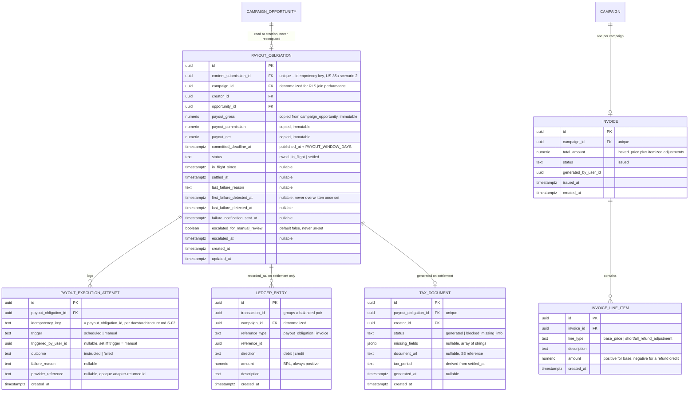

# E6 -- Payments and Financial Transparency: Technical Architecture

## 1. Overview

This document specifies the data model, API contracts, and behavioral rules for Epic E6 (Payments and Financial Transparency). It covers eight user stories: US-29 (gross/commission/net/expected-date before acceptance), US-35a (create a payout obligation on confirmed publication), US-35b (execute within the committed window), US-35c (notify within 24 hours on failure), US-36a (payment history and statements), US-36b (tax documentation), US-20 (one consolidated invoice per campaign for a direct brand buyer), and US-42 (consolidated per-client billing for an agency, with Aurora paying creators directly).

All decisions here build on the foundation established in [Aurora's Architecture](../architecture.md) and on [E1](./e1-access-onboarding.md) (tenancy, RBAC, RLS, MFA enforcement pattern), [E2](./e2-campaign-planning-pool-buying.md) (campaign lifecycle, `pool_shortfall_resolution`, the adapter-behind-a-DI-token pattern), [E3](./e3-creator-matching-curation.md) (`campaign_opportunity` and its immutable `payout_gross/commission/net` figures, the creator-portal auth pattern, the minimal-entity-ahead-of-a-later-epic precedent), [E4](./e4-brand-safety.md) (the adapter discipline, the exported-service-for-in-process-reuse pattern), and [E5](./e5-briefing-content-workflow.md) (`content_submission.published_at`, the `content_submission.publication_confirmed` audit event, `PublicationLinkVerifierAdapter`'s precedent of a narrow, dedicated adapter rather than widening an existing one). The stack is **not** re-decided here: NestJS modular monolith, PostgreSQL with RLS keyed on `account_id` (plus the `app.creator_portal` escape hatch E3-E5 already established, extended in this epic with one new escape hatch, `app.aurora_operator`, section 3.5), Redis for queues/caching, S3-compatible object storage, and the inference/fetch-adapter boundary discipline `docs/architecture.md` section 2.1 already commits to platform-wide.

`docs/architecture.md`'s own top-level data model (section 2.4) already names three of this epic's principal entities in advance -- `PAYOUT_OBLIGATION`, `LEDGER_ENTRY`, and `INVOICE` -- and already states the two decisions that carry the most weight for this epic before this document even exists: "`LEDGER_ENTRY` is append-only and double-entry... which is what makes NFR-13's reconcilability mechanical rather than aspirational" and "`PAYOUT_OBLIGATION` is separated from its ledger entries: the obligation records what is owed and by when, the ledger records what moved... which is what lets FR-46 hold a failed payout visibly outstanding." This document is the first to actually build those entities; it does not revisit whether they should exist, only how.

E6 is implemented as a new backend module, `payments`, alongside `auth`, `pricing`, `brand-profile`, `invitation`, `workspace`, `agency`, `audit`, `jobs`, `campaign`, `matching`, `brand-safety`, and `content-workflow`. It:

- **Introduces** `payout_obligation`, `payout_execution_attempt`, `ledger_entry`, `invoice`, `invoice_line_item`, and `tax_document`. None of these exist yet.
- **Extends**, additively, two tables this epic does not own long-term: `creator` (E3, ADR-0013's "extend, not replace" precedent) gains a nullable `tax_id`/`tax_id_type` pair for US-36b; `campaign_opportunity` (E3) is read directly, unchanged, as the stable source of `payout_gross/commission/net` -- this epic copies those figures into `payout_obligation` at creation time, it never recomputes or re-derives them (per the stories document's own framing, section 3.7 of the E3 doc, and `docs/architecture.md`'s explicit naming of `campaign_opportunity` as "a table E2 already owns and already treats as an opaque input").
- **Requires one small, additive change to two modules this epic does not own**, mirroring the exact mechanism ADR-0032 already established for E5/E4: (1) `content-workflow.module.ts` imports the new `PaymentsModule` and injects its exported `PayoutObligationService` into `PublicationService`, so `POST /creator-portal/content-submissions/:id/confirm-publication` (E5, section 4.6) calls into this epic in the same database transaction as setting `published_url`/`published_at` (ADR-0036); (2) `matching`'s existing `GET /creator-portal/opportunities` and `POST /creator-portal/opportunities/:id/accept` responses (E3, section 3.7) gain one additional, read-only field, `expected_payment_date`, computed from data `matching` already holds plus this epic's configured window constant (ADR-0035). Neither change touches `campaign_opportunity`'s schema or its payout-immutability trigger.
- **Reuses** the `account_id`-scoped RLS pattern, the `audit` module (extended in this epic to also log *reads* of financial data, not only writes, per NFR-23's explicit "logged on every access" target -- the first epic with that requirement), and the `jobs` module (Bull/Redis) for asynchronous payout execution, retry, escalation, and notification, on a new `payments` queue alongside `campaign`, `matching`, `brand-safety`, `content-workflow`, and `email`. It reuses E3's `CreatorAuthGuard` for every creator-facing endpoint and E1's MFA-enforcement pattern (`MFA_REQUIRED_FOR_ROLE`) for the one new principal this epic introduces (section 3.5, ADR-0038).

**Governing NFRs for every endpoint in this epic (Table 15 of the PRD, plus NFR-26 flagged explicitly by the stories document for US-29 despite the Table 14/15 inconsistency):**

| NFR | Target | How this design meets it |
|---|---|---|
| NFR-11 | >= 95% of payout obligations settled by the committed deadline, automatic or manual, any remainder flagged "in progress" | `payout_obligation.status` makes "owed but not yet settled" structurally visible (never silently dropped); a scheduled retry sweep plus an explicit, MFA-gated manual-settlement fallback (ADR-0033, ADR-0038) are the two paths to `settled`, exactly matching the two paths NFR-11's own wording names. An escalation flag (mirroring ADR-0030's precedent) flips when the deadline is within 24 hours and still unsettled, giving "in progress" a durable, queryable signal, not an inferred one. |
| NFR-13 | Zero lost/duplicated/altered financial obligations; append-only, fully reconcilable ledger | `payout_obligation` is unique on `content_submission_id` (idempotent creation, US-35a scenario 2). `ledger_entry` is append-only (DB trigger, same precedent as `audit_log`/`campaign_state_transition`) and written in balanced debit/credit pairs by exactly one service (ADR-0037), mirroring `docs/architecture.md`'s S-01/S-02/N-01. A scheduled reconciliation job sums settled obligations against ledger entries per campaign and pages on any discrepancy, extending the mechanism `docs/architecture.md` Table 14 already names for this NFR. |
| NFR-17 | Immutable audit log covering all financial events, retained 5 years | Every state-changing action in this epic writes an audit log entry (obligation created/refused/executed/settled/failed/manually settled, invoice generated, tax document generated), reusing the `audit` module unchanged. Retention is a platform-wide `audit_log` property (E1), not re-decided here. |
| NFR-19 | MFA mandatory for roles that can approve payouts or change bank details | The one new principal this epic introduces that "can approve payouts" -- `aurora_operator`, the manual-settlement fallback actor (ADR-0038) -- is gated by the exact `MFA_REQUIRED_FOR_ROLE` mechanism E1 already built for financial-privilege roles (section 3.7 of the E1 doc), extended to this new principal rather than reinvented. This pilot's stub payout adapter never captures or changes creator banking/Pix details at all (ADR-0033's explicit scope boundary), so the "change bank details" clause of this NFR has no surface to gate yet; it becomes active the moment a real adapter implementation adds that capture flow. |
| NFR-23 | Financial data access role-restricted and logged on every access | Every read endpoint in this epic (payout obligation detail/list, statement, tax document, invoice) writes an audit log entry on access, not only on mutation -- a departure from every prior epic's write-only audit convention, built as a reusable `FinancialAccessAuditInterceptor` (section 4.1) rather than per-handler boilerplate, so the obligation is structural rather than a convention a future endpoint could forget. |
| NFR-26 | WCAG 2.2 AA, scoped by the epic header's resolution of the Table 14/15 inconsistency to US-29's pre-acceptance breakdown | The opportunity-detail view (E3's existing `/creator-portal/opportunities` route, which this epic's `expected_payment_date` field extends) is flagged AA-scoped in this epic's frontend route map (section 6), the same way E5 flagged its own two AA-scoped routes explicitly rather than leaving it to be inferred. |
| NFR-36 | Payout logic depends on an internal abstraction; a provider can be replaced without changing FR-44 through FR-47 behavior | `PayoutExecutionAdapter` (ADR-0033) is the only thing that knows how a transfer is actually instructed. `payout_obligation`, `ledger_entry`, and every endpoint in this epic depend only on the adapter's interface and `PayoutObligationService`'s own computed state, never on a provider SDK. Swapping the stub for a real Brazilian PSP (Pix, per `docs/architecture.md`'s own technology-stack framing) is a new adapter implementation and a DI binding change -- no table in this document changes shape, and FR-44 through FR-47's behavior (create, execute, notify, show history) is unchanged either way. |

---

## 2. Integration: How This Epic Is Triggered, and What It Reuses Rather Than Rebuilds

This section exists because the stories document and the task that produced this document are both explicit that E6 must be built against the *real* hand-off surfaces E3 and E5 already shipped, not an assumed one.

### 2.1 The trigger: E5's `publication_confirmed` hand-off, not a separately invented signal

E5's `PublicationService.confirmPublication` (`backend/src/content-workflow/publication.service.ts`, documented in section 4.6 of the E5 architecture doc) already does exactly four things in sequence, inside one request: (1) checks `content_review_decision.decision = approved` (gate 1), refusing with `DRAFT_NOT_APPROVED` otherwise; (2) checks `BrandSafetyGateService.getGateStatus` (gate 2), refusing with `SAFETY_NOT_CLEARED` otherwise; (3) verifies the published link via `PublicationLinkVerifierAdapter`; (4) on success, sets `content_submission.published_url`/`published_at`, calls `BrandSafetyGateService.recordPublication`, and writes the audit log entry `content_submission.publication_confirmed`. E5's own architecture document states plainly that this is as far as it goes: "No payout obligation is created here (FR-44 is E6's scope...); this endpoint's only downstream effect beyond the two writes above is the audit log entry, which a future E6 implementation can key off."

This epic keys off that hand-off by **extending step 4's transaction**, not by subscribing to the audit log as an event stream. The codebase has no event bus (`EventEmitter2`, a message broker, or equivalent) anywhere in `backend/src` -- every cross-module hand-off actually built so far (E5 calling into E4's `BrandSafetyGateService`, per ADR-0032) is a direct, in-process service call inside the same database transaction, not a published-and-subscribed event. "Emit an event" in E2's and E3's architecture prose (e.g., `opportunity.accepted`) describes the *conceptual* hand-off, not a literal pub/sub mechanism; the concrete, buildable version of that hand-off is always an exported service call. This epic follows that real convention, not the aspirational prose: `content-workflow.module.ts` is given one small, additive wiring change (ADR-0036) so that `PublicationService.confirmPublication`, immediately after step 4's two writes and in the **same transaction**, calls `PayoutObligationService.createForConfirmedPublication(...)` (exported by this epic's new `PaymentsModule`). The audit log entry `content_submission.publication_confirmed` is still written exactly as E5 built it, unchanged; this epic adds a second, equally real signal (the actual obligation row) in the same commit, rather than treating the audit log as the only trace of the event.

Because E5's own precondition check (gate 1, `content_review_decision.decision = approved`) has already run and succeeded by the time `createForConfirmedPublication` is ever called, this epic's obligation-creation logic does not re-verify approval independently -- the call happening at all already implies it, exactly as the stories document's integration note states. The one thing `createForConfirmedPublication` does defensively re-check is that `published_at` is actually set on the DTO it receives (catching a malformed or synthetic call before it can ever create a placeholder obligation, satisfying US-35a scenario 3) and that the referenced `campaign_opportunity` exists and carries `status = accepted` (a safe, narrow read of a table every module already treats as shared reference data, per section 2.2 below) -- it does not reach into `content-workflow`'s own `content_review_decision` table to repeat a check only `content-workflow` is positioned to make correctly.

### 2.2 The payout figures: E3's immutable `campaign_opportunity.payout_gross/commission/net`, read directly, never recomputed

E3's architecture document is explicit that `campaign_opportunity.payout_gross/commission/net` are computed once, at opportunity-creation time, and locked by a database trigger (`opportunity_payout_immutable`) the moment the row is created -- "E3 only stores the figures it was given and displays them," with the actual computation out of E3's scope and explicitly named as this epic's concern for *display*, not recalculation. `docs/architecture.md` independently names `campaign_opportunity` as a table other modules may read directly as an opaque input (the same discipline `content-workflow` already relies on, since its own module directly registers the `CampaignOpportunity` TypeORM entity rather than reaching it through an exported service). This epic follows that exact precedent: `PayoutObligationService.createForConfirmedPublication` reads `campaign_opportunity` by id and **copies** `payout_gross`, `payout_commission`, and `payout_net` onto the new `payout_obligation` row at creation time. It never re-derives a commission rate, never re-applies a formula, and never writes back to `campaign_opportunity`. If the commission formula itself ever changes, that is a change inside E3's opportunity-creation code, not this epic's -- consistent with the stories document's own framing that "this epic's scope for US-29 is narrower than it looks... not reimplement the gross/commission/net display."

The one field E3's existing surface does not yet carry -- the expected payment date -- is added as a read-only, computed field on E3's *existing* endpoints (`GET /creator-portal/opportunities`, `POST /creator-portal/opportunities/:id/accept`), not as a new column on `campaign_opportunity` and not as a new endpoint this epic owns (section 4.2, ADR-0035). This keeps E3's payout-immutability guarantee completely untouched: the gross/commission/net figures a creator sees before accepting are exactly the figures E3 already locks; this epic's one addition is a projection, clearly distinguished from those three locked figures, never merged into the same immutable trigger's scope.

### 2.3 What this epic does not touch

`ContentSafetyAdapter`, `MatchingEngineAdapter`, `PublicationLinkVerifierAdapter`, the shortlist/opportunity lifecycle, and the review-decision tables are exclusively E3/E4/E5's concern. This epic's `payments` module imports no class from `matching`, `brand-safety`, or `content-workflow` other than reading `campaign_opportunity` directly (section 2.2, the sanctioned shared-reference-data exception) and being called by `content-workflow`'s `PublicationService` through this epic's own exported `PayoutObligationService` (section 2.1) -- the same "narrow interface, not a provider SDK" discipline every prior epic already applies.

---

## 3. Data Model

### 3.1 Entity-Relationship Diagram



Rows and relationships shown in plain type (`CAMPAIGN_OPPORTUNITY`, `CAMPAIGN`) already exist, owned by E2/E3. Every other entity above is new, introduced by this epic.

### 3.2 Entity Descriptions

**PAYOUT_OBLIGATION.** The FR-44 entity, and the concrete realization of `docs/architecture.md`'s top-level `PAYOUT_OBLIGATION`. Created exactly once per `content_submission` (unique constraint on `content_submission_id`, section 3.6), by `PayoutObligationService.createForConfirmedPublication`, called from E5's publication-confirmation transaction (section 2.1). `payout_gross/commission/net` are copied from the referenced `campaign_opportunity` at creation time and never updated afterward (trigger-enforced, mirroring E3's own `opportunity_payout_immutable` precedent exactly). `committed_deadline_at` is computed once, at creation, as `published_at + PAYOUT_WINDOW_DAYS` (ADR-0034) and is itself immutable -- a creator's deadline is the deadline that existed the moment the obligation was created, never silently extended or shortened afterward. `status` starts `owed` (chosen to match the stories document's own vocabulary, "the obligation is immediately visible to Duda as owed," US-35a scenario 1) and is the same three-state machine `docs/architecture.md`'s QAS-01 diagram already specifies under the names `pending`/`in_flight`/`settled` (section 3.4). Failure is deliberately **not** a fourth status: per US-35c scenarios 1 and 2, a failed execution attempt must leave the obligation visibly `owed`, not transition it to some terminal "failed" state that could be mistaken for resolution -- `last_failure_reason`, `first_failure_detected_at` (the anchor for the 24-hour notification clock, set once and never overwritten by a later failure), `last_failure_detected_at`, and `failure_notification_sent_at` are a parallel set of fields layered on top of `status = owed`, not a replacement for it. `escalated_for_manual_review` mirrors ADR-0030's exact precedent (a flag that flips once, true, and is never un-set) for the case where `committed_deadline_at` is within `PAYOUT_ESCALATION_LEAD_HOURS` (default 24) and the obligation is still not `settled` -- the durable, queryable signal behind NFR-11's "visibly flagged as in progress."

**PAYOUT_EXECUTION_ATTEMPT.** Append-only log of every call this epic's code makes to `PayoutExecutionAdapter.executeTransfer` (ADR-0033), one row per attempt. `idempotency_key` is always `payout_obligation_id` itself, per `docs/architecture.md`'s own S-02 sensitivity point ("idempotency keys derived from the obligation ID"), so a crashed worker that retries an in-flight instruction can never cause the adapter (real or stub) to instruct a second, duplicate transfer for the same obligation. `trigger` distinguishes a scheduled attempt (the normal path) from a manual one (an `aurora_operator` invoking the fallback, section 3.5, ADR-0038); `triggered_by_user_id` is set only for the latter. This table is never the source of the obligation's own `status` -- it is a historical trail, read for ops/reconciliation purposes, consistent with keeping `payout_obligation` itself as the single, authoritative "what is owed and by when" record `docs/architecture.md` already names.

**LEDGER_ENTRY.** The concrete realization of `docs/architecture.md`'s top-level `LEDGER_ENTRY`: append-only, double-entry, written only on an obligation's actual settlement (never on creation, never on a failed attempt -- a failure moves no money, so it writes no ledger row at all). Every financial event writes a **balanced pair** sharing one `transaction_id`: a `debit` leg and a `credit` leg of equal `amount`, both tagged with the same `campaign_id` and `reference_type`/`reference_id`. This is what makes NFR-13's "fully reconcilable against campaign records at any point in time" a property of the schema rather than a discipline someone has to remember: summing `ledger_entry.amount` by `direction` for any `transaction_id` always balances, by construction, because exactly one service (`LedgerService.recordBalancedEntry`, ADR-0037) is permitted to write to this table and it never writes one leg without the other, in the same database transaction. A correction is a new, compensating pair, never an edit to an existing row (enforced by an append-only trigger, the same precedent as `audit_log` and `campaign_state_transition`).

**TAX_DOCUMENT.** US-36b's FR-50 entity, deliberately kept simple per the stories document's Should-priority framing. Created when a `payout_obligation` transitions to `settled`. `status = generated` when the referenced creator's `tax_id` (the additive extension to `creator`, section 3.3) is present at that moment; `blocked_missing_info` otherwise, with `missing_fields` naming exactly what is absent (US-36b scenario 3's "clearly flags... what information is missing"). Unique on `payout_obligation_id` (US-36b scenario 2's "each payout's documentation... attributable to its own obligation," never merged across payouts in the same period). `document_url` points to a generated PDF in object storage (ADR-0042's precedent, reused here), never a mutable in-place record -- a later profile correction does not retroactively regenerate an already-issued document; it only unblocks future ones (an inference consistent with `payout_obligation`'s own immutability discipline, not a stated PRD requirement, and recorded as such in section 7).

**INVOICE / INVOICE_LINE_ITEM.** FR-48/FR-49's entity, the concrete realization of `docs/architecture.md`'s top-level `INVOICE`, serving both US-20 (direct brand buyer) and US-42 (agency client) with **no schema difference between the two** (ADR-0040) -- a campaign's `account_id` is already either a brand's own account or one specific agency client account (FR-06/FR-07's existing isolation), so "one invoice per campaign, scoped to the campaign's owning account" already satisfies "consolidated per client" without any agency-specific table. One row per campaign (unique on `campaign_id`, US-20 scenario 1's "exactly one invoice"), generated explicitly (never automatically, ADR-0039) once the campaign's pool composition has settled (section 4.3's precondition). `total_amount` is the campaign's own `locked_price` (E2, FR-18) plus the sum of `invoice_line_item.amount` (which can be negative). A shortfall resolved as `partial_refund` (E2's existing `pool_shortfall_resolution`, FR-19) produces exactly one `line_type = shortfall_refund_adjustment` line item carrying a negative amount equal to `pool_shortfall_resolution.refund_amount` -- a `revised_guarantee` resolution produces **no** line item at all, since it never changes the locked price (US-20 scenario 2's "it still reflects a single, fixed total price with any refund or credit... clearly itemized on that same document" is satisfied by construction: the price is one number, any FR-19 refund is one itemized line, and a revised guarantee simply never touches either). Budget reallocation (FR-23) never produces a line item either, for the same reason: it redistributes already-locked spend among creators, it never changes the campaign's total price.

### 3.3 Additive Extension to `creator` (E3, ADR-0013's Precedent)

```sql
-- Additive, nullable: no backfill required, no existing row or code path
-- that reads `creator` needs to change, since none of it reads these
-- two columns (NFR-30-consistent additive migration, same discipline
-- E5 applied to content_submission).
ALTER TABLE creator ADD COLUMN tax_id text NULL;
ALTER TABLE creator ADD COLUMN tax_id_type text NULL; -- 'cpf' | 'cnpj'
```

`creator` remains owned long-term by E8 (per ADR-0013's own framing); this epic adds exactly the two fields US-36b's tax documentation needs and nothing else (no validation beyond presence is performed at the pilot stage -- format-checking a CPF/CNPJ is explicitly left to a future epic, consistent with the task's instruction to keep US-36b simple).

### 3.4 Payout Obligation State Machine

```
(publication confirmed, via E5's transaction) --[valid preconditions]--> owed
                                                --[invalid preconditions]--> (refused, no row created, US-35a scenario 3)

owed --[scheduled or manual execution attempt instructed]--> in_flight
owed --[execution attempt fails immediately]--> owed (failure fields set, US-35c)

in_flight --[adapter confirms settlement, or operator marks settled]--> settled (terminal)
in_flight --[adapter reports failure, or operator marks failed]--> owed (failure fields set, retriable, US-35c)

owed --[committed_deadline_at - PAYOUT_ESCALATION_LEAD_HOURS reached, still not settled]--> owed, escalated_for_manual_review = true
```

`settled` is the only terminal state. There is no `cancelled` state for an obligation: per the stories document's own inference for PRD open question 4 (section 7), an obligation already created under US-35a is unaffected by a campaign being paused or cancelled afterward, consistent with NFR-13's zero-tolerance framing -- this document does not invent a cancellation path for a payout obligation.

### 3.5 Role Permissions and the `aurora_operator` Principal (extends E1-E5 tables)

| Permission | brand_owner | brand_manager | brand_analyst | agency_admin | agency_operator (own clients) | creator | aurora_operator |
|---|---|---|---|---|---|---|---|
| View own payout obligations, history, statements, tax documents | -- | -- | -- | -- | -- | yes (self) | -- |
| Generate campaign invoice | yes | yes | no | yes | yes | -- | -- |
| View campaign invoice | yes | yes | yes | yes | yes | -- | -- |
| Trigger scheduled payout execution/retry | -- | -- | -- | -- | -- | -- | n/a (system job) |
| Manually mark a payout settled or failed (fallback) | -- | -- | -- | -- | -- | -- | yes |
| View payout obligations/attempts across campaigns (reconciliation) | -- | -- | -- | -- | -- | -- | yes |

**`aurora_operator`** (ADR-0038) is a new, minimal, non-tenant-scoped principal, analogous to the creator-portal's own escape from account-based RLS (E3's `app.creator_portal` session flag). It is **not** one of FR-04's six roles and is not self-service: it is a boolean flag (`user.is_aurora_operator`) set only by direct administrative action (seeded/granted outside this epic's API surface, the same way the pilot's `creator` rows are seeded per ADR-0013), gating a new `OperatorAuthGuard` and a parallel session flag, `app.aurora_operator`, set only for an authenticated operator's connection. **Exactly who at Aurora holds this flag, and whether granting it requires its own approval workflow, is left to product** -- PRD open question 3 explicitly leaves "no role is named for who may manually trigger a stalled payout" unresolved, and this document does not invent that policy, only the mechanism a future policy would attach to (ADR-0038 states this explicitly). `OperatorAuthGuard` reuses E1's exact `MFA_REQUIRED_FOR_ROLE` mechanism unconditionally for this principal, since "can approve payouts" is precisely NFR-19's own naming of a role requiring mandatory MFA.

`brand_analyst` stays read-only (invoice view only), consistent with the line every prior epic already drew.

### 3.6 Database Constraints

```sql
-- Idempotent obligation creation (US-35a scenario 2): at most one
-- obligation per submission, regardless of how many times the
-- triggering transaction is retried or redelivered.
ALTER TABLE payout_obligation ADD CONSTRAINT uq_payout_obligation_submission
  UNIQUE (content_submission_id);

-- Payout figures are immutable once copied, mirroring E3's
-- opportunity_payout_immutable trigger exactly.
CREATE OR REPLACE FUNCTION prevent_payout_obligation_figures_mutation()
RETURNS trigger AS $$
BEGIN
  IF OLD.payout_gross IS DISTINCT FROM NEW.payout_gross
     OR OLD.payout_commission IS DISTINCT FROM NEW.payout_commission
     OR OLD.payout_net IS DISTINCT FROM NEW.payout_net
     OR OLD.committed_deadline_at IS DISTINCT FROM NEW.committed_deadline_at THEN
    RAISE EXCEPTION 'payout_obligation figures and deadline are immutable once created';
  END IF;
  RETURN NEW;
END;
$$ LANGUAGE plpgsql;

CREATE TRIGGER payout_obligation_figures_immutable
  BEFORE UPDATE ON payout_obligation
  FOR EACH ROW EXECUTE FUNCTION prevent_payout_obligation_figures_mutation();

-- Ledger is append-only (same precedent as audit_log, campaign_state_transition).
CREATE OR REPLACE FUNCTION prevent_ledger_entry_mutation()
RETURNS trigger AS $$
BEGIN
  RAISE EXCEPTION 'ledger_entry is append-only: UPDATE and DELETE are prohibited';
END;
$$ LANGUAGE plpgsql;

CREATE TRIGGER ledger_entry_immutable
  BEFORE UPDATE OR DELETE ON ledger_entry
  FOR EACH ROW EXECUTE FUNCTION prevent_ledger_entry_mutation();

-- Execution attempts are an append-only audit trail of what was tried.
CREATE OR REPLACE FUNCTION prevent_payout_execution_attempt_mutation()
RETURNS trigger AS $$
BEGIN
  RAISE EXCEPTION 'payout_execution_attempt is append-only: UPDATE and DELETE are prohibited';
END;
$$ LANGUAGE plpgsql;

CREATE TRIGGER payout_execution_attempt_immutable
  BEFORE UPDATE OR DELETE ON payout_execution_attempt
  FOR EACH ROW EXECUTE FUNCTION prevent_payout_execution_attempt_mutation();

-- One invoice per campaign (US-20 scenario 1).
ALTER TABLE invoice ADD CONSTRAINT uq_invoice_campaign
  UNIQUE (campaign_id);

-- One tax document per obligation (US-36b scenario 2).
ALTER TABLE tax_document ADD CONSTRAINT uq_tax_document_obligation
  UNIQUE (payout_obligation_id);
```

The cross-row rule "a `ledger_entry` is only ever written in a balanced pair sharing one `transaction_id`" is enforced by the single-writer discipline (`LedgerService.recordBalancedEntry`, ADR-0037), not a declarative constraint -- the same category of choice E2/E3/E4 already made for cross-row business rules a plain `CHECK` cannot reach, and it is verified in practice by the scheduled reconciliation job (section 5), not merely assumed.

### 3.7 Row-Level Security

`payout_obligation`, `payout_execution_attempt` (joined via `payout_obligation_id`), and `ledger_entry` carry `campaign_id` directly (denormalized, same precedent as E3/E4/E5's child tables) and add the one new escape hatch alongside the now-familiar `app.creator_portal` branch:

```sql
CREATE POLICY tenant_isolation ON payout_obligation
  USING (
    campaign_id IN (
      SELECT id FROM campaign
      WHERE account_id = current_setting('app.current_account_id', true)::uuid
    )
    OR current_setting('app.creator_portal', true) = 'true'
    OR current_setting('app.aurora_operator', true) = 'true'
  );

CREATE POLICY tenant_isolation ON payout_execution_attempt
  USING (
    payout_obligation_id IN (
      SELECT id FROM payout_obligation
      WHERE campaign_id IN (
        SELECT id FROM campaign
        WHERE account_id = current_setting('app.current_account_id', true)::uuid
      )
    )
    OR current_setting('app.aurora_operator', true) = 'true'
  );

CREATE POLICY tenant_isolation ON ledger_entry
  USING (
    campaign_id IN (
      SELECT id FROM campaign
      WHERE account_id = current_setting('app.current_account_id', true)::uuid
    )
    OR current_setting('app.aurora_operator', true) = 'true'
  );
-- No creator_portal branch: creators read payout_obligation (their own
-- record), never ledger_entry directly, consistent with
-- docs/architecture.md's framing that the obligation, not the ledger, is
-- the creator-facing record.
```

As with E3's creator-portal branch, the actual "only this creator's own obligations" restriction is enforced in application code (filtering by `creator_id` against the caller's JWT claim), never by RLS, since no tenant boundary applies to the creator actor type. The same is true for `aurora_operator`: the branch grants read access across tenants by design (an operator's job is cross-campaign reconciliation and fallback execution), with no further account-scoping -- this is the deliberate, narrow privilege this one new principal exists to carry, gated by the MFA requirement in section 3.5, not by RLS.

`tax_document` joins via `payout_obligation_id` with the same `app.creator_portal` branch `content_review_decision` already uses (a creator needs to read their own tax document's status). `invoice`/`invoice_line_item` use the standard direct `account_id`/join-via-`campaign_id` pattern from E1/E2, with no creator-portal or operator branch (neither actor reads invoices in this release).

The E1-E5 CI check (every tenant-scoped table has an RLS policy) is extended to cover all six new tables, and to recognize `app.aurora_operator` as a second legitimate escape-hatch flag alongside `app.creator_portal`.

---

## 4. API Contracts

### 4.1 Conventions

Identical to E1-E5: base URL `https://api.aurora.com.br/v1`, JSON bodies, bearer JWT, `X-Account-Id` header for agency context, the same structured error shape (`code`, `message`, `details`), cursor pagination, ISO 8601 UTC timestamps. Creator-portal endpoints live under `/v1/creator-portal/*`, authenticated with E3's `CreatorAuthGuard`, unchanged. Operator endpoints live under `/v1/ops/*`, authenticated with the new `OperatorAuthGuard` (section 3.5).

**NFR-23's read-logging requirement is implemented as a reusable interceptor**, `FinancialAccessAuditInterceptor`, applied to every controller in this epic (the same platform-wide `CorrelationIdInterceptor` precedent, not per-handler boilerplate): on a successful 2xx response from a GET endpoint touching `payout_obligation`, `ledger_entry`, `tax_document`, or `invoice`, it writes an audit log entry (`payout_obligation.accessed`, `invoice.accessed`, etc.) carrying the actor (creator id, user id, or operator id) and the resource id read. This is the first epic to log reads, not only writes, because NFR-23 is the first NFR in this catalog to require it explicitly ("logged on every access").

### 4.2 Additive Change to E3's Existing Opportunity Endpoints (US-29)

**`GET /creator-portal/opportunities` and `POST /creator-portal/opportunities/:id/accept`** (owned by `matching`, unchanged otherwise, per section 2.2 of the E3 doc) gain one new, read-only field in their response:

```json
{
  "id": "opp-001",
  "payout_gross": "800.00",
  "payout_commission": "120.00",
  "payout_net": "680.00",
  "expected_payment_date": "2026-12-05T00:00:00Z",
  "expected_payment_date_is_estimate": true,
  "...": "every other field from E3's existing response, unchanged"
}
```

`expected_payment_date` is computed per ADR-0035: `COALESCE(campaign.timeline_end, opportunity.expires_at) + PAYOUT_WINDOW_DAYS`. `expected_payment_date_is_estimate` is always `true` on this surface (there is no case, before publication, where the figure is anything but a projection) -- included explicitly so the frontend never renders it with the same visual weight as the three immutable, locked figures beside it (US-29 scenario 1's "all displayed together" does not mean "displayed as equally certain"). This computation reads only fields `matching` already holds (`campaign.timeline_end`, `opportunity.expires_at`) plus this epic's exported configuration constant; it requires no new table and no cross-module service call.

US-29 scenario 2 (rounding: net always exactly gross minus commission, two decimal places in BRL) and scenario 3 (a closed opportunity never looks like a live offer) are already satisfied by E3's existing, unchanged `payout_gross/commission/net` numeric columns, trigger, and `status` field -- this epic adds no new rounding or closed-state logic, consistent with the stories document's framing that US-29 is narrower than it first appears.

### 4.3 Creator-Facing Payment History, Statements, and Tax Documents (US-36a, US-36b)

#### GET /creator-portal/payout-obligations

**Query parameters:** `status` (optional: `owed` | `in_flight` | `settled`), `campaign_id` (optional), `cursor`, `limit`.

**Success response (200 OK):**
```json
{
  "data": [
    {
      "id": "pay-001",
      "campaign_id": "camp-1234-...",
      "campaign_name": "Lancamento Serum Vitamina C",
      "buyer_name": "Acme Cosmeticos",
      "payout_gross": "800.00",
      "payout_commission": "120.00",
      "payout_net": "680.00",
      "status": "owed",
      "committed_deadline_at": "2026-10-28T00:00:00Z",
      "last_failure_reason": null,
      "escalated_for_manual_review": false,
      "settled_at": null,
      "created_at": "2026-10-23T08:00:00Z"
    }
  ],
  "pagination": { "next_cursor": null, "has_more": false }
}
```

`buyer_name` is resolved from `campaign.account.name` at read time, satisfying US-36a scenario 2's "correctly attributes its campaign and buyer context" whether the account is a brand's own account or an agency client account -- the same field either way, since both are just `account` rows (section 3.2's `INVOICE` note, ADR-0040). A request scoped to a period or campaign where the creator has no obligation returns an accurate, empty `data: []` with 200, never an error and never another creator's data (US-36a scenario 3).

---

#### GET /creator-portal/payout-obligations/:id

Full detail, same shape as a list entry, plus `payout_execution_attempt` history (trigger, outcome, failure reason, timestamp -- every attempt, not only the latest, so Duda's own "why has this failed before" question is answerable from her own view).

**Error responses:**
- 404 `PAYOUT_OBLIGATION_NOT_FOUND`: not found, or found but not owned by the requesting creator (one error code for both, same information-leakage discipline E4/E5 already apply).

---

#### GET /creator-portal/payout-obligations/:id/statement

Generates (or returns a cached, still-valid) PDF statement for this obligation (ADR-0042).

**Success response (200 OK):**
```json
{
  "payout_obligation_id": "pay-001",
  "document_url": "https://assets.aurora.com.br/statements/pay-001/statement.pdf?...",
  "generated_at": "2026-10-23T09:00:00Z"
}
```

A signed URL, short-lived (1 hour), same mechanism as E1's brand-profile logo. Covers exactly this one obligation's gross/commission/net/status/dates (open question 5 leaves the *format* unresolved at the product level; this document adopts PDF as a pilot default, ADR-0042, explicitly open to adding CSV later without a schema change).

---

#### GET /creator-portal/payout-obligations/:id/tax-document

**Success response (200 OK), generated:**
```json
{
  "status": "generated",
  "tax_period": "2026-10",
  "document_url": "https://assets.aurora.com.br/tax-documents/pay-001/doc.pdf?...",
  "generated_at": "2026-11-01T06:00:00Z"
}
```

**Success response (200 OK), blocked (US-36b scenario 3):**
```json
{
  "status": "blocked_missing_info",
  "missing_fields": ["tax_id"],
  "message": "Para gerar seu documento fiscal, e necessario informar seu CPF ou CNPJ no seu perfil."
}
```

**Error responses:**
- 404 `TAX_DOCUMENT_NOT_AVAILABLE`: the underlying obligation has not settled yet (no document is ever generated for an obligation still `owed` or `in_flight`).

### 4.4 Invoice Endpoints (US-20, US-42)

#### POST /campaigns/:id/invoice

Generates the campaign's single invoice (ADR-0039).

**Required role:** `brand_owner`, `brand_manager`, `agency_admin`, `agency_operator` (with client access).

**Preconditions:** `campaign.state` is `active`, `paused`, or `completed` (not earlier -- a draft/quoted/confirmed campaign has no settled pool yet), **and** no `campaign_opportunity` row for this campaign has `status = pending` (US-20 scenario 3's "while creator opportunities are still pending acceptance"). On failure:

**Error response (422 `CAMPAIGN_NOT_BILLABLE`):**
```json
{
  "error": {
    "code": "CAMPAIGN_NOT_BILLABLE",
    "message": "A campanha ainda tem oportunidades pendentes de resposta. Aguarde a resolucao antes de gerar a fatura.",
    "details": { "pending_opportunities": 4 }
  }
}
```

**Success response (201 Created):**
```json
{
  "id": "inv-001",
  "campaign_id": "camp-1234-...",
  "total_amount": "36500.00",
  "line_items": [
    { "line_type": "base_price", "description": "Preco fixo da campanha (FR-18)", "amount": "45000.00" },
    { "line_type": "shortfall_refund_adjustment", "description": "Reembolso proporcional por pool abaixo do minimo garantido (FR-19)", "amount": "-8500.00" }
  ],
  "issued_at": "2026-11-02T10:00:00Z"
}
```

**Behavior:**
1. Validate preconditions above.
2. If an invoice already exists for this campaign, return 409 `INVOICE_ALREADY_GENERATED` (invoicing is a one-time action per campaign, consistent with FR-48's "single" framing -- regenerating is not exposed in this release, left as an open item, section 7).
3. Compute `total_amount = campaign.locked_price + SUM(adjustment line items)`. Read `pool_shortfall_resolution` for this campaign (E2's existing entity); if `resolution_type = partial_refund` and resolved, create one `shortfall_refund_adjustment` line item for `-refund_amount`. A `revised_guarantee` resolution creates no line item (section 3.2).
4. Write audit log `invoice.generated`.

---

#### GET /campaigns/:id/invoice

**Required role:** Any authenticated member with account access.

**Success response (200 OK):** Same shape as the POST response. **Error response:** 404 `INVOICE_NOT_YET_GENERATED` if none exists.

No separate US-42 endpoint exists -- an agency operator calling either endpoint against a campaign owned by one of their client accounts gets exactly this same behavior, scoped by the account that already isolates that client's data from every other client's (FR-07, unchanged by this epic). This is ADR-0040's entire point made concrete.

### 4.5 Operator Endpoints (the Manual Fallback, US-35b, US-35c)

#### POST /ops/payout-obligations/:id/mark-settled

**Required principal:** `aurora_operator`, MFA-verified (section 3.5).

**Request:** `{ "provider_reference": "manual-confirmation-2026-10-28" }` (free text, for the operator's own record of what they verified).

**Behavior:** In one transaction: write a `payout_execution_attempt` row (`trigger: manual`, `outcome: instructed`, `triggered_by_user_id`), call `LedgerService.recordBalancedEntry` for this obligation's `payout_net`, set `status = settled`, `settled_at = now()`. Write audit log `payout_obligation.manually_settled`. Enqueues `generate-tax-document` (section 5).

**Error responses:**
- 409 `ALREADY_SETTLED`: the obligation is already `settled`.

---

#### POST /ops/payout-obligations/:id/mark-failed

**Required principal:** `aurora_operator`, MFA-verified.

**Request:** `{ "reason": "Chave Pix invalida informada pela criadora" }`.

**Behavior:** Records the failure (`last_failure_reason`, `first_failure_detected_at` if unset, `last_failure_detected_at`), leaves `status = owed` (never a terminal failure state, section 3.2), writes a `payout_execution_attempt` row (`trigger: manual`, `outcome: failed`). Enqueues `notify-payout-failure` (section 5). Writes audit log `payout_obligation.manually_failed`.

---

#### GET /ops/payout-obligations

Reconciliation/triage list, across all campaigns.

**Query parameters:** `status`, `escalated_for_manual_review` (boolean), `cursor`, `limit`.

**Required principal:** `aurora_operator`.

**Success response (200 OK):** Same per-item shape as the creator-portal list, plus `creator_display_name` and `campaign_name`.

---

## 5. Background Jobs

| Job | Queue/Trigger | Behavior |
|---|---|---|
| `attempt-payout-execution` | `payments` queue, enqueued immediately after a `payout_obligation` commits | Calls `PayoutExecutionAdapter.executeTransfer` (ADR-0033) with `idempotencyKey = obligation.id`. On `instructed`: writes the attempt row, sets `status = in_flight`, `in_flight_since = now()`. On `failed`: writes the attempt row, sets the failure fields (section 3.2), leaves `status = owed`, enqueues `notify-payout-failure`. |
| `poll-in-flight-payouts` | Cron, every 15 minutes | For every `in_flight` obligation, calls `PayoutExecutionAdapter.checkStatus`. On `settled`: `LedgerService.recordBalancedEntry`, `status = settled`, enqueues `generate-tax-document`. On `failed`: reverts to `owed` with failure fields set, enqueues `notify-payout-failure`. On `pending`: no-op (the stub adapter, by design, never resolves this way on its own -- section on ADR-0033 -- settlement for the pilot comes only through the operator endpoints in section 4.5; this job exists so a future real-adapter swap needs no new job, only a real `checkStatus` implementation). |
| `retry-unexecuted-payouts` | Cron, every 30 minutes | Finds `owed` obligations with no attempt yet, or whose most recent attempt failed, and re-enqueues `attempt-payout-execution`. No cap on retry count (consistent with this epic's general discipline of not inventing a limit the PRD does not state, section 7). |
| `escalate-stalled-payouts` | Cron, every 15 minutes | Finds obligations where `status != settled`, `escalated_for_manual_review = false`, and `committed_deadline_at - now() <= PAYOUT_ESCALATION_LEAD_HOURS`. Sets `escalated_for_manual_review = true`, `escalated_at = now()`. Writes audit log `payout_obligation.escalated_for_manual_review`. This is the production signal `docs/architecture.md` Table 14 already names for NFR-11 ("any obligation past its window" pages immediately) made concrete a full lead window before the deadline, not only after a breach. |
| `notify-payout-failure` | `payments` queue, enqueued on first detected failure | Calls `PayoutNotificationAdapter.notifyFailure` (ADR-0043). Sets `failure_notification_sent_at = now()` regardless of the adapter's `delivered` outcome (US-35c scenario 3 -- in-app visibility never depends on this). |
| `notify-overdue-payout-failures` | Cron, every 15 minutes | Safety net: finds obligations with `first_failure_detected_at` set, `failure_notification_sent_at` still null, older than 5 minutes (a crashed-enqueue guard, same precedent as E2's `expire-pending-quotes`). Re-enqueues `notify-payout-failure`. Guarantees the 24-hour SLA holds even if the inline enqueue is lost. |
| `generate-tax-document` | `payments` queue, enqueued on settlement (automatic or manual) | Checks `creator.tax_id`. If present: generates a PDF (ADR-0042's object-storage mechanism, reused), `status = generated`. If absent: `status = blocked_missing_info`, `missing_fields = ["tax_id"]`. Writes audit log `tax_document.generated` or `tax_document.blocked_missing_info`. |
| `reconcile-ledger-to-obligations` | Cron, daily | For every campaign with at least one `settled` obligation, sums `ledger_entry` debit-leg amounts tagged `reference_type = payout_obligation` and compares to the sum of `settled` obligations' `payout_net`. Any discrepancy pages immediately (NFR-13, zero-tolerance -- `docs/architecture.md` Table 14's existing framing for this exact NFR, built concretely here for the first time). |

---

## 6. Frontend Route Map

| Route | Auth | Description | NFR-26 scope |
|---|---|---|---|
| `/creator-portal/opportunities/:id` | Auth (creator) | E3's existing opportunity detail (US-28/US-29), extended with this epic's `expected_payment_date` field, visually distinguished from the three locked figures as an estimate, plus the closed/no-longer-live state for a non-pending opportunity (US-29 scenario 3, already covered by E3's existing status handling). | **WCAG 2.2 AA** -- named explicitly per the epic header's resolution of the Table 14/15 inconsistency for FR-43. |
| `/creator-portal/payments` | Auth (creator) | Payment history (US-36a): every obligation, status, gross/commission/net, campaign/buyer attribution, statement download action. | Level A (default). |
| `/creator-portal/payments/:id` | Auth (creator) | Obligation detail: execution attempt history, failure reasons if any, tax document status/download. | Level A (default). |
| `/app/campaigns/:id/invoice` | Auth (brand/agency) | Invoice view/generate action (US-20/US-42): preconditions surfaced inline (`CAMPAIGN_NOT_BILLABLE` with the pending-opportunity count), line items including any FR-19 adjustment. | Level A (default). |
| `/ops/payouts` | Auth (aurora_operator, MFA-verified) | Reconciliation/triage dashboard: filterable by status and escalation flag, mark-settled/mark-failed actions. | Level A (default); internal tool, not creator- or brand-facing. |

All creator-facing routes above additionally satisfy NFR-25 (360 px viewport), per the platform-wide convention.

---

## 7. Open Questions Resolved -- and Left Open

| PRD open question | Resolution | ADR |
|---|---|---|
| 1. Committed payout window length, and whether it is fixed or configurable | A fixed, platform-wide, externally configured default of 5 calendar days from publication confirmation, applied uniformly (not per-campaign or per-creator) for the pilot. An architectural assumption filling a product gap, explicitly open to revision. | ADR-0034 |
| (derived) How US-29's pre-acceptance "expected payment date" can be shown before any publication date is known | A projection from data already available at opportunity-creation time (`campaign.timeline_end`, falling back to `opportunity.expires_at`) plus the window default, explicitly flagged to the creator as an estimate, distinct from the binding deadline fixed later at actual publication confirmation. | ADR-0035 |
| 2. Commission rate or calculation formula | **Not resolved.** This epic copies E3's already-computed figures; it does not state or imply a rate. | -- |
| 3. Role authorized to manually trigger or clear a stalled/failed payout | **Not resolved at the policy level.** A mechanism (`aurora_operator`, MFA-gated) is built to carry whatever policy product eventually states; who is granted the flag and under what process is explicitly left open. | ADR-0038 |
| 4. Effect of a paused/cancelled campaign on an already-created, unsettled obligation | Not revisited by this epic beyond the stories document's own inference: an existing `payout_obligation` has no cancellation path in this design: it continues toward settlement regardless of the owning campaign's later state. This is an inference, not a stated requirement, consistent with the stories document's own framing. | -- |
| 5. Downloadable statement format (US-36a) | PDF via object storage, generated on demand with a short-lived signed URL. An architectural default; CSV is not built in this release and would not require a schema change to add. | ADR-0042 |
| 6. Tax documentation jurisdiction, document type, and timing | Brazilian default only, generated on settlement, a single simple PDF per obligation. Other jurisdictions, document types, and any timing beyond "on settlement" are left open, consistent with FR-50's Should priority and the stories document's own framing. | ADR-0041 |
| 7. Invoice timing/cadence (US-20, US-42) | An explicit, manually-triggered action (`POST /campaigns/:id/invoice`), gated on the campaign's pool composition having settled, generated once per campaign with no regeneration path exposed in this release. Automatic generation at a specific lifecycle point is left as a future enhancement. | ADR-0039 |
| 8. Aurora's own float/working-capital exposure paying creators ahead of collecting from brands/agencies | **Not addressed.** This is a financial-policy question with no functional requirement behind it in this document's source material, and this document does not invent one. Noted here, as the stories document itself does, so the gap stays visible. | -- |
| 9. NFR-26's Table 14/15 inconsistency for FR-43/US-29 | Resolved by attaching NFR-26 to US-29's pre-acceptance breakdown route specifically (section 1, section 6), consistent with how E5 resolved the equivalent gap for FR-36. | -- |

---

## 8. NFR Compliance Checklist

| NFR | How this design satisfies it |
|---|---|
| NFR-11 | `status = owed` never silently disappears (section 3.2); a scheduled retry path (`retry-unexecuted-payouts`) and an MFA-gated manual fallback (section 4.5) are the two settlement paths NFR-11's own wording names; `escalated_for_manual_review` gives "in progress" a durable, queryable, never-un-set signal a full day before a deadline is breached, and the daily reconciliation job plus the escalation sweeper are the production signals for this target, extending `docs/architecture.md` Table 14's existing commitment. |
| NFR-13 | `payout_obligation` is unique on `content_submission_id` (idempotent creation). `ledger_entry` is append-only, written in balanced pairs by exactly one service (ADR-0037), and reconciled daily against settled obligations with an immediate page on any discrepancy -- the concrete build-out of `docs/architecture.md`'s S-01/S-02/N-01/T-01, none of which this epic revisits, only implements. |
| NFR-17 | Every state-changing action in this epic (obligation created/refused, execution attempted/settled/failed, manual settlement/failure, invoice generated, tax document generated/blocked) writes to the existing, unchanged, append-only `audit_log`, retained 5 years per E1's existing property. |
| NFR-19 | `aurora_operator`, the one principal in this epic that can approve/settle a payout, is gated by E1's exact, already-built `MFA_REQUIRED_FOR_ROLE` mechanism, extended to this new principal. "Change bank details" has no surface in this pilot at all (ADR-0033's explicit scope boundary: no real transfer, no bank/Pix-detail capture), so there is nothing to gate yet on that clause -- a real adapter swap would need to add that capture flow and this same MFA gate around it. |
| NFR-23 | Every financial-data read endpoint in this epic writes an audit log entry on access via `FinancialAccessAuditInterceptor` (section 4.1), the first time this platform's audit convention covers reads, not only writes, because this is the first NFR to require it explicitly. Role restriction is enforced the same way as every prior epic: RLS plus server-side role checks. |
| NFR-26 | The one route the epic header attaches NFR-26 to (E3's opportunity detail, extended with `expected_payment_date`) is named explicitly in section 6, the same discipline E5 applied to its own two AA-scoped routes. |
| NFR-36 | `PayoutExecutionAdapter` is the only thing that knows how a transfer is instructed or checked; every table and endpoint in this document depends only on its interface and on `PayoutObligationService`'s computed state. Replacing the stub with a real Brazilian PSP (Pix) implementation is a new adapter class and a DI binding change -- no table in section 3 changes shape, and FR-44 through FR-47's behavior is unchanged either way (ADR-0033). |
