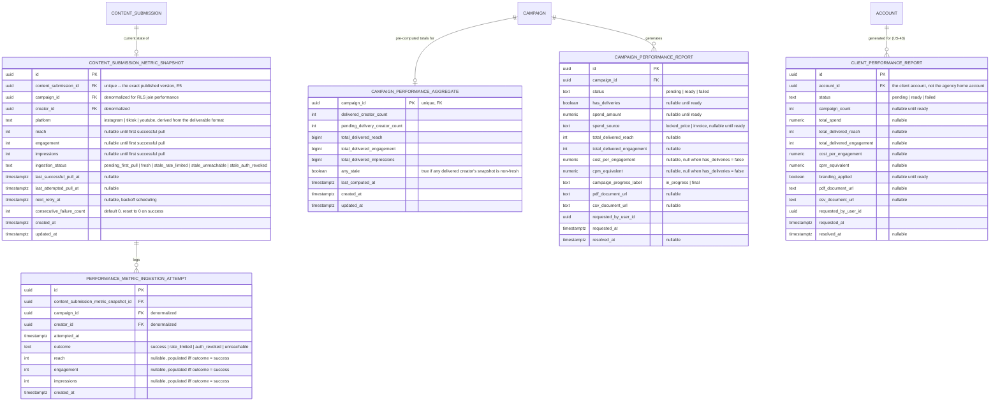

# E7 -- Analytics and Reporting: Technical Architecture

## 1. Overview

This document specifies the data model, API contracts, and behavioral rules for Epic E7 (Analytics and Reporting). It covers five user stories: US-21a (ingest performance metrics from connected social platforms), US-21b (unified dashboard, results by creator and by pool), US-22 (export a report that proves ROI), US-37 (a creator sees her own delivered performance), US-43 (per-client reports under the agency's own branding), and US-46 (compare performance across an agency's clients).

All decisions here build on the foundation established in [Aurora's Architecture](../architecture.md) and on [E1](./e1-access-onboarding.md) (tenancy, RBAC, RLS, the `workspace`/`account`/`operator_client_access` agency primitives), [E2](./e2-campaign-planning-pool-buying.md) (`campaign`, `campaign_pool_member`, `campaign.locked_price`, the `reallocate-budget` job's existing but currently stubbed dependency on this epic), [E3](./e3-creator-matching-curation.md) (`creator`, `campaign_opportunity`, the minimal-entity-ahead-of-a-later-epic precedent, the creator-portal auth pattern), [E5](./e5-briefing-content-workflow.md) (`content_submission.published_at`, the version-lineage model), and [E6](./e6-payments-financial-transparency.md) (`invoice`, the adapter-behind-a-DI-token pattern, the exported-service-for-in-process-reuse pattern, the discipline of reading another epic's figures rather than recomputing them). The stack is **not** re-decided here: NestJS modular monolith, PostgreSQL with RLS keyed on `account_id` (plus the `app.creator_portal` escape hatch E3-E6 already established), Redis for queues/caching, S3-compatible object storage, and the inference/fetch-adapter boundary discipline `docs/architecture.md` section 2.1 already commits to platform-wide.

E7 is implemented as a new backend module, `analytics`, alongside `auth`, `pricing`, `brand-profile`, `invitation`, `workspace`, `agency`, `audit`, `jobs`, `campaign`, `matching`, `brand-safety`, `content-workflow`, and `payments`. It:

- **Introduces** the one genuinely new entity this epic owns: ingested performance-metric data, modeled as three tables (section 2) -- a per-published-submission snapshot, an append-only ingestion-attempt log, and a per-campaign pre-computed aggregate.
- **Reads, and never duplicates or recomputes**, four prior epics' entities: `campaign.locked_price` and `campaign.state` (E2, FR-18/FR-20); `campaign_pool_member` (E2, pool composition); `campaign_opportunity.payout_gross/commission/net` is explicitly **not** read by this epic for any buyer-facing surface (section 2.2); `content_submission.published_url`/`published_at` (E5, FR-42, the delivery signal); `invoice.total_amount` (E6, FR-48, the billed-spend figure once one exists). This epic's own data model never re-derives a figure another epic already owns the computation for -- the same discipline E6's own architecture document applies to `campaign_opportunity`'s payout figures (its section 2.2) and that this document applies in turn (section 3 below).
- **Requires one small, additive wiring change** to `campaign.module.ts`: `CampaignScheduledTasksService.scheduleReallocation` (`backend/src/campaign/campaign-scheduled-tasks.service.ts`), which today hardcodes `metricsFeedAvailable: false, performance: []` with an explicit comment that "the metrics feed integration (FR-52) does not exist yet," is changed to call this epic's exported `PerformanceScoringService.getReallocationInputs(campaignId)` instead (ADR-0047). This is the real, already-built seam the epic header's integration note points at, not a conceptual one.
- **Extends**, additively, one table this epic does not own long-term: the existing `agency` module gains a minimal `agency_branding_profile` table (ADR-0048), sized to exactly the two visual properties a rendered report needs, owned long-term by E9.
- **Reuses** the `account_id`-scoped RLS pattern, the `audit` module for every report-generation and ingestion-failure event, and the `jobs` module (Bull/Redis) for asynchronous metric ingestion and report rendering, on a new `analytics` queue alongside `campaign`, `matching`, `content-workflow`, `payments`, and `email`. It reuses E3's `CreatorAuthGuard` for the one creator-facing endpoint (US-37).

**Governing NFRs for every endpoint in this epic (Table 15 of the PRD):**

| NFR | Target | How this design meets it |
|---|---|---|
| NFR-02 | Dashboard first render p95 ≤ 3 s with up to 6 months of history | The dashboard's pool-level totals are read from `campaign_performance_aggregate`, a single pre-computed row per campaign (section 2.2), never aggregated at request time -- exactly the mechanism `docs/architecture.md`'s QAS-07/N-05/T-05 already names ("aggregates pre-computed by ingestion workers, not aggregated at read time"). The per-creator list is a single indexed join bounded by NFR-06's 150-creator pool ceiling, not by history length -- 6 months of history affects which `performance_metric_ingestion_attempt` rows exist, but the dashboard never reads that table (section 2.2), so render time does not grow with history depth. |
| NFR-05 | Report export ≤ 30 s for campaigns of up to 100 creators | Report generation is asynchronous (202 + poll, the same pattern E2's quote and E3's shortlist already established), so the 30-second budget is a job-completion target, not a synchronous request budget. The job itself does a small number of indexed reads (one `campaign_performance_aggregate` row, one `invoice` row if present, the campaign's pool-size-bounded creator list) plus a PDF/CSV render, well inside the budget at 100-creator scale -- the same order of work E6's statement generation (ADR-0042) already does for a single obligation, scaled to a pool-sized list. |
| NFR-08 | 20,000 performance events/day, horizontally scalable later | Ingestion runs on a fixed cadence (every 4 hours, ADR-0044) across every published `content_submission`. At the pilot's own pool ceiling (150 creators/campaign, NFR-06) and a generous pilot assumption of 20 concurrently active campaigns at that ceiling, one full platform-wide pass is 3,000 pull attempts; six passes/day is 18,000 events, inside the 20,000 target with headroom. Each attempt is one `performance_metric_ingestion_attempt` row (append-only), so the event count is literal, not approximated, and the job is a Bull queue consumer that scales horizontally by adding worker replicas, not by changing the data model. |
| NFR-35 | Degrade gracefully: retry with backoff, serve stale-marked last-known metrics, never block submission or payout | `SocialMetricsAdapter` (ADR-0044) is the only thing that knows how a platform pull is attempted. A failed pull never blanks `content_submission_metric_snapshot`'s last-known values (section 2.2); it only updates `ingestion_status` and timestamps. Ingestion is discovered by scheduled polling against `content_submission.published_at`, never a hook inside E5's or E6's transactions (ADR-0045) -- a total ingestion outage changes nothing about whether a creator can submit content or get paid, because neither path reads anything this epic owns. |

---

## 2. Data Model

### 2.1 Entity-Relationship Diagram



Rows and relationships shown in plain type (`CONTENT_SUBMISSION`, `CAMPAIGN`, `ACCOUNT`) already exist, owned by E5, E2, and E1 respectively. Every entity above is new, introduced by this epic. `AGENCY_BRANDING_PROFILE` (section 2.3) is a sixth new table, additive to the existing `agency` module rather than to `analytics`.

### 2.2 Entity Descriptions

**CONTENT_SUBMISSION_METRIC_SNAPSHOT.** The FR-52 entity's read-facing half: the current, best-known reach/engagement/impressions for one exact published piece of content, keyed one-to-one with `content_submission.id` (unique). Rows are created lazily by the ingestion job (section 4) the first time it discovers a `content_submission` with `published_at` set and no snapshot row yet -- this epic never writes to `content_submission` itself, it only reads `published_at` to discover what to track (ADR-0045). `platform` is derived once, at row creation, from the campaign's `deliverable_formats` (E2) or the submission's own deliverable context; it does not change. `reach`/`engagement`/`impressions` are nullable because a freshly discovered, not-yet-pulled submission has no data yet (`ingestion_status = pending_first_pull`) -- this is never confused with a zero, consistent with US-21b scenario 2's and US-37 scenario 3's shared rule that "no data" and "a measured zero" are different facts. Once a successful pull happens, these three fields hold the **last-known** values and are never blanked by a subsequent failure (US-21a scenario 2); only `ingestion_status` and the timestamp fields change on failure. `ingestion_status` distinguishes a transient failure (`stale_rate_limited`, `stale_unreachable`) from a structurally different one (`stale_auth_revoked`), satisfying US-21a scenario 3's explicit requirement that the two never be conflated. `next_retry_at` and `consecutive_failure_count` drive backoff (section 4): transient failures retry on the next normal 4-hour cycle; an `auth_revoked` outcome sets `next_retry_at` 24 hours out, so a permanently dead authorization is not re-attempted every cycle at the same cost as a live one, pending a creator reconnecting her account (E8 scope, not built yet -- section 7).

**PERFORMANCE_METRIC_INGESTION_ATTEMPT.** Append-only log of every call this epic's ingestion job makes to `SocialMetricsAdapter.pullMetrics` (ADR-0044), one row per attempt -- the literal unit NFR-08's "20,000 performance events per day" counts. Never updated or deleted (same precedent as `audit_log`, `campaign_state_transition`, `payout_execution_attempt`). This table is the historical trail for debugging and volume monitoring; it is never read by the dashboard, the report, or US-37's endpoint (those all read the snapshot, section 2's overview, consistent with `docs/architecture.md`'s N-05/T-05 convention of serving reads from a materialized state, not a log).

**CAMPAIGN_PERFORMANCE_AGGREGATE.** One row per campaign (unique on `campaign_id`), the pre-computed totals the dashboard (US-21b) reads directly, satisfying NFR-02 by construction (section 1). Recomputed by a `recomputeAggregate(campaignId)` call invoked at the end of every ingestion-job run that touched that campaign's creators, and whenever the discovery step finds a newly published submission or a campaign's pool composition changes -- bounded by the 150-creator pool ceiling, so recomputation is a single aggregate SQL query over at most 150 rows, cheap enough to run inline rather than needing its own queue. `delivered_creator_count`/`pending_delivery_creator_count` partition the pool (E2's `campaign_pool_member`) into those with and without a confirmed publication, satisfying US-21b scenario 2's explicit distinction. Totals are summed **only** over delivered creators' current snapshot values (US-21b scenario 2, "the pool-level aggregate is computed only from creators who have actually delivered"). `any_stale` is a single flag covering the whole campaign's delivered set, letting the dashboard render one "some figures may be out of date" banner instead of the frontend having to scan every creator row to decide whether to show it.

**CAMPAIGN_PERFORMANCE_REPORT / CLIENT_PERFORMANCE_REPORT.** The two FR-53/FR-55 export entities -- one per single campaign (US-22, direct brand or an agency campaign viewed individually), one per client account across all of that client's campaigns (US-43). Both are request-response audit rows, mirroring E2's `campaign_quote` and E3's `campaign_shortlist` pattern (`status: pending -> ready | failed`, polled by the frontend). `has_deliveries`/`campaign_count` and the cost-efficiency fields are explicitly nullable until `ready`, and `cost_per_engagement`/`cpm_equivalent` are **null, not zero**, whenever there is no delivered engagement or reach to divide by (US-22 scenario 3's "does not fabricate placeholder... figures"). `spend_source` records whether the figure came from `campaign.locked_price` (mid-campaign, no invoice yet) or `invoice.total_amount` (E6, once generated) -- see section 3 for the exact precedence rule. `CLIENT_PERFORMANCE_REPORT.account_id` is the **client's own account**, not the agency's home account, so the same `account_id`-keyed RLS pattern every other epic uses applies here with no special workspace-level policy needed (section 2.4).

### 2.3 Additive Extension: `agency_branding_profile` (Ahead of E9, ADR-0048)

```sql
-- Owned long-term by E9 (US-44, FR-57's full scope: logo, colors, domain,
-- the white-label client-facing surface, and a configuration UI). This
-- epic adds exactly the two visual properties US-43's report renderer
-- needs and nothing else -- no domain, no client-facing portal theming.
CREATE TABLE agency_branding_profile (
  id uuid PRIMARY KEY DEFAULT gen_random_uuid(),
  workspace_id uuid NOT NULL UNIQUE REFERENCES workspace(id),
  logo_url text NULL,              -- S3 reference, nullable until configured
  primary_color_hex text NULL,
  secondary_color_hex text NULL,
  updated_by_user_id uuid NULL,
  created_at timestamptz NOT NULL DEFAULT now(),
  updated_at timestamptz NOT NULL DEFAULT now()
);
```

This table lives in the existing `agency` module (`backend/src/agency`), not in `analytics` -- the same "extend an existing module minimally, owned long-term by whichever epic owns that domain" discipline E6 applied to `creator.tax_id` (owned by E3/E8). `agency.module.ts` exports a narrow read method, `AgencyBrandingService.getBrandingProfile(workspaceId)`, which `analytics`'s report renderer calls in-process (the same exported-service-for-in-process-reuse pattern ADR-0032/ADR-0036 already established) rather than reaching into `agency`'s table directly. A row with all three visual fields `null` is the default, "not yet configured" state -- see section 3.5 for the rendering rule when that is the case (ADR-0048).

### 2.4 Role Permissions (extends E1-E6 tables)

| Permission | brand_owner | brand_manager | brand_analyst | agency_admin | agency_operator (own clients) | creator |
|---|---|---|---|---|---|---|
| View campaign dashboard | yes | yes | yes | yes | yes | -- |
| Request/view campaign report (US-22) | yes | yes | yes | yes | yes | -- |
| View own performance (US-37) | -- | -- | -- | -- | -- | yes (self) |
| Request/view per-client report (US-43) | -- | -- | -- | yes | yes (own clients) | -- |
| Request/view cross-client comparison (US-46) | -- | -- | -- | yes | yes (own clients only) | -- |
| Configure agency branding (ahead of E9, section 2.3) | -- | -- | -- | yes | -- | -- |

`brand_analyst` can view the dashboard and request/view reports (read-only actions; generating a report is not a financial commitment, unlike invoicing) but has no write access anywhere else in this epic, consistent with every prior epic's "analyst = read-only" line. Branding configuration is restricted to `agency_admin`, matching E1's existing precedent for workspace-level settings.

### 2.5 Row-Level Security

`content_submission_metric_snapshot` and `performance_metric_ingestion_attempt` carry `campaign_id` directly (denormalized, same precedent as E3-E6's child tables), with the former also carrying the `app.creator_portal` branch (US-37 needs a creator to read her own metrics):

```sql
CREATE POLICY tenant_isolation ON content_submission_metric_snapshot
  USING (
    campaign_id IN (
      SELECT id FROM campaign
      WHERE account_id = current_setting('app.current_account_id', true)::uuid
    )
    OR current_setting('app.creator_portal', true) = 'true'
  );
-- Actual "only this creator's own snapshots" restriction is enforced in
-- application code (filtering by creator_id against the caller's JWT
-- claim), the same discipline E3/E5/E6 already apply for this actor type.

CREATE POLICY tenant_isolation ON performance_metric_ingestion_attempt
  USING (
    campaign_id IN (
      SELECT id FROM campaign
      WHERE account_id = current_setting('app.current_account_id', true)::uuid
    )
  );
-- No creator_portal branch: this append-only log is never read by a
-- creator directly (section 2.2), same precedent as
-- briefing_distribution_recipient (E5).
```

`campaign_performance_aggregate` and `campaign_performance_report` use the standard direct join-to-`campaign` policy, no creator-portal branch (neither Marina's dashboard nor her report export is a creator-facing surface). `client_performance_report` carries `account_id` directly and uses the plain, single-tenant policy every epic already uses:

```sql
CREATE POLICY tenant_isolation ON client_performance_report
  USING (account_id = current_setting('app.current_account_id', true)::uuid);
```

A request for `client_performance_report` sets `X-Account-Id` to the **client account's own id**, exactly the convention already used for campaign creation under FR-24 (E2) and invoice generation under FR-49 (E6) -- Renata's session switches tenant context to the client she is acting for, and RLS applies unchanged. This is what makes US-43 scenario 3's refusal (a client account outside her access) automatic: `RolesGuard` already resolves `currentAccountId` only for accounts the caller's membership and `operator_client_access` grants reach to (E1), so a request for an inaccessible client never gets far enough to query this table with the right tenant context at all.

**One narrow, new escape hatch for US-46's cross-client read (ADR-0048, section 3.6).** Comparing campaigns across *several* client accounts in one request cannot be expressed as a single `X-Account-Id` tenant context, since RLS (and `RolesGuard`) resolve exactly one current account per request. This epic adds a third instance of the pattern `app.creator_portal` (E3) and `app.aurora_operator` (E6) already established -- a session flag, `app.agency_cross_client_read`, set only on the connection serving `GET /agency/reports/compare`, narrower in scope than `aurora_operator`'s unrestricted cross-tenant reach:

```sql
CREATE POLICY tenant_isolation ON campaign_performance_aggregate
  USING (
    campaign_id IN (
      SELECT id FROM campaign
      WHERE account_id = current_setting('app.current_account_id', true)::uuid
    )
    OR (
      current_setting('app.agency_cross_client_read', true) = 'true'
      AND campaign_id IN (
        SELECT c.id FROM campaign c
        JOIN account a ON a.id = c.account_id
        WHERE a.workspace_id = current_setting('app.current_workspace_id', true)::uuid
      )
    )
  );
```

RLS here is the backstop against a workspace boundary, not the scope limiter within it: the service layer (section 3.6) independently validates, per requested `client_account_id`, that it belongs to the caller's workspace **and** that the caller (if `agency_operator`) actually holds `operator_client_access` for it, *before* the flag is ever set on the connection -- the same "RLS lets the session through, application code enforces the finer-grained restriction" discipline E3's creator-portal and E6's `aurora_operator` already apply. `app.current_workspace_id` is resolved server-side from the caller's membership, never accepted as client input.

The E1-E6 CI check (every tenant-scoped table has a policy, every escape-hatch flag is on the recognized allow-list) is extended to cover all six new tables and the new `app.agency_cross_client_read` flag.

### 2.6 Database Constraints

```sql
-- One snapshot per published submission
ALTER TABLE content_submission_metric_snapshot ADD CONSTRAINT uq_metric_snapshot_submission
  UNIQUE (content_submission_id);

-- One campaign-level aggregate row
ALTER TABLE campaign_performance_aggregate ADD CONSTRAINT uq_performance_aggregate_campaign
  UNIQUE (campaign_id);

-- Ingestion attempts are an append-only trail (same precedent as
-- audit_log, campaign_state_transition, payout_execution_attempt)
CREATE OR REPLACE FUNCTION prevent_ingestion_attempt_mutation()
RETURNS trigger AS $$
BEGIN
  RAISE EXCEPTION 'performance_metric_ingestion_attempt is append-only: UPDATE and DELETE are prohibited';
END;
$$ LANGUAGE plpgsql;

CREATE TRIGGER ingestion_attempt_immutable
  BEFORE UPDATE OR DELETE ON performance_metric_ingestion_attempt
  FOR EACH ROW EXECUTE FUNCTION prevent_ingestion_attempt_mutation();

-- A report's cost-efficiency fields are only ever both-or-neither null,
-- tying them structurally to has_deliveries rather than relying on
-- service-layer discipline alone to keep them consistent.
ALTER TABLE campaign_performance_report ADD CONSTRAINT chk_cost_efficiency_consistency
  CHECK (
    (has_deliveries IS DISTINCT FROM true AND cost_per_engagement IS NULL AND cpm_equivalent IS NULL)
    OR (has_deliveries = true)
    OR (status != 'ready')
  );

ALTER TABLE agency_branding_profile ADD CONSTRAINT uq_branding_workspace
  UNIQUE (workspace_id);
```

---

## 3. Integration: Exactly What This Epic Reads From E2, E3, E5, and E6

This section exists for the same reason E6's section 2 exists: to state precisely which fields this epic reads directly, and to make explicit that none of them are duplicated into this epic's own tables or recomputed with different logic.

### 3.1 Pool composition and spend (E2)

`campaign_pool_member` (`campaignId`, `creatorId`, `allocatedBudget`, `committedBudget`, `status`) is read to determine the denominator for "how many of the pool have and have not yet published" (US-21b scenario 2). This epic reads it; it never writes to it. **`campaign_pool_member.status` includes a `published` enum value that no epic's code currently sets** (confirmed against `backend/src/database/entities/campaign-pool-member.entity.ts` and every reference to `PoolMemberStatus.PUBLISHED` in the codebase) -- this epic does not treat that field as the delivery signal, and does not set it either, since doing so would make this epic a second writer of a table E2 owns. The authoritative delivery signal is `content_submission.published_at` (section 3.3), exactly as the stories document specifies.

`campaign.locked_price` and `campaign.state` (`backend/src/database/entities/campaign.entity.ts`) are read for the report's spend figure and progress label (section 3.4). Both are read-only references; FR-18 already guarantees `locked_price` does not change after confirmation, so this epic never needs to react to it changing.

### 3.2 The reallocation hand-off (E2's `reallocate-budget` job, ADR-0047)

`backend/src/campaign/campaign-scheduled-tasks.service.ts`'s `scheduleReallocation` currently enqueues every `reallocate-budget` job with `metricsFeedAvailable: false, performance: []`, by design, with a comment stating this epic's feed does not exist yet. `backend/src/campaign/reallocation.processor.ts` already consumes exactly the shape this epic needs to produce: `{ metricsFeedAvailable: boolean, performance: PerformanceSample[] }` where `PerformanceSample = { poolMemberId: string, score: number }`. ADR-0047 resolves the wiring precisely; summarized here: `campaign.module.ts` imports `AnalyticsModule` and calls its exported `PerformanceScoringService.getReallocationInputs(campaignId)` in place of the hardcoded literals, with **no change** to `reallocation.processor.ts` itself, since the shape it already expects is exactly what this epic now produces.

### 3.3 Delivery confirmation (E5)

`content_submission.published_at` (set by E5's `POST /creator-portal/content-submissions/:id/confirm-publication`) is the one authoritative "did this creator deliver" fact this epic reads. The join path from a pool member to her delivered content is: `campaign_pool_member(campaignId, creatorId)` -> `campaign_opportunity(campaignId, creatorId)` (unique per E3's `uq_opportunity` constraint) -> `content_submission(opportunityId)` filtered to `published_at IS NOT NULL` (at most one such row per opportunity, since E5's version-lineage rule permits only the approved version to ever be confirmed for publication). This epic never reads `content_submission.caption_text`, `on_screen_text`, `audio_transcript`, or any safety/review field -- only `id`, `published_url`, and `published_at`.

### 3.4 Financial figures (E2 and E6)

"Spend," per the stories document's own framing, is `campaign.locked_price` whenever no invoice exists yet (mid-campaign export, US-22 scenario 2), and `invoice.total_amount` (E6, `backend/src/database/entities/invoice.entity.ts`) once one has been generated for that campaign -- the two already agree by construction, since `invoice.total_amount` is `locked_price` plus any FR-19 refund adjustment, never an independently computed figure (E6 section 3.2). The report service calls `GET /campaigns/:id/invoice`-equivalent logic (an in-process read of the `invoice` repository, not an HTTP call, since both modules live in the same deployable) to decide `spend_source`. This epic never reads `payout_obligation`, `ledger_entry`, or any individual creator's `payout_gross`/`commission`/`net` -- consistent with the stories document's own inference (its open question 2) that no buyer-facing dashboard or report exposes a per-creator payout figure, and with NFR-23's role-based restriction on creator financial data.

### 3.5 Agency structure (E1, extended minimally for branding only, ADR-0048)

`workspace` (`type`, `maxClientAccounts`), `account` (`workspaceId`), and `operator_client_access` (`membershipId`, `accountId`) already fully implement the isolation primitive US-43 and US-46 need -- confirmed against `backend/src/agency/agency.service.ts`, which already scopes an `agency_operator`'s visible client list to exactly the accounts named in their `operator_client_access` rows. **No new client-account entity is introduced by this epic.** The only missing piece for US-43 is FR-57's branding configuration, which section 2.3 adds minimally, ahead of E9. US-46 requires no new entity at all (section 3.6, ADR-0048).

---

## 4. Ingestion Pipeline (US-21a, FR-52)

### 4.1 `SocialMetricsAdapter` (ADR-0044)

```typescript
export type MetricsPullOutcome =
  | { outcome: 'success'; reach: number; engagement: number; impressions: number }
  | { outcome: 'rate_limited' }
  | { outcome: 'unreachable' }
  | { outcome: 'auth_revoked' };

export interface SocialMetricsAdapter {
  pullMetrics(input: {
    creatorId: string;
    contentSubmissionId: string;
    platform: string;
    publishedUrl: string;
  }): Promise<MetricsPullOutcome>;
}
```

`StubSocialMetricsAdapter` is this pilot's only implementation (ADR-0044), analogous to `StubMatchingEngineAdapter` (E2) and `StubPayoutExecutionAdapter` (E6): it makes no network call to any social platform. It deterministically derives a synthetic, monotonically-growing `reach`/`engagement`/`impressions` triple from `contentSubmissionId` and the elapsed time since the submission's `publishedAt`, always returning `{ outcome: 'success' }`, so US-21b and US-22 are demoable and testable end to end without a real OAuth token existing anywhere (none can exist yet, since E8 has not shipped FR-08). Integration tests exercise the `rate_limited`/`unreachable`/`auth_revoked` branches against a mock adapter, the same way E6's integration tests exercise `PayoutExecutionAdapter` failure branches without a real provider.

### 4.2 Discovery and scheduling

A scheduled job, `discover-and-ingest-metrics`, runs every 4 hours (an architectural default filling the PRD's own unstated cadence, per its open question 4; ADR-0044):

1. **Discover.** Find every `content_submission` with `published_at IS NOT NULL` and no `content_submission_metric_snapshot` row yet (a plain `LEFT JOIN ... WHERE snapshot.id IS NULL` query, bounded by campaign pool size). Create a snapshot row per discovery, `ingestion_status = pending_first_pull`.
2. **Pull.** For every snapshot with `ingestion_status != stale_auth_revoked` or with `next_retry_at <= now()`, call `SocialMetricsAdapter.pullMetrics`. Write a `performance_metric_ingestion_attempt` row for every call, success or failure.
3. **Update.** On `success`: update `reach`/`engagement`/`impressions`, `ingestion_status = fresh`, `last_successful_pull_at = now()`, `consecutive_failure_count = 0`, `next_retry_at = null`. On `rate_limited`/`unreachable`: `ingestion_status = stale_rate_limited` or `stale_unreachable`, increment `consecutive_failure_count`, leave the last-known values untouched, `next_retry_at = null` (retried on the plain next 4-hour cycle -- this **is** the backoff at pilot scale, per NFR-35). On `auth_revoked`: `ingestion_status = stale_auth_revoked`, `next_retry_at = now() + 24h` (a longer wait, since this is not expected to self-resolve without a creator reconnecting her account, an E8 capability not yet built -- section 7).
4. **Recompute.** For every distinct `campaign_id` touched in steps 1-3, call `recomputeAggregate(campaignId)` (section 2.2).

This job never touches `content_submission`, `campaign_opportunity`, or any E5/E2 table -- it only reads `published_at` to discover work. A total ingestion outage (every pull fails) changes nothing about E5's submission flow or E6's payout flow, satisfying NFR-35's "never blocks content submission or payout" by the simple fact that neither of those paths has a dependency pointed at this epic (ADR-0045).

---

## 5. API Contracts

### 5.1 Conventions

Identical to E1-E6: base URL `https://api.aurora.com.br/v1`, JSON bodies, bearer JWT, `X-Account-Id` header for agency/client context, the same structured error shape (`code`, `message`, `details`), cursor pagination, ISO 8601 UTC timestamps. Creator-portal endpoints live under `/v1/creator-portal/*`, authenticated with `CreatorAuthGuard` (E3's guard, reused unchanged).

### 5.2 Dashboard (US-21b)

#### GET /campaigns/:id/dashboard

**Required role:** Any authenticated member with account access.

**Success response (200 OK):**
```json
{
  "campaign_id": "camp-1234-...",
  "campaign_state": "active",
  "pool_size": 42,
  "delivered_count": 35,
  "pending_delivery_count": 7,
  "pool_aggregate": {
    "total_delivered_reach": 1230000,
    "total_delivered_engagement": 45210,
    "total_delivered_impressions": 2300000,
    "any_stale": true,
    "last_computed_at": "2026-10-21T06:00:00Z"
  },
  "creators": [
    {
      "creator_id": "creator-9001",
      "display_name": "Duda Oliveira",
      "status": "delivered",
      "reach": 18400,
      "engagement": 920,
      "impressions": 41000,
      "ingestion_status": "fresh",
      "last_successful_pull_at": "2026-10-21T06:00:00Z"
    },
    {
      "creator_id": "creator-9050",
      "display_name": "Joao Pereira",
      "status": "pending_delivery",
      "reach": null,
      "engagement": null,
      "impressions": null,
      "ingestion_status": null,
      "last_successful_pull_at": null
    }
  ]
}
```

**Behavior:** `pool_aggregate` is a direct read of `campaign_performance_aggregate` (no computation at request time, NFR-02). `creators` is a single query joining `campaign_pool_member` -> `creator` (display name) -> the delivery join path (section 3.3) -> `content_submission_metric_snapshot`, bounded by the pool's row count (≤150, NFR-06). A creator with `status: pending_delivery` always carries `null` figures, never `0` (US-21b scenario 2).

---

### 5.3 Report Export (US-22)

#### POST /campaigns/:id/reports

**Required role:** Any authenticated member with account access.

**Request:** Empty body.

**Success response (202 Accepted):**
```json
{ "report_id": "rpt-001", "status": "pending", "poll_url": "/v1/campaigns/camp-1234-.../reports/rpt-001" }
```

**Behavior:** Creates a `campaign_performance_report` row, enqueues `generate-campaign-report` on the `analytics` queue. The job reads `campaign_performance_aggregate`, `campaign.locked_price`/`state`, and (if present) `invoice.total_amount` (section 3.4), computes `cost_per_engagement`/`cpm_equivalent` (ADR-0046) only when `has_deliveries = true`, renders a PDF and a CSV to object storage (reusing E6's ADR-0042 pattern of a signed, short-lived URL), and sets `status = ready`.

---

#### GET /campaigns/:id/reports/:reportId

**Success response (200 OK), ready, with deliveries:**
```json
{
  "id": "rpt-001",
  "status": "ready",
  "campaign_progress_label": "in_progress",
  "spend_amount": "45000.00",
  "spend_source": "locked_price",
  "has_deliveries": true,
  "total_delivered_reach": 1230000,
  "total_delivered_engagement": 45210,
  "cost_per_engagement": "0.9953",
  "cpm_equivalent": "36.59",
  "pdf_document_url": "https://assets.aurora.com.br/reports/rpt-001/report.pdf?...",
  "csv_document_url": "https://assets.aurora.com.br/reports/rpt-001/report.csv?...",
  "resolved_at": "2026-10-21T10:00:05Z"
}
```

**When no creator has delivered yet (US-22 scenario 3):**
```json
{
  "id": "rpt-002",
  "status": "ready",
  "campaign_progress_label": "in_progress",
  "spend_amount": "45000.00",
  "spend_source": "locked_price",
  "has_deliveries": false,
  "total_delivered_reach": null,
  "total_delivered_engagement": null,
  "cost_per_engagement": null,
  "cpm_equivalent": null,
  "message": "Nenhuma entrega confirmada ainda. O valor investido ja esta definido; os resultados aparecerao aqui conforme as publicacoes forem confirmadas.",
  "pdf_document_url": "https://assets.aurora.com.br/reports/rpt-002/report.pdf?...",
  "csv_document_url": "https://assets.aurora.com.br/reports/rpt-002/report.csv?...",
  "resolved_at": "2026-10-21T10:00:02Z"
}
```

`campaign_progress_label` is `in_progress` whenever `campaign.state` is `active` or `paused`, and `final` when `completed` (US-22 scenario 2's "states clearly that the campaign is still in progress"). `spend_source` is `invoice` whenever `GET /campaigns/:id/invoice`'s underlying row exists, `locked_price` otherwise.

---

### 5.4 Creator's Own Performance (US-37)

#### GET /creator-portal/performance

**Success response (200 OK):**
```json
{
  "data": [
    {
      "content_submission_id": "sub-6001",
      "campaign_id": "camp-1234-...",
      "campaign_name": "Lancamento Serum Vitamina C",
      "published_url": "https://instagram.com/p/abc123",
      "published_at": "2026-10-23T08:00:00Z",
      "reach": 18400,
      "engagement": 920,
      "impressions": 41000,
      "ingestion_status": "fresh",
      "last_successful_pull_at": "2026-10-21T06:00:00Z"
    }
  ]
}
```

**Behavior:** Scoped to `creator_id` from the creator's JWT (never from a path/query parameter), joined to `content_submission` where `published_at IS NOT NULL` and `creatorId` matches. A declined or still-pending opportunity has no `content_submission` row with `published_at` set, so it is simply absent from `data` -- never a fabricated zero-figure entry (US-37 scenario 3).

---

### 5.5 Per-Client Reports (US-43)

#### POST /agency/clients/:clientAccountId/reports

**Required role:** `agency_admin`, `agency_operator` (with `operator_client_access` for `clientAccountId`). Caller's `X-Account-Id` is set to `clientAccountId` itself (section 2.5).

**Success response (202 Accepted):** Same shape as the campaign report's POST.

**Behavior:** Aggregates every campaign under `clientAccountId` (reusing each campaign's own `campaign_performance_aggregate` row and `locked_price`/`invoice`, never recomputing per-creator figures a second time). Calls `AgencyBrandingService.getBrandingProfile(workspaceId)` (section 2.3); if a profile exists with at least `logo_url` set, renders the PDF with the agency's logo/colors and sets `branding_applied = true`. **If no branding profile exists, or it is entirely unconfigured** (all three fields `null`), the report renders with a neutral, Aurora-agnostic template -- plain typography, no Aurora logo, no agency logo -- and `branding_applied = false` (ADR-0048 resolves the PRD's open question 6 this way: falling back to *Aurora's own* branding would contradict US-43's stated purpose, "I deliver them as my agency's work").

---

#### GET /agency/clients/:clientAccountId/reports/:reportId

Same polling shape as the campaign report, plus `campaign_count` and `branding_applied`.

**Error responses:**
- 404 `CLIENT_NOT_FOUND`: `clientAccountId` does not resolve under the caller's current tenant context (covers both "does not exist" and "not accessible to this caller," the same one-code-for-both discipline E3/E4/E5 already apply, satisfying US-43 scenario 3 without confirming to the caller which case applies).

---

### 5.6 Cross-Client Comparison (US-46, ADR-0048)

#### GET /agency/reports/compare?client_account_ids=acct-1,acct-2,acct-3

**Required role:** `agency_admin` (any client in their own workspace), `agency_operator` (only clients named in their own `operator_client_access` rows).

**Success response (200 OK):**
```json
{
  "data": [
    {
      "client_account_id": "acct-1",
      "client_name": "Loja A",
      "campaign_count": 5,
      "total_spend": "180000.00",
      "total_delivered_reach": 2400000,
      "total_delivered_engagement": 98000,
      "average_reach_per_campaign": 480000,
      "average_engagement_per_campaign": 19600
    },
    {
      "client_account_id": "acct-2",
      "client_name": "Loja B",
      "campaign_count": 1,
      "total_spend": "20000.00",
      "total_delivered_reach": 150000,
      "total_delivered_engagement": 6200,
      "average_reach_per_campaign": 150000,
      "average_engagement_per_campaign": 6200
    }
  ],
  "refused": [
    { "client_account_id": "acct-9", "reason": "NOT_ACCESSIBLE" }
  ]
}
```

**Behavior:**
1. For each requested `client_account_id`: validate it belongs to the caller's own workspace, and (if the caller is `agency_operator`) that `operator_client_access` grants them that specific client. A failing id is placed in `refused` with an explicit reason -- **never silently omitted** (US-46 scenario 3's exact requirement).
2. For every id that passes validation, set the `app.agency_cross_client_read` / `app.current_workspace_id` session flags (section 2.5) for exactly this query, and read each client's campaigns' `campaign_performance_aggregate` rows plus `campaign.locked_price`/`invoice.total_amount` for spend.
3. Present both a total and a per-campaign average for each client (US-46 scenario 2), never a normalized or scaled figure that would imply equivalence between a client with one campaign and a client with many.

**Error responses:**
- 400 `NO_VALID_CLIENTS`: every requested id was refused (an all-refused response is a 400, not a 200 with an empty `data` array, so an empty result is never confused with "these clients legitimately have no data").

---

## 6. Background Jobs

| Job | Queue | Trigger | Behavior |
|---|---|---|---|
| `discover-and-ingest-metrics` | `analytics` | Cron, every 4 hours | Section 4.2: discovers newly published submissions, pulls via `SocialMetricsAdapter`, updates snapshots, recomputes touched campaigns' aggregates. |
| `generate-campaign-report` | `analytics` | `POST /campaigns/:id/reports` | Renders the single-campaign PDF/CSV (section 5.3). |
| `generate-client-report` | `analytics` | `POST /agency/clients/:id/reports` | Renders the per-client, multi-campaign PDF/CSV, applying branding if configured (section 5.5). |

---

## 7. Frontend Route Map

| Route | Auth | Description |
|---|---|---|
| `/app/campaigns/:id/dashboard` | Auth (brand/agency) | Unified dashboard (US-21b): per-creator breakdown, pool aggregate, pending-delivery and staleness indicators. |
| `/app/campaigns/:id/reports` | Auth (brand/agency) | Report request/poll screen (US-22): spend, delivered reach/engagement, cost efficiency, in-progress vs. final label, PDF/CSV download actions. |
| `/creator-portal/performance` | Auth (creator) | Duda's own performance view (US-37): one card per published piece, staleness indicator, nothing shown for undelivered opportunities. |
| `/agency/clients/:id/reports` | Auth (agency) | Per-client report request/poll screen (US-43), branded preview if configured. |
| `/agency/branding` | Auth (agency_admin) | Minimal branding configuration form (section 2.3): logo upload, two color pickers. |
| `/agency/reports/compare` | Auth (agency) | Cross-client comparison (US-46): multi-client table, totals and per-campaign averages side by side, explicit "not accessible" rows for any refused client. |

All creator-facing routes satisfy NFR-25 (360 px viewport), per the platform-wide convention. None of this epic's routes are named in Table 14/15 for NFR-26 (WCAG AA); all default to level A, consistent with the PRD's own scoping.

---

## 8. NFR Compliance Checklist

| NFR | How this design satisfies it |
|---|---|
| NFR-02 | `campaign_performance_aggregate` is a pre-computed, single-row-per-campaign read (section 2.2); the per-creator list is bounded by the 150-creator pool ceiling (NFR-06), not by history length. Dashboard render time at 6 months of history is therefore a function of pool size, not time range, which is what keeps it inside the 3-second p95 regardless of how long a campaign has been running. |
| NFR-05 | Report generation is asynchronous (202 + poll), so the 30-second budget governs job completion, not a blocking HTTP call. The job's own work is a small number of indexed reads plus a render, the same order of magnitude as E6's existing statement-generation job (ADR-0042) scaled to a 100-creator pool. |
| NFR-08 | Ingestion runs on a fixed 4-hour cadence; at the pilot's own pool and concurrency assumptions (150 creators/campaign, ~20 concurrent campaigns at that ceiling) one full pass is ~3,000 events, six passes/day is ~18,000, inside the 20,000/day target with headroom (section 1). The job is a Bull queue consumer, horizontally scalable by adding worker replicas with no change to the data model, satisfying the "pipeline that can scale horizontally later" half of the target. |
| NFR-35 | `SocialMetricsAdapter` isolates the only thing that can fail (section 4.1); a failure never blanks `content_submission_metric_snapshot`'s last-known values, only updates `ingestion_status` and timestamps (section 2.2); `auth_revoked` is logged and surfaced distinctly from a transient failure (US-21a scenario 3); ingestion is discovered by polling `content_submission.published_at`, never a hook inside E5's submission flow or E6's payout flow (ADR-0045), so a total ingestion outage changes nothing about either path -- there is no dependency for it to block. |

---

## 9. Open Questions Resolved -- and Left Open

| PRD / stories-document open question | Resolution | ADR |
|---|---|---|
| 1. No formula specified for "cost efficiency" (US-22, FR-53) | Cost per engagement (BRL/engagement) and a CPM-equivalent (BRL per 1,000 delivered reach) are both shown, as an explicit architectural default, not a confirmed product decision. Null, never zero, when there is no delivered engagement/reach to divide by. | ADR-0046 |
| 2. Whether a per-creator breakdown ever shows an individual creator's payout | Not revisited by this epic; this document's endpoints never read `payout_gross`/`commission`/`net` at all (section 3.4), consistent with the stories document's own inference. | -- |
| 4. No ingestion cadence stated (US-21a) | A fixed, platform-wide 4-hour cadence, an architectural default sized against NFR-08 (section 1, section 4.2). | ADR-0044 |
| 5. US-43/US-46 depend on E9 entities not yet specified | The underlying isolation primitive (`workspace`/`account`/`operator_client_access`) already exists from E1 and needs no new entity. The one genuine gap (FR-57's branding) is filled with a minimal, E9-owned-long-term `agency_branding_profile` table, sized to exactly what a rendered report needs. | ADR-0048 |
| 6. No fallback specified for unbranded US-43 reports | Falls back to a neutral, agency- and Aurora-agnostic template, never to Aurora's own branding (which would contradict US-43's stated purpose). | ADR-0048 |
| 8. No retention period stated for raw ingested metrics (FR-52) | Not resolved at the product level. This document assumes retention at least covers NFR-02's 6-month dashboard window (the snapshot itself, not the append-only attempt log, is what the dashboard needs retained); no stated policy exists yet for discarding old `performance_metric_ingestion_attempt` rows beyond the platform-wide 30-day structured-log retention (NFR-32), and this document does not invent one. | -- |
