# E8 -- Creator Recruitment and Growth: Technical Architecture

## 1. Overview

This document specifies the data model, API contracts, and behavioral rules for Epic E8 (Creator Recruitment and Growth). It covers nine user stories: US-23.1 (unclaimed profile created from public data), US-23.2 (invitation and claim flow), US-24.1 (link social accounts via platform authorization), US-24.2 (compute and maintain audience metrics), US-24.3 (compute authenticity score), US-24.4 (qualification decision at the end of onboarding), US-25 (automatic media kit), US-26 (visibility to mid-market brands), and US-27 (creator-set rate preferences).

All decisions here build on the foundation established in [Aurora's Architecture](../architecture.md) and on [E1](./e1-access-onboarding.md) (the global `user` entity, bcrypt/JWT authentication, the email-verification and consent-recording conventions, `OperatorAuthGuard`-equivalent principal pattern), [E3](./e3-creator-matching-curation.md) (the minimal `creator` entity and ADR-0013's explicit "extend, not replace" mandate, the `CreatorAuthGuard`/creator-JWT pattern, the authenticity flag-only policy of ADR-0017), [E6](./e6-payments-financial-transparency.md) (the `aurora_operator` principal, ADR-0038, and the pdf-via-object-storage export pattern, ADR-0042), and [E7](./e7-analytics-reporting.md) (the `SocialMetricsAdapter` precedent, ADR-0044, and the exported-service-for-in-process-reuse wiring pattern, ADR-0032/ADR-0036/ADR-0047). The stack is **not** re-decided here: NestJS modular monolith, PostgreSQL with RLS keyed on `account_id` (plus the `app.creator_portal`/`app.aurora_operator` escape hatches E3/E6 already established), Redis for queues/caching, S3-compatible object storage.

E8 is implemented as a new backend module, `creator-network`, alongside `auth`, `matching`, `brand-safety`, `content-workflow`, `payments`, `analytics`, `agency`, `audit`, and `jobs`. It:

- **Extends, additively, the `creator` table E3 introduced** (ADR-0013's explicit long-term ownership hand-off): new nullable columns for recruitment origin, unclaimed-profile expiry, claim timestamp, qualification outcome detail, and authenticity status/timing. No existing column is removed, renamed, or retyped; no existing E3 query (`matching` module's shortlist generation, exclusion filtering, opportunity creation) changes its shape.
- **Introduces** seven new tables this epic owns outright: `creator_public_import`, `creator_invitation`, `creator_consent_record`, `creator_social_account`, `creator_rate_preference`, `creator_media_kit_export`, and `creator_data_subject_request`.
- **Replaces** the pilot-only stub creator login (`POST /creator-portal/login`, `backend/src/matching/creator-portal.controller.ts`, explicitly marked in that file's own comment as "E8 owns the real creator login flow... this endpoint exists only so US-28 is testable end to end before that flow ships") with real email/password registration, email verification, and login, reusing E1's `User` entity and `AuthService` patterns rather than building a second identity system (ADR-0050). The replaced endpoint's only consumers (US-28's opportunity accept/decline, already built) need no change: both the stub and this epic's real login issue the identical JWT shape (`sub = user_id`, `creator_id` claim), which `JwtStrategy` (`backend/src/auth/strategies/jwt.strategy.ts`) already handles unchanged.
- **Defines** three new external-integration adapters -- `SocialAuthAdapter`, `CreatorAudienceInsightsAdapter`, `AuthenticityScoringAdapter` -- each stub-only in this pilot, following the exact precedent `MatchingEngineAdapter` (ADR-0011), `ContentSafetyAdapter` (ADR-0021), `PayoutExecutionAdapter` (ADR-0033), and `SocialMetricsAdapter` (ADR-0044) already established: define the interface, ship a deterministic stub, defer the real integration.
- **Reuses** the `aurora_operator` principal and its `OperatorAuthGuard` (E6, ADR-0038; `backend/src/payments/operator-auth.guard.ts`) for every ops-mediated endpoint this epic adds (unclaimed-profile creation, invitation dispatch, data-subject-request handling), requiring one additive export from `payments.module.ts`, the same shape of change ADR-0032/ADR-0036/ADR-0047 already made routine in this codebase.
- **Reuses** the `CreatorAuthGuard` and creator-JWT pattern from `matching` (E3, section 2.3 of the E3 architecture doc) for every creator-self endpoint, and extends `JwtStrategy` with zero code changes, since the claim shape it already recognizes (`creator_id` present) is exactly what this epic's login issues.
- **Reads, and never recomputes**, E7's `content_submission_metric_snapshot` (via a new, narrow exported method on `AnalyticsModule`) for the media kit's campaign-performance section (US-25), following the same "read the other epic's owned figure, never duplicate the computation" discipline E6 and E7 both already apply to each other's data.

**Governing NFRs for every endpoint in this epic (per the stories document, honoring its own flagged Table 14/15 inconsistency for NFR-26 and NFR-35 -- see section 9):**

| NFR | Target | How this design meets it |
|---|---|---|
| NFR-15 | Zero social platform credentials stored; authorization tokens only, encrypted at rest, rotated at least every 90 days | `creator_social_account` never has a column capable of holding a platform password. OAuth access/refresh tokens are stored as ciphertext via application-level envelope encryption (ADR-0049), never plaintext. A daily `refresh-social-tokens` job proactively rotates any token nearing its platform-issued expiry, which in practice rotates every connected token on a cycle far shorter than 90 days -- the 90-day ceiling is met with wide margin by construction, not by a once-per-90-days cron. |
| NFR-20 | Unclaimed profiles: public data only, deleted automatically after 90 days if unclaimed, never exposed to any brand-facing surface | `creator_public_import` stores exactly and only what ops observed publicly (section 2.2); any field not actually observed is left null, never inferred (US-23.1 scenario 2). `creator.status = 'unclaimed'` is the same field E3's shortlist/exclusion/opportunity queries already treat as excluded and E3's `GET /creators/:id/metrics` already 404s on (E3 architecture doc section 3.3) -- this epic changes none of that filtering logic, it only starts writing real rows into the state E3 already knows to hide. A daily `expire-unclaimed-profiles` job hard-deletes any unclaimed creator (and its import snapshot) past `unclaimed_expires_at`, with no manual trigger required. |
| NFR-21 | LGPD access/correction/deletion/portability fulfilled within 15 days | The claim-time decline (US-23.2 scenario 3) fulfills a deletion request in the same request/response cycle. For an already-active creator exercising these rights outside the claim moment -- a gap the PRD's own FR-13 scoping leaves open (stories document open question 4) -- `creator_data_subject_request` (ADR-0056) gives Aurora operations a minimal, trackable queue with an explicit `due_at` (15 days from request), closing the NFR structurally even though no self-service UI exists yet. |
| NFR-22 | Every consent recorded with timestamp, scope, and terms version | `creator_consent_record` is written at every consent-bearing event this epic has: registration (terms acceptance), claim confirmation (terms acceptance + profile claim), and every successful OAuth callback (scope granted). No consent-bearing action in this epic's API surface completes without a corresponding row. |
| NFR-24 | Creator onboarding median completion ≤ 10 minutes across ≤ 5 steps | Section 5 defines the exact 5-step flow (account/claim, link account, review details, automatic analysis, qualification result) backend-dev and frontend-dev build against. All adapter calls in the hot path are the deterministic, sub-second pilot stubs (ADR-0049/ADR-0051/ADR-0052); the only step with no fixed latency bound is the rare pending-qualification fallback (US-24.4 scenario 3), which is explicitly exempted from the same-session expectation by the story itself. |
| NFR-26 | WCAG 2.2 AA on FR-08 and FR-11's flows (per the stories document's own inference from section 5.2, despite Table 15's E8 row omitting it) | Applies to the onboarding, linking, and qualification-result screens (section 5's steps 1, 2, and 5). Frontend responsibility, same as every other epic's treatment of this NFR -- the API returns structured, machine-readable codes and pt-BR messages (section 3) so accessible error states can be rendered. |
| NFR-35 | Social integrations degrade gracefully: retry with backoff, serve last-known metrics marked stale, never block onboarding completion or active-campaign matching (per the stories document's own inference for US-24.2, despite Table 15's E8 row omitting it) | `CreatorAudienceInsightsAdapter` failures never blank `creator.audience_size`/`engagement_rate`/`demographic_composition`/`content_niche` -- a failed refresh only ever leaves the prior values in place and flips `metrics_stale` (the same field and semantics E3's existing `refresh-creator-metrics-staleness` job already reads). A rate-limited or unreachable initial computation at onboarding sets `onboarding_status = 'pending'` rather than blocking her session (US-24.2 scenario 3, US-24.4 scenario 3); it never touches any other creator's shortlist eligibility, since E3's matching reads each creator row independently. |

---

## 2. Data Model

### 2.1 Entity-Relationship Diagram

```mermaid
erDiagram
    CREATOR {
        uuid id PK "existing, E3/ADR-0013"
        uuid user_id FK "existing, nullable until claimed or self-registered"
        text display_name "existing"
        text status "existing: unclaimed | active | suspended"
        text onboarding_status "existing: qualified | not_qualified | pending"
        text content_niche "existing, nullable"
        jsonb demographic_composition "existing, nullable"
        int audience_size "existing, nullable"
        numeric engagement_rate "existing, nullable"
        numeric authenticity_score "existing, nullable"
        timestamptz metrics_computed_at "existing, nullable"
        boolean metrics_stale "existing, default false"
        text recruitment_origin "NEW: self_registered | recruited"
        timestamptz unclaimed_expires_at "NEW, nullable, set only while status=unclaimed"
        timestamptz claimed_at "NEW, nullable"
        text authenticity_status "NEW: pending | scored | insufficient_data"
        timestamptz authenticity_computed_at "NEW, nullable"
        jsonb qualification_missing_criteria "NEW, nullable, array of criterion keys"
        timestamptz qualification_decided_at "NEW, nullable"
        timestamptz qualification_expected_ready_at "NEW, nullable"
        timestamptz qualification_notified_at "NEW, nullable"
    }

    CREATOR ||--o| CREATOR_PUBLIC_IMPORT : "imported from (US-23.1)"
    CREATOR_PUBLIC_IMPORT {
        uuid id PK
        uuid creator_id FK "unique"
        text source "e.g. manual_research"
        text platform "nullable"
        text observed_handle "nullable"
        text observed_display_name "nullable"
        int observed_follower_count "nullable"
        text observed_niche "nullable"
        jsonb raw_payload "nullable, whatever else ops captured"
        uuid imported_by_user_id FK "aurora_operator"
        timestamptz imported_at
    }

    CREATOR ||--o{ CREATOR_INVITATION : "invited via (US-23.2)"
    CREATOR_INVITATION {
        uuid id PK
        uuid creator_id FK
        text token "unique, cryptographically random"
        text contact_email
        text status "pending | accepted | declined | expired"
        timestamptz expires_at "created_at + 7 days"
        timestamptz responded_at "nullable"
        uuid created_by_user_id FK "aurora_operator"
        timestamptz created_at
    }

    CREATOR ||--o{ CREATOR_CONSENT_RECORD : "consented via (NFR-22)"
    CREATOR_CONSENT_RECORD {
        uuid id PK
        uuid creator_id FK
        text consent_type "terms_acceptance | oauth_authorization | profile_claim"
        jsonb scope "nullable, granted OAuth scopes array"
        text terms_version
        timestamptz granted_at
        timestamptz created_at
    }

    CREATOR ||--o{ CREATOR_SOCIAL_ACCOUNT : "links (US-24.1)"
    CREATOR_SOCIAL_ACCOUNT {
        uuid id PK
        uuid creator_id FK
        text platform "instagram | tiktok | youtube"
        text platform_user_id
        text platform_handle
        text status "connected | disconnected"
        text disconnect_reason "nullable: revoked_by_platform | refresh_failed | manual"
        text access_token_ciphertext
        text access_token_nonce
        text refresh_token_ciphertext "nullable"
        text refresh_token_nonce "nullable"
        int token_key_version
        jsonb granted_scope
        timestamptz token_expires_at
        timestamptz last_refreshed_at "nullable"
        timestamptz connected_at
        timestamptz disconnected_at "nullable"
        timestamptz created_at
        timestamptz updated_at
    }

    CREATOR ||--o{ CREATOR_RATE_PREFERENCE : "sets (US-27)"
    CREATOR_RATE_PREFERENCE {
        uuid id PK
        uuid creator_id FK
        text deliverable_format
        numeric rate_amount
        text currency "default BRL"
        timestamptz created_at
        timestamptz updated_at
    }

    CREATOR ||--o{ CREATOR_MEDIA_KIT_EXPORT : "generates (US-25)"
    CREATOR_MEDIA_KIT_EXPORT {
        uuid id PK
        uuid creator_id FK
        text status "pending | ready | failed"
        boolean has_campaign_history "nullable until ready"
        text pdf_document_url "nullable"
        text failure_reason "nullable"
        timestamptz requested_at
        timestamptz resolved_at "nullable"
    }

    CREATOR ||--o{ CREATOR_DATA_SUBJECT_REQUEST : "requests (NFR-21)"
    CREATOR_DATA_SUBJECT_REQUEST {
        uuid id PK
        uuid creator_id FK
        text request_type "access | correction | deletion | portability"
        text status "pending | fulfilled"
        jsonb details "nullable, e.g. requested corrections"
        text export_document_url "nullable, for access/portability"
        timestamptz requested_at
        timestamptz due_at "requested_at + 15 days"
        timestamptz fulfilled_at "nullable"
        uuid fulfilled_by_user_id "nullable, aurora_operator"
        timestamptz created_at
    }
```



Rows and relationships shown in plain type where unlabeled (`CREATOR`'s existing columns) already exist, owned and introduced by E3 (ADR-0013). Every table below `CREATOR` and every `CREATOR`-column marked `NEW` is introduced by this epic.

### 2.2 Entity Descriptions

**CREATOR (extended).** No column E3 defined is touched. `recruitment_origin` defaults to `'self_registered'` and is set to `'recruited'` only by the unclaimed-profile creation path (section 4.1); it is read by no query in this epic or E3 -- it exists purely as an internal provenance fact, never as a matching or visibility input, which is the concrete mechanism guaranteeing US-26 scenario 2's promise that recruited and self-registered creators are treated identically. `unclaimed_expires_at` is set only at unclaimed-profile creation (`created_at + 90 days`) and is the sole input to the deletion job (section 4.3); it is irrelevant and unused once `status` leaves `'unclaimed'`. `claimed_at` records the moment `status` transitions `unclaimed -> active` via a successful claim confirmation (section 3.2); it is purely informational (audit/reporting), read by nothing else. `authenticity_status`/`authenticity_computed_at` separate "not yet attempted," "scored," and "insufficient data" as distinct, queryable facts -- `authenticity_score` alone being null was ambiguous between those three cases, which US-24.3 scenario 3 requires to be told apart (never fabricating a score is different from not having tried yet). `qualification_missing_criteria`/`qualification_decided_at`/`qualification_expected_ready_at`/`qualification_notified_at` give US-24.4's three outcomes (qualified, not qualified with named reasons, pending with a timeframe and a later notification) a concrete home without inventing a fourth `onboarding_status` value -- the existing three-value enum (`qualified | not_qualified | pending`) already covers exactly these three outcomes (section 2.6).

**CREATOR_PUBLIC_IMPORT.** The literal, immutable record of what Aurora actually observed before Duda ever interacted with the platform (US-23.1). Unique on `creator_id`: an unclaimed profile is imported exactly once. Every field is nullable except `source`, `imported_by_user_id`, and `imported_at` -- US-23.1 scenario 2's "stores only what it actually observed... leaves the fields it cannot verify null rather than estimating" is enforced by this table's shape, not by application discipline alone: there is no non-nullable `engagement_rate` or `authenticity_score` column here for a service to feel obliged to fill in. This table is kept **structurally separate** from `creator`'s own live fields precisely so that Duda's corrections (US-23.2 scenario 2) can become the live, authoritative `creator.display_name`/`content_niche` etc. without ever merging with or being overwritten by the original import -- the import row is retained afterward purely as an audit trail of what Aurora actually knew before she corrected it, and is never read by any query that serves a live profile view (see ADR-0054). On decline (US-23.2 scenario 3) or 90-day expiry (US-23.1 scenario 3), this row is hard-deleted in the same transaction as its `creator` row.

**CREATOR_INVITATION.** Tracks one outreach attempt at a time for one unclaimed creator, structurally mirroring E1's own `invitation` table (token-based, 7-day expiry, a status enum with the same four values) rather than inventing a new invitation pattern (ADR-0055). `contact_email` is captured by Aurora operations at invitation-creation time (section 4.2) -- an unclaimed profile's public data (US-23.1) carries no verified contact channel by definition, so the invitation is the first point a contact address enters the system at all, and it is discarded along with everything else on decline or expiry. A creator may have more than one invitation row over time (a first invitation expiring unanswered does not preclude a second attempt), but `status = 'accepted'` is terminal: once accepted, `creator.status` has already moved to `'active'` and no further invitation for that creator is meaningful.

**CREATOR_CONSENT_RECORD.** One row per consent-bearing event, satisfying NFR-22 uniformly across every such event this epic has: `terms_acceptance` (registration and claim confirmation both record this), `oauth_authorization` (every successful OAuth callback, with `scope` populated from exactly the scopes the platform granted), and `profile_claim` (the specific act of claiming a previously-unclaimed profile, distinct from a plain terms acceptance because it carries the additional legal weight of converting the LGPD basis from legitimate interest to contract execution, per `docs/architecture.md` section 4.3). This table is scoped to creator-subject consent only in this epic; it does not generalize to brand/agency user consent, which no story in this epic touches and which this document does not invent a mechanism for.

**CREATOR_SOCIAL_ACCOUNT.** One row per `(creator_id, platform)` pair (unique constraint; relinking a platform overwrites the existing row's tokens rather than creating a second one). `access_token_ciphertext`/`refresh_token_ciphertext` are AES-256-GCM ciphertext, never plaintext, with per-record nonces and a `token_key_version` recording which envelope key encrypted them (ADR-0049). `status = 'disconnected'` with `disconnect_reason = 'revoked_by_platform'` is set by the proactive refresh job (section 4.4) the moment a refresh attempt comes back `revoked` -- satisfying US-24.1 scenario 2's "the next token refresh attempt fails, Aurora detects this and marks the connection as disconnected" literally, not as a side effect discovered only when a brand-facing read happens to fail. `granted_scope` is the exact scope list the platform returned at authorization, read-only reference data for audit, never widened or narrowed by this epic without a fresh authorization.

**CREATOR_RATE_PREFERENCE.** Current-value table, one row per `(creator_id, deliverable_format)` (unique, upserted on save, no history table). This is deliberately not versioned: the immutability Duda is promised (US-27 scenario 2, "any already-created opportunity keeps its original payout figures unchanged") is already guaranteed by E3's existing `prevent_opportunity_payout_mutation` trigger on `campaign_opportunity` (E3 architecture doc section 2.5) the moment an opportunity is created from whatever rate was current at that time -- this epic only needs to hold the *current* rate, not a ledger of past ones (ADR-0058).

**CREATOR_MEDIA_KIT_EXPORT.** Request-response audit row, mirroring E2's `campaign_quote`, E3's `campaign_shortlist`, and E7's `campaign_performance_report` pattern exactly (`status: pending -> ready | failed`, polled by the frontend). `has_campaign_history` is `false` whenever the creator has zero published, delivered content (section 3.6) -- the kit still generates in that case, using only audience metrics, per US-25 scenario 2's explicit requirement that Aurora never fabricate campaign results she has not earned.

**CREATOR_DATA_SUBJECT_REQUEST.** The minimal, ops-mediated mechanism closing the gap the stories document's own open question 4 names: NFR-21 commits to 15-day fulfillment for access/correction/deletion/portability requests, but no FR beyond FR-13's claim-time decline describes how an already-active creator exercises these rights later. `due_at` is computed once, at creation, and never recalculated; `status` has exactly two values because this is an operator checklist, not a workflow engine -- an operator manually performs the requested action (an export reusing the media kit's audience-metrics projection for access/portability, or a hard-delete cascade identical in shape to the unclaimed-expiry cascade for deletion) and marks the row fulfilled (ADR-0056).

### 2.3 Role Permissions (extends E1-E7 tables)

| Permission | brand_owner / brand_manager / brand_analyst | agency_admin / agency_operator | aurora_operator | creator |
|---|---|---|---|---|
| Register, verify email, log in | -- | -- | -- | yes (self) |
| View/accept/decline own claim invitation | -- | -- | -- | yes (via invitation token, pre-authentication) |
| Link / view / disconnect own social accounts | -- | -- | -- | yes (self) |
| View own onboarding/qualification status | -- | -- | -- | yes (self) |
| Set/update own rate preferences | -- | -- | -- | yes (self) |
| Request/view own media kit | -- | -- | -- | yes (self) |
| Create unclaimed profile from public data | -- | -- | yes | -- |
| Dispatch an invitation for an unclaimed profile | -- | -- | yes | -- |
| Create / fulfill a data-subject request | -- | -- | yes | -- |

No brand, brand-analyst, or agency role has any permission anywhere in this epic's API surface, matching this epic's Personas table (Duda only) in the stories document. The one place an agency role's workflow *mentions* recruitment at all is E3's existing `suggested_action: invite` field in the `POST /campaigns/:id/shortlist/override` error payload (E3 architecture doc section 3.6) -- that field remains informational only; this epic does not expose a callable endpoint for an agency role to trigger an invitation directly, consistent with `docs/architecture.md` section 2.2 naming active recruitment as a process Aurora operations staff run, not a self-service brand/agency feature.

### 2.4 Row-Level Security and Access Control

None of this epic's new tables carry `account_id`, and none receive an RLS policy -- they extend or hang off `creator`, which E3 already established as shared, non-tenant-scoped reference data with no RLS policy at all (E3 architecture doc section 2.4: "creator itself carries no account_id and no RLS policy -- it is shared reference data across tenants"). The E1/E3/E7 CI check (every tenant-scoped table has a policy, plus an explicit allow-list for intentionally shared tables) is extended to add this epic's seven new tables to that same allow-list.

Access control for this epic's tables is therefore enforced entirely in application code, by principal type, following the precedent E3/E6/E7 already set for non-tenant actors:

- **Creator-self endpoints** (`/creator-portal/*`) use `CreatorAuthGuard` (E3, reused unchanged) and additionally filter every query by `creator_id` taken from the JWT's `creator_id` claim, never from a path or query parameter -- the same discipline E3's and E7's creator-portal endpoints already apply.
- **Ops-mediated endpoints** (`/ops/creators/*`) use `OperatorAuthGuard` (E6, ADR-0038, reused unchanged after one additive export from `payments.module.ts`), which already enforces `is_aurora_operator = true` and mandatory MFA on the acting user. No new guard is introduced by this epic.
- **The claim/invitation endpoints** (`GET /creator-portal/invitations/:token`, `POST /creator-portal/invitations/:token/confirm`, `POST /creator-portal/invitations/:token/decline`) are public (no bearer token), and are instead gated by possession of the invitation's own cryptographically random token -- the same bearer-token-as-capability pattern E1's workspace `invitation.token` already uses.

### 2.5 Database Constraints

```sql
-- One import snapshot per creator
ALTER TABLE creator_public_import ADD CONSTRAINT uq_creator_public_import
  UNIQUE (creator_id);

-- One connection per platform per creator
ALTER TABLE creator_social_account ADD CONSTRAINT uq_creator_social_account
  UNIQUE (creator_id, platform);

-- One current rate per deliverable format per creator
ALTER TABLE creator_rate_preference ADD CONSTRAINT uq_creator_rate_preference
  UNIQUE (creator_id, deliverable_format);

-- A creator carries unclaimed_expires_at only while actually unclaimed,
-- preventing a stale expiry timestamp from surviving a claim and later
-- being misread by a maintenance query
ALTER TABLE creator ADD CONSTRAINT chk_unclaimed_expiry_consistency
  CHECK (
    (status = 'unclaimed' AND unclaimed_expires_at IS NOT NULL)
    OR (status != 'unclaimed' AND unclaimed_expires_at IS NULL)
  );

-- Rate preferences are always strictly positive and bounded
-- (ADR-0058, PRD open question 6's pilot-default resolution)
ALTER TABLE creator_rate_preference ADD CONSTRAINT chk_rate_amount_bounds
  CHECK (rate_amount > 0 AND rate_amount <= 50000);

-- An import's only lawful subsequent fate is correction (into creator's
-- own live columns) or deletion -- it is never updated in place, which
-- would blur "what Aurora originally observed" with "what she corrected"
CREATE OR REPLACE FUNCTION prevent_public_import_mutation()
RETURNS trigger AS $$
BEGIN
  RAISE EXCEPTION 'creator_public_import is immutable: UPDATE is prohibited, only DELETE on decline/expiry/claim-cleanup';
END;
$$ LANGUAGE plpgsql;

CREATE TRIGGER public_import_immutable
  BEFORE UPDATE ON creator_public_import
  FOR EACH ROW EXECUTE FUNCTION prevent_public_import_mutation();
```

### 2.6 State Machines

**Unclaimed-profile lifecycle (US-23.1, US-23.2):**

```
(ops observes public data) --> creator.status = unclaimed
                                creator_public_import created
                                unclaimed_expires_at = now() + 90 days
       |
       | ops dispatches an invitation
       v
creator_invitation.status = pending
       |
       +-- she declines --> creator_invitation.status = declined
       |                    creator + creator_public_import HARD DELETED
       |                    (no further contact)
       |
       +-- she accepts and confirms (with corrections) -->
       |        creator.status = active
       |        creator.claimed_at = now()
       |        creator.user_id = <new user>
       |        creator's live fields = her corrections (not merged)
       |        creator_invitation.status = accepted
       |        creator.unclaimed_expires_at = null (via chk_unclaimed_expiry_consistency)
       |
       +-- 90 days elapse, unanswered -->
                creator + creator_public_import + any creator_invitation rows
                HARD DELETED by expire-unclaimed-profiles (no manual trigger)
```

An accepted claim does **not** set `onboarding_status = 'qualified'` -- it only ends the unclaimed/hidden phase (`status: unclaimed -> active`). Qualification is a separate gate, driven entirely by the US-24 chain below, exactly as it is for a self-registered creator. This is what makes US-26 scenario 2 true by construction: a claimed creator and a self-registered creator reach the matching-eligible state (`status = active AND onboarding_status = qualified`) through the identical subsequent path.

**Qualification lifecycle (US-24.1 through US-24.4), for both self-registered and claimed creators alike:**

```
creator created (status=active, onboarding_status=pending)
       |
       v
link >= 1 social account (US-24.1) --> creator_social_account row(s) created
       |
       v
compute-creator-metrics job runs (US-24.2, US-24.3)
       |
       +-- adapters succeed -->
       |     creator.audience_size / engagement_rate / demographic_composition /
       |     content_niche / authenticity_score / authenticity_status populated
       |     metrics_computed_at = now()
       |     qualification rule evaluated immediately (ADR-0053)
       |         meets all criteria --> onboarding_status = qualified
       |                                 qualification_decided_at = now()
       |         fails >= 1 criterion --> onboarding_status = not_qualified
       |                                 qualification_missing_criteria = [...]
       |                                 qualification_decided_at = now()
       |
       +-- adapter rate-limited/unreachable -->
             onboarding_status stays pending
             qualification_expected_ready_at = now() + a few minutes
             job retries on backoff; once it resolves, qualification_notified_at
             is set and a notification email is sent (US-24.4 scenario 3)
```

---

## 3. External Integration Adapters

Every external dependency in this epic follows the adapter-plus-stub discipline `docs/architecture.md` section 2.1 commits to platform-wide and every prior epic's own integration already executed (`MatchingEngineAdapter`, `ContentSafetyAdapter`, `PayoutExecutionAdapter`, `SocialMetricsAdapter`). This epic adds three, justified individually in ADR-0049 through ADR-0052.

### 3.1 `SocialAuthAdapter` (OAuth linking, US-24.1)

```typescript
export interface SocialAuthAdapter {
  getAuthorizationUrl(input: {
    platform: 'instagram' | 'tiktok' | 'youtube';
    state: string; // CSRF token, bound server-side to the creator session
    redirectUri: string;
  }): string;

  exchangeCode(input: {
    platform: string;
    code: string;
    redirectUri: string;
  }): Promise<
    | {
        outcome: 'granted';
        accessToken: string;
        refreshToken: string | null;
        expiresAt: Date;
        scope: string[];
        platformUserId: string;
        platformHandle: string;
      }
    | { outcome: 'denied' }
    | { outcome: 'unavailable' }
  >;

  refreshToken(input: {
    platform: string;
    refreshToken: string;
  }): Promise<
    | { outcome: 'refreshed'; accessToken: string; refreshToken: string; expiresAt: Date }
    | { outcome: 'revoked' }
    | { outcome: 'unavailable' }
  >;
}
```

**`StubSocialAuthAdapter`** (this pilot's only implementation, ADR-0050) makes no network call to Meta, TikTok, or Google. `getAuthorizationUrl` points at Aurora's own internal, clearly-labeled simulated-consent page rather than a real platform OAuth screen -- no developer app is registered with any platform for this pilot, the same scope boundary ADR-0033 already drew for a real payment processor. The simulated consent page lets a tester choose `granted`, `denied`, or `unavailable`, so all three of US-24.1's scenarios are exercisable end to end without any real platform dependency. `exchangeCode` on a `granted` choice returns deterministic synthetic tokens; `refreshToken` always returns `refreshed` in normal operation and is driven to `revoked` only in integration tests against a mock, mirroring exactly how `StubPayoutExecutionAdapter`'s and `StubSocialMetricsAdapter`'s failure branches are tested without the stub itself behaving unpredictably.

### 3.2 `CreatorAudienceInsightsAdapter` (audience metrics, US-24.2)

```typescript
export type AudienceInsightsOutcome =
  | {
      outcome: 'success';
      audienceSize: number;
      demographicComposition: Record<string, number>;
      engagementRate: string;
      contentNiche: string;
    }
  | { outcome: 'rate_limited' }
  | { outcome: 'unreachable' }
  | { outcome: 'auth_revoked' };

export interface CreatorAudienceInsightsAdapter {
  getAudienceInsights(input: {
    creatorId: string;
    socialAccountId: string;
    platform: string;
    accessToken: string;
  }): Promise<AudienceInsightsOutcome>;
}
```

**`StubCreatorAudienceInsightsAdapter`** deterministically derives a synthetic, plausible audience-size/engagement/niche profile from `creatorId` and `platform`, always returning `success`, exactly mirroring `StubSocialMetricsAdapter`'s own "no real-world harm in synthetic-but-plausible numbers" reasoning (ADR-0044). The three failure outcomes exist on the interface from day one, exercised only in integration tests against a mock adapter (ADR-0051, section 3.2 below explains why this is a distinct adapter from E7's `SocialMetricsAdapter` rather than an extension of it).

### 3.3 `AuthenticityScoringAdapter` (fraud/anomaly detection, US-24.3)

```typescript
export interface AuthenticityScoringAdapter {
  scoreAuthenticity(input: {
    creatorId: string;
    socialAccountId: string;
    audienceSize: number;
    engagementRate: string;
  }): Promise<
    | { outcome: 'scored'; score: number } // 0-100
    | { outcome: 'insufficient_data' }
  >;
}
```

**`StubAuthenticityScoringAdapter`** deterministically derives a 0-100 score from `creatorId`, always returning `scored` in normal pilot operation; `insufficient_data` is exercised only in integration tests against a mock, satisfying US-24.3 scenario 3 without the stub itself needing real signal to judge confidence from (ADR-0052). The score this adapter produces is read and displayed by E3's existing `GET /creators/:id/metrics` endpoint and governed by E3's existing flag-only policy (ADR-0017) -- this epic computes the number E3 already knows how to display; it does not change ADR-0017's two-tier threshold or its "never an automatic exclusion" rule in any way.

---

## 4. Recruitment and Claim Endpoints (US-23.1, US-23.2)

### 4.1 `POST /ops/creators/unclaimed`

Creates an unclaimed profile from publicly observed data.

**Required principal:** `aurora_operator` (`OperatorAuthGuard`, MFA-enforced per ADR-0038's existing rule).

**Request:**
```json
{
  "display_name": "Duda Oliveira",
  "source": "manual_research",
  "platform": "instagram",
  "observed_handle": "@duda.oliveira",
  "observed_follower_count": 8400,
  "observed_niche": "beleza e skincare"
}
```
Only `display_name` and `source` are required; every other field is optional and stored exactly as given, or left null (US-23.1 scenario 2).

**Success response (201 Created):**
```json
{
  "creator_id": "creator-5001",
  "status": "unclaimed",
  "unclaimed_expires_at": "2027-01-19T00:00:00Z"
}
```

**Behavior:** Creates `creator` (`status = unclaimed`, `onboarding_status = pending`, `recruitment_origin = recruited`, `unclaimed_expires_at = now() + 90 days`) and `creator_public_import` in one transaction. Writes audit log `creator.unclaimed_profile_created`. No matching, shortlist, or brand-facing query is touched -- E3's existing filters already exclude `status = unclaimed`.

---

### 4.2 `POST /ops/creators/:id/invitations`

Dispatches a claim invitation for an unclaimed profile.

**Required principal:** `aurora_operator`.

**Preconditions:** Creator exists, `status = unclaimed`, and has no `creator_invitation` row with `status = pending`.

**Request:**
```json
{ "contact_email": "duda.oliveira@example.com" }
```

**Success response (201 Created):**
```json
{ "invitation_id": "inv-001", "status": "pending", "expires_at": "2026-10-28T00:00:00Z" }
```

**Behavior:** Creates `creator_invitation` (7-day expiry, same convention as E1's workspace `invitation`), enqueues an email via the existing `email` queue (reused, no new queue needed for this single transactional email) containing a link to `GET /creator-portal/invitations/:token`. Audit log `creator_invitation.created`.

**Error responses:**
- 409 `INVITATION_ALREADY_PENDING`: an unresolved invitation already exists for this creator.
- 404 `CREATOR_NOT_FOUND`: no creator with this id, or the creator is not `unclaimed`.

---

### 4.3 `GET /creator-portal/invitations/:token`

Public (no auth). Previews the imported data for review.

**Success response (200 OK):**
```json
{
  "invitation_id": "inv-001",
  "status": "pending",
  "imported_data": {
    "display_name": "Duda Oliveira",
    "platform": "instagram",
    "observed_handle": "@duda.oliveira",
    "observed_follower_count": 8400,
    "observed_niche": "beleza e skincare"
  }
}
```

**Error responses:**
- 404 `INVITATION_NOT_FOUND`: unknown token.
- 410 `INVITATION_EXPIRED`: past `expires_at`, already `declined`, or already `accepted`.

---

### 4.4 `POST /creator-portal/invitations/:token/confirm`

Accepts the invitation, applies her corrections as authoritative, creates her credentials, and activates the profile.

**Request:**
```json
{
  "email": "duda.oliveira@gmail.com",
  "password": "********",
  "corrections": {
    "display_name": "Duda M. Oliveira",
    "content_niche": "skincare e maquiagem"
  },
  "accepted_terms": true,
  "terms_version": "2026-10-01"
}
```

**Success response (200 OK):**
```json
{
  "creator_id": "creator-5001",
  "status": "active",
  "access_token": "...",
  "expires_in": 900,
  "message": "Verifique seu email para confirmar sua conta."
}
```

**Behavior (single transaction):**
1. Create `user` (bcrypt-hashed password, `email_verified = false`), set `creator.user_id`.
2. Overwrite `creator`'s live fields with exactly the keys present in `corrections` (unspecified fields keep E3's/the import's existing values; corrections are never merged field-by-field with the import -- a corrected `display_name` fully replaces the imported one, US-23.2 scenario 2).
3. Set `creator.status = 'active'`, `creator.claimed_at = now()`, `creator.unclaimed_expires_at = null`.
4. Set `creator_invitation.status = 'accepted'`, `responded_at = now()`.
5. Write `creator_consent_record` rows for `terms_acceptance` and `profile_claim`.
6. Send an email-verification email (reusing E1's `VerificationToken`/`AuthService` pattern, scoped to this new user). Issue a creator JWT immediately (same pattern E1's own `verifyEmail` already uses -- issuing a session at the point of a trust-establishing action rather than forcing a second round trip), so she can continue straight into the US-24 linking flow; `email_verified` gates nothing in this epic besides future password-reset and re-login, consistent with creators carrying no financial-privilege role that would require NFR-19's MFA gate.
7. Audit log `creator.claimed`.

**Error responses:**
- 410 `INVITATION_EXPIRED` / 409 `INVITATION_ALREADY_RESOLVED`.
- 422 `EMAIL_ALREADY_REGISTERED`: the given email already belongs to a `user` row (generic message, no enumeration leak, consistent with E1's own anti-enumeration convention -- though here, unlike brand registration, confirming the claim cannot silently succeed against someone else's identity, so this is one of the few places this epic does return an explicit conflict rather than E1's "always say success" pattern, because the invitation token itself already proves she is the intended recipient).

---

### 4.5 `POST /creator-portal/invitations/:token/decline`

**Request:** Empty body.

**Success response (200 OK):**
```json
{ "status": "declined" }
```

**Behavior:** Sets `creator_invitation.status = 'declined'`, `responded_at = now()`, then hard-deletes the `creator` row and its `creator_public_import` row in the same transaction. Audit log `creator.invitation_declined` is written **before** the deletion (the audit log, not the creator row, is the durable record that this happened, consistent with `docs/architecture.md` section 4.2's framing of the audit log as a security control independent of the data it describes). No further invitation is created for this person.

---

## 5. Registration, Linking, and Onboarding Endpoints (US-24.1 through US-24.4)

The five-step onboarding flow this section's endpoints implement, satisfying NFR-24's ≤ 5-step, ≤ 10-minute budget:

| Step | Screen | Backend call(s) |
|---|---|---|
| 1 | Account (email/password/name/terms) -- or, for a claimed profile, this step was already completed by section 4.4 | `POST /creator-portal/register` |
| 2 | Link at least one social account | `POST /creator-portal/social-accounts/:platform/authorize`, then the platform's (simulated) redirect back to `GET /creator-portal/social-accounts/:platform/callback` |
| 3 | Review/correct surfaced details (niche, display name) | `PATCH /creator-portal/profile` (not detailed further here -- a straightforward field update on her own `creator` row, same shape as the claim-confirm corrections) |
| 4 | Automatic analysis (no user input; a short wait screen) | `compute-creator-metrics` job runs server-side |
| 5 | Qualification result | `GET /creator-portal/onboarding/status` |

### 5.1 `POST /creator-portal/register`

**Request:**
```json
{ "email": "duda@example.com", "password": "********", "name": "Duda Oliveira", "accepted_terms": true, "terms_version": "2026-10-01" }
```

**Success response (201 Created):** Same shape and enumeration-safe behavior as E1's brand `POST /auth/register` (ADR-0001), reused as-is via `AuthService`. Additionally creates `creator` (`status = active`, `onboarding_status = pending`, `recruitment_origin = self_registered`, `user_id` set) and a `creator_consent_record` (`terms_acceptance`) in the same transaction as the `user` row.

### 5.2 `POST /creator-portal/verify-email` / `POST /creator-portal/login`

Identical semantics to E1's brand equivalents (`AuthService.verifyEmail`/`login`, reused unchanged), except the issued JWT carries `creator_id` instead of `memberships`, and there is no MFA branch (creators hold no financial-privilege role under FR-04; NFR-19 does not apply to this login). **This replaces** the pilot-only `POST /creator-portal/login { creator_id }` stub in `backend/src/matching/creator-portal.controller.ts` (ADR-0050); that controller's opportunity accept/decline endpoints require no change, since both the old stub and this epic's real login issue the identical JWT shape.

### 5.3 `POST /creator-portal/social-accounts/:platform/authorize`

**Required principal:** `CreatorAuthGuard`.

**Success response (200 OK):**
```json
{ "authorize_url": "https://aurora.com.br/_simulated-oauth/instagram?state=st-001", "state": "st-001" }
```

**Behavior:** Generates a CSRF `state` value bound server-side to `(creator_id, platform, expires in 10 minutes)`, calls `SocialAuthAdapter.getAuthorizationUrl`.

### 5.4 `GET /creator-portal/social-accounts/:platform/callback`

Public (the platform redirects the browser without Aurora's bearer token attached; identity is resolved from the server-bound `state`, never from a caller-supplied `creator_id`).

**Query parameters:** `code`, `state`, or `error` (denied) / absent entirely (platform unavailable, surfaced as a client-side timeout the frontend maps to the same named-platform failure message).

**Behavior:**
1. Resolve and invalidate `state` -> `creator_id`. Invalid/expired/reused `state` returns 400 `INVALID_OAUTH_STATE`.
2. Call `SocialAuthAdapter.exchangeCode`.
3. On `granted`: encrypt both tokens (ADR-0049), upsert `creator_social_account` (`status = connected`), write `creator_consent_record` (`oauth_authorization`, `scope` = granted scopes), enqueue `compute-creator-metrics` for this creator, redirect to the frontend's step-3 screen.
4. On `denied`: redirect to the frontend with `?platform=instagram&result=denied` -- US-24.1 scenario 3's "names the specific platform that failed to connect... lets her retry or continue onboarding with whichever platforms she has successfully connected." Never a registration failure; never a fallback credential of any kind.
5. On `unavailable`: same redirect shape with `result=unavailable`.

### 5.5 `GET /creator-portal/social-accounts`

Lists the creator's own connections, including `status`, `disconnect_reason`, `connected_at` -- the surface that lets her see a `disconnected` state and be prompted to relink (US-24.1 scenario 2).

### 5.6 `DELETE /creator-portal/social-accounts/:platform`

Manual disconnect. **Success response (204).** Sets `status = disconnected`, `disconnect_reason = 'manual'`. Does not delete `creator_social_account` outright (retained for audit, same discipline as E3's soft-removal of shortlist entries), and does not touch `creator.audience_size`/etc -- those remain at their last-known value, exactly as a platform-side revocation would leave them (US-24.1 scenario 2's "without losing any other data already on her profile").

### 5.7 `GET /creator-portal/onboarding/status`

**Success response (200 OK), qualified:**
```json
{
  "onboarding_status": "qualified",
  "status": "active",
  "linked_platforms": ["instagram"],
  "audience_size": 8400,
  "engagement_rate": "2.3",
  "authenticity_score": 81,
  "authenticity_status": "scored",
  "qualification_decided_at": "2026-10-21T10:04:12Z"
}
```

**When not qualified (US-24.4 scenario 2):**
```json
{
  "onboarding_status": "not_qualified",
  "qualification_missing_criteria": ["min_engagement_rate"],
  "qualification_decided_at": "2026-10-21T10:04:12Z"
}
```

**When pending (US-24.4 scenario 3):**
```json
{
  "onboarding_status": "pending",
  "qualification_expected_ready_at": "2026-10-21T10:09:00Z",
  "message": "Ainda estamos analisando seu perfil. Avisaremos por email quando a decisao estiver pronta."
}
```

**Behavior:** A pure read of the creator's current row -- this epic does not introduce a second source of truth for qualification state. Qualification thresholds and the pending-fallback mechanics are specified in ADR-0053.

---

## 6. Media Kit Endpoints (US-25)

### 6.1 `POST /creator-portal/media-kit`

**Success response (202 Accepted):**
```json
{ "export_id": "mk-001", "status": "pending", "poll_url": "/v1/creator-portal/media-kit/mk-001" }
```

**Behavior:** Creates `creator_media_kit_export`, enqueues `generate-media-kit` on the `creator-network` queue. The job reads `creator.audience_size`/`demographic_composition`/`engagement_rate`/`content_niche`/`authenticity_score` directly, and calls `AnalyticsModule`'s newly-exported `AnalyticsService.getCreatorDeliveredPerformance(creatorId)` (ADR-0057) for her real, delivered campaign history -- never recomputing or duplicating what E7 already owns. Renders a PDF to object storage, signed short-lived URL (reusing E6's ADR-0042 pattern).

### 6.2 `GET /creator-portal/media-kit/:exportId`

**When ready, with campaign history:**
```json
{ "id": "mk-001", "status": "ready", "has_campaign_history": true, "pdf_document_url": "https://assets.aurora.com.br/media-kits/mk-001/kit.pdf?..." }
```

**When ready, no campaign history yet (US-25 scenario 2):**
```json
{
  "id": "mk-002",
  "status": "ready",
  "has_campaign_history": false,
  "campaign_section_message": "Esta secao sera preenchida apos sua primeira entrega de campanha.",
  "pdf_document_url": "https://assets.aurora.com.br/media-kits/mk-002/kit.pdf?..."
}
```

**On failure (US-25 scenario 3):**
```json
{ "id": "mk-003", "status": "failed", "failure_reason": "render_error", "message": "Nao foi possivel gerar seu media kit. Tente novamente." }
```

---

## 7. Rate Preference Endpoints (US-27)

### 7.1 `PUT /creator-portal/rate-preferences/:deliverableFormat`

**Request:**
```json
{ "rate_amount": "350.00", "currency": "BRL" }
```

**Success response (200 OK):**
```json
{ "deliverable_format": "instagram_reel", "rate_amount": "350.00", "currency": "BRL", "updated_at": "2026-10-21T11:00:00Z", "applies_to": "future_opportunities_only" }
```

**Behavior:** Upserts `creator_rate_preference`. `applies_to: future_opportunities_only` is returned explicitly so the frontend can state US-27 scenario 2's non-retroactivity plainly, mirroring E3's own `applies_to: future_shortlist_generations_only` convention for exclusions.

**Error responses:**
- 422 `INVALID_RATE`: `rate_amount <= 0` or `> 50000` (ADR-0058's pilot bound). The response names the valid range explicitly; the value is never clamped or rounded silently (US-27 scenario 3).

### 7.2 `GET /creator-portal/rate-preferences`

Lists every format she has set a rate for.

---

## 8. Data Subject Request Endpoints (NFR-21 gap, ops-mediated)

### 8.1 `POST /ops/creators/:id/data-subject-requests`

**Required principal:** `aurora_operator`.

**Request:** `{ "request_type": "deletion" }` (or `access`, `correction`, `portability`).

**Success response (201 Created):** `{ "request_id": "dsr-001", "status": "pending", "due_at": "2026-11-05T00:00:00Z" }`.

### 8.2 `PATCH /ops/creators/:id/data-subject-requests/:requestId`

**Request:** `{ "status": "fulfilled", "export_document_url": "https://..." }` (for access/portability) or `{ "status": "fulfilled" }` (for deletion/correction, performed out-of-band by the operator before marking fulfilled).

**Behavior:** For `request_type = deletion`, fulfillment is expected to have already hard-deleted the creator's data via the same cascade `expire-unclaimed-profiles` uses, consistent with `docs/architecture.md` section 4.3's rule that a deletion response states what was deleted, what was retained (ledger entries, under legal obligation), and why.

---

## 9. Background Jobs

| Job | Queue | Trigger | Behavior |
|---|---|---|---|
| `compute-creator-metrics` | `creator-network` | Enqueued on every successful OAuth callback (section 5.4) | Calls `CreatorAudienceInsightsAdapter` then `AuthenticityScoringAdapter` for the newly-linked account, updates `creator`'s metrics/authenticity columns, evaluates qualification (ADR-0053), sets `onboarding_status` accordingly. On `rate_limited`/`unreachable`, retries with backoff (1 minute, then exponential, capped) and leaves `onboarding_status = pending` until resolved; on eventual success, sets `qualification_notified_at` and enqueues a notification email if the creator already left the onboarding session. |
| `refresh-creator-audience-metrics` | `creator-network` | Cron, every 12 hours | Re-pulls `CreatorAudienceInsightsAdapter` for every `connected` `creator_social_account`, updates the owning creator's metrics columns and `metrics_computed_at`. Never blanks existing values on failure (NFR-35); leaves E3's existing hourly `refresh-creator-metrics-staleness` job (E3 architecture doc section 4) to flag staleness past 24 hours, unchanged. |
| `refresh-social-tokens` | `creator-network` | Cron, daily | For every `connected` `creator_social_account` with `token_expires_at` within 7 days, calls `SocialAuthAdapter.refreshToken`. On `refreshed`, re-encrypts and stores the new tokens, updates `last_refreshed_at`. On `revoked`, sets `status = disconnected`, `disconnect_reason = revoked_by_platform` (US-24.1 scenario 2). This is the mechanism that keeps NFR-15's 90-day rotation ceiling satisfied with wide margin. |
| `expire-unclaimed-profiles` | `creator-network` | Cron, daily | Hard-deletes every `creator` with `status = unclaimed` and `unclaimed_expires_at < now()`, cascading to its `creator_public_import` and any `creator_invitation` rows, in one transaction per creator. Writes audit log `creator.unclaimed_profile_expired` before deleting (US-23.1 scenario 3). |
| `expire-pending-invitations` | `creator-network` | Cron, daily | Marks any `creator_invitation` with `status = pending` and `expires_at < now()` as `expired` (does not delete the creator row -- only a decline or the 90-day unclaimed expiry does that). |
| `generate-media-kit` | `creator-network` | `POST /creator-portal/media-kit` | Section 6.1. |

---

## 10. Frontend Route Map

| Route | Auth | Description |
|---|---|---|
| `/creator-portal/register` | Public | Self-registration (step 1). |
| `/creator-portal/invitations/:token` | Public (token) | Claim review/correct/confirm or decline (US-23.2). |
| `/creator-portal/onboarding/link-accounts` | Auth (creator) | Step 2: connect social platforms, per-platform status, retry/continue-with-partial on denial or outage. |
| `/creator-portal/onboarding/review` | Auth (creator) | Step 3: review/correct surfaced display name, niche. |
| `/creator-portal/onboarding/analyzing` | Auth (creator) | Step 4: wait screen while `compute-creator-metrics` runs. |
| `/creator-portal/onboarding/result` | Auth (creator) | Step 5: qualified / not-qualified-with-reasons / pending-with-timeframe (US-24.4). |
| `/creator-portal/social-accounts` | Auth (creator) | Connection management, reconnect prompt on `disconnected` (US-24.1 scenario 2). |
| `/creator-portal/rate-preferences` | Auth (creator) | Set/update rates per deliverable format (US-27). |
| `/creator-portal/media-kit` | Auth (creator) | Request/poll/download media kit (US-25). |

All creator-facing routes satisfy NFR-25 (360 px viewport) per the platform-wide convention. Onboarding (`link-accounts`, `review`, `result`) and the claim screen are the flows named by NFR-26 (WCAG 2.2 AA); the rest default to level A, consistent with the PRD's own scoping and every prior epic's treatment of this NFR.

---

## 11. Integration: Exactly How This Epic Extends E3 and Feeds E3's Matching Pool

This section exists for the same reason E6's and E7's own integration sections exist: to state precisely what is shared, read, and never duplicated.

**What this epic adds to the `creator` table E3 owns the identity/status core of (ADR-0013).** Every new column (section 2.2) is additive and nullable (or carries a safe default). No existing column changes type, nullability, or default. No existing query in `matching` (`real-matching-engine.adapter.ts`, `shortlist.service.ts`, `exclusion.service.ts`, `opportunity.service.ts`) needs to change, because none of them reference any column this epic adds -- they continue to read exactly `status`, `onboarding_status`, and the metrics fields E3 already defined, which this epic is simply the first thing to populate with real data for creators who actually went through a real flow (rather than the pilot's manually-seeded rows).

**The matching-eligibility gate is untouched and now meaningfully populated.** E3's shortlist generation, exclusion filtering, and `GET /creators/:id/metrics` already read `creator.status = 'active'` and `creator.onboarding_status = 'qualified'` as the eligibility and visibility gates respectively (E3 architecture doc sections 2.2, 3.2.1, 3.3). This epic is the first thing in the codebase that ever sets those fields to those values as the outcome of a real registration, link, metrics, and qualification sequence, rather than a pilot seed script. **E3 requires zero code changes to start benefiting from this epic**, the same relationship E3 itself documented it would eventually have with E8 (ADR-0013's own "when E8 ships... E8 inherits a schema it can grow instead of migrate around").

**Unclaimed exclusion is unchanged, now backed by real rows.** E3's `GET /creators/:id/metrics` already 404s when a creator is not visible in a given context "e.g., an unclaimed profile" (E3 architecture doc section 3.3); E3's shortlist-generation query already treats `status != 'active'` as ineligible. This epic populates `status = 'unclaimed'` for the first time with real, ops-created rows (previously, per ADR-0013, every pilot-seeded creator was `status = 'active'` by default, so this exclusion path existed but was never actually exercised against a real row until now).

**US-26's "no special tier for recruited creators" guarantee is structural, not a convention anyone has to remember.** `recruitment_origin` is written once at creation and read by nothing in `matching` or anywhere else in this epic's own code -- there is no query, weight, or filter anywhere that branches on it. A recruited creator who claims and qualifies is, from the moment `onboarding_status = qualified`, byte-for-byte indistinguishable to E3's matching engine from a self-registered creator who qualified the same day.

**E3's `suggested_action: invite` now points at something real.** `POST /campaigns/:id/shortlist/override`'s existing `CREATOR_NOT_ELIGIBLE` error (E3 architecture doc section 3.6) names `suggested_action: invite` when an agency tries to add a creator with no profile. This epic is what makes that suggestion actionable: Aurora operations (not the agency directly, section 2.3) can now actually create an unclaimed profile and dispatch an invitation for that person. No change to E3's error payload or endpoint is required.

**Rate preferences feed E3/E6's opportunity payout computation as a read-only input.** `creator_rate_preference` is read by whichever module ultimately computes `campaign_opportunity.payout_gross/commission/net` -- a computation E3's own architecture document already states is "out of this epic's scope" (E3 section 2.2) and belongs to E3/E6's existing, not-yet-fully-specified integration. This epic's only obligation is to hold the creator's current rate accurately and never retroactively alter an opportunity already created from it -- a guarantee E3's existing `prevent_opportunity_payout_mutation` trigger already provides unconditionally, requiring no new enforcement from this epic.

**The media kit reads E7's performance data, never E3's or E6's directly.** `AnalyticsModule.getCreatorDeliveredPerformance` (ADR-0057) is the only new cross-module read this epic introduces outside the `creator` table itself, following the identical "exported-service-for-in-process-reuse" pattern E6 and E7 already used three times (ADR-0032, ADR-0036, ADR-0047).

---

## 12. NFR Compliance Checklist

| NFR | How this design satisfies it |
|---|---|
| NFR-15 | Zero platform credentials ever reach Aurora (`SocialAuthAdapter`'s interface has no password field anywhere). OAuth tokens are AES-256-GCM ciphertext at rest (ADR-0049), never plaintext. `refresh-social-tokens` rotates every connected token well within the platform's own expiry window, keeping actual rotation far more frequent than the 90-day ceiling. |
| NFR-20 | `creator_public_import` structurally cannot hold a verified metric (no non-nullable engagement/authenticity column exists on it). `status = unclaimed` continues to be excluded from every brand-facing and matching surface by E3's existing, unchanged filters. `expire-unclaimed-profiles` runs daily with no manual trigger, enforcing the 90-day ceiling mechanically. |
| NFR-21 | Claim-time decline fulfills a deletion request immediately. `creator_data_subject_request` (ADR-0056) gives ongoing requests an explicit, tracked 15-day due date, closing the gap the stories document's open question 4 identified, as an ops-mediated manual fallback consistent with every other pilot-scale manual-fallback pattern already established (E6's payout settlement, tax documentation). |
| NFR-22 | `creator_consent_record` is written at every consent-bearing event this epic defines (terms acceptance, profile claim, OAuth authorization), each carrying timestamp, scope, and terms version. |
| NFR-24 | Section 5's exact 5-step flow, with every synchronous backend call in the pilot's hot path backed by a deterministic, sub-second stub adapter. |
| NFR-26 (per stories-document flag) | Onboarding (steps 1, 2, 3, 5) and the claim screen are the flows named; frontend responsibility, structured error codes and pt-BR copy provided by every endpoint in sections 4-5. |
| NFR-35 (per stories-document flag) | `CreatorAudienceInsightsAdapter` failures never blank existing metrics (only `metrics_stale`/retry state changes); a failed initial computation sets `onboarding_status = pending` rather than blocking the session; no other creator's or campaign's matching is affected, since E3 reads each creator row independently and this epic touches no shared aggregate. |

---

## 13. Open Questions Resolved -- and Left Open

| Stories-document open question | Resolution | ADR |
|---|---|---|
| 2. NFR-26/NFR-35 omitted from Table 15's E8 row | Both applied to this design anyway, on the strength of their FR-level definition, exactly as the stories document itself already argued. The Table 14/15 inconsistency in the PRD itself is not resolved here -- it is a product-document defect, not an architectural one, and is carried forward as a recommendation to fix the PRD rather than silently decided either way. | -- |
| 5. Authenticity score behavior with insufficient data | `authenticity_status = 'insufficient_data'` is a first-class, queryable state, never a fabricated number, and never blocks the rest of qualification (ADR-0052). Confirmed as an architectural default pending product confirmation, exactly as the stories document itself flagged it. | ADR-0052 |
| 6. Valid rate bounds for US-27 | `rate_amount > 0 AND rate_amount <= 50000` (BRL), a pilot-scoped architectural default, not a confirmed product decision. | ADR-0058 |
| 3. Identity ambiguity on unclaimed-profile creation (two people, same public presence) | **Not resolved here.** This is exactly the kind of identity/consent judgment call the task's own instructions reserve for product, not an architecture document. `creator_public_import` records `imported_by_user_id` and `raw_payload` precisely so a future resolution (e.g., a mandatory human cross-check step before `POST /ops/creators/unclaimed` is called) has an audit trail to build against, but this document does not invent a disambiguation mechanism. |
| 4. Ongoing LGPD rights for already-active creators | Partially closed by `creator_data_subject_request` (ADR-0056) as a minimal, ops-mediated mechanism satisfying NFR-21's 15-day clock structurally. The genuinely open part -- whether this should eventually be a self-service creator-facing flow rather than an ops queue -- is left to product, consistent with the stories document's own framing ("this gap should be closed with an explicit story"). |
| 7. No performance target for media kit generation/export | Not resolved here. This design reuses the same asynchronous, pending/ready/failed pattern as every other export in this codebase (E2's quote, E3's shortlist, E7's report), which is sized comfortably under NFR-05's 30-second analogy for a single creator's data (far smaller than a 100-creator campaign report), but no explicit numeric target is invented in the absence of one in the PRD. |
| 8. No measurable NFR for creator acquisition cost | Not addressed by this document, as the stories document itself recommends: this is a product/business metric gap, not something an architecture document should invent a target for. This design does, incidentally, make the relevant raw counts queryable (`creator.recruitment_origin`, `creator_invitation` lifecycle timestamps, claim/decline rates), so a future NFR revision would not require new data model work to measure against -- but no target is asserted here. |
| 1. US-26 has no traced functional requirement | Confirmed and left exactly as the stories document modeled it: US-26 is entirely emergent from US-24.4's qualification gate plus E3's existing FR-25 matching, with no new mechanism of this epic's own (section 11). No FR gap is invented or silently filled here. |

---

## 14. Summary of Required Changes to Existing Modules

For backend-dev's planning: this epic requires exactly three additive, narrow changes outside its own new `creator-network` module, each following a pattern already used at least once elsewhere in this codebase.

1. **`payments.module.ts`** gains `OperatorAuthGuard` to its `exports` array (currently used only within `payments`), so `creator-network`'s ops endpoints can import and reuse it unchanged (ADR-0038 precedent, no change to the guard's own logic).
2. **`analytics.module.ts`** gains one new exported method, `AnalyticsService.getCreatorDeliveredPerformance(creatorId: string)`, returning the same shape US-37's existing `GET /creator-portal/performance` endpoint already computes (E7 architecture doc section 5.4) -- a thin, additive export, not a new table or a new computation (ADR-0057).
3. **`backend/src/matching/creator-portal.controller.ts`** has its pilot-only `login` handler removed (ADR-0050); its `opportunities` endpoints are untouched, since they depend only on the `CreatorAuthGuard`/JWT shape this epic's real login continues to produce identically.
