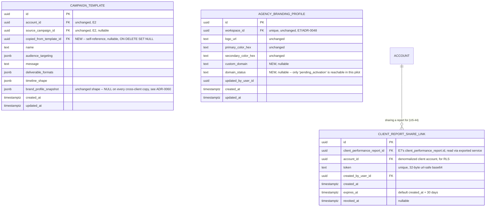

# E9 -- Agency Multi-Client Operations: Technical Architecture

## 1. Overview

This document specifies the data model, API contracts, and behavioral rules for the genuinely unbuilt scope of Epic E9 (Agency Multi-Client Operations). Per `docs/epics/e9-agency-multi-client-operations/stories.md`, that scope is narrower than Table 1/Table 4 of the PRD suggest: US-38 and US-45 are fully implemented by E1; US-42, US-43, US-46, US-47 are fully implemented by E6, E7, and E1 respectively and are not re-specified here. What this document actually designs is:

- **US-39** -- an explicit client-context selector and persistent client attribution on campaigns. The authorization mechanism (`RolesGuard` + `AccountAccessService.resolveAccess`, E1) already covers every scenario's enforcement; nothing here changes how access is granted or denied. What is missing is a user-facing surface.
- **US-41** (FR-22) -- cross-client campaign template reuse, both at client onboarding time (wiring up E1's dead `copy_templates_from` stub) and as an ongoing action. E2's ADR-0010 explicitly deferred this to E9 and named the floor this document extends: account-scoped `campaign_template`, no new sharing model invented beyond what cross-client copying requires.
- **US-44** (FR-57, full scope) -- white-label branding beyond the report-only `agency_branding_profile` E7 built ahead of this epic (ADR-0048). This document extends that table; it does not replace it.
- **FR-60** (the shared US-38/US-45 addendum) -- a read endpoint for the audit log. The write path (`AuditService.log`, E1) is already called by every epic; no controller has ever existed to read it back.

The stack is **not** re-decided here: NestJS modular monolith, PostgreSQL with RLS keyed on `account_id` (plus the `app.creator_portal`, `app.aurora_operator`, and `app.agency_cross_client_read` escape hatches E3, E6, and E7 already established), Redis for queues/caching, S3-compatible object storage, React/TypeScript frontend with React Query and the existing `axios` client/interceptor pattern (`frontend/src/lib/api-client.ts`). Every decision below builds directly on E1 (`workspace`/`account`/`membership`/`operator_client_access`/`audit_log`, `RolesGuard`, `AccountAccessService`), E2 (`campaign`, `campaign_template`, ADR-0010), and E7 (`agency_branding_profile`, `client_performance_report`, the exported-service-for-in-process-reuse pattern, ADR-0048).

**This epic touches four existing backend modules additively (`agency`, `campaign`, `audit`, `analytics`) and introduces no new module.** Nothing here is a new service boundary; everything is an extension of a module another epic already owns, following the precedent ADR-0013, ADR-0020, and ADR-0048 already established for taking the smallest slice of a later epic's scope.

**Governing NFRs for every endpoint in this epic (Table 15 of the PRD), restated from the stories document:**

| NFR | Target | How this design meets it |
|---|---|---|
| NFR-09 | Up to 10 client accounts per agency workspace | Unchanged from E1 (`workspace.max_client_accounts`, checked in `AgencyService.createClient`). Nothing in this epic adds a second place client accounts are created or counted. |
| NFR-16 | 100% server-side authorization; zero cross-tenant reads; every denial logged | Every new endpoint in this document reuses `RolesGuard`/`AccountAccessService.resolveAccess` for its primary tenant check (US-39, FR-60) or adds one narrow, explicitly validated escape hatch following the exact pattern E7's `app.agency_cross_client_read` already established (US-41's cross-account template copy, section 2.6). The one genuine gap this document closes -- `audit_log` had no RLS policy at all before this epic, relying solely on the fact nothing read it -- is fixed with an explicit, asymmetric read/write policy (section 2.7, ADR-0062), not left as a latent risk the first read endpoint would have exposed. |
| NFR-17 | Immutable audit log, 5-year retention | The write path and the append-only trigger are unchanged (E1). This epic adds a read path only; no endpoint in this document ever updates or deletes an `audit_log` row, so immutability holds by the simple fact that no such code path exists. |

---

## 2. Data Model

### 2.1 Entity-Relationship Diagram (new and changed entities only)



Rows and relationships shown in plain type (`ACCOUNT`) already exist, owned by E1. `CAMPAIGN_TEMPLATE` and `AGENCY_BRANDING_PROFILE` already exist, owned by E2 and E7 respectively -- this epic adds columns to both, additively, per each table's own stated extension contract (ADR-0010's "floor," ADR-0048's explicit "when E9 ships, it extends this table... rather than replacing it"). `CLIENT_REPORT_SHARE_LINK` is the one genuinely new table this epic introduces, and it lives in the existing `agency` module (`backend/src/agency`), not in `analytics`, for the same reason `agency_branding_profile` lives there and not in `analytics`: it is a white-label/agency-domain concern that happens to read a report `analytics` owns, not a reporting concern itself.

No changes are made to `campaign`, `workspace`, `account`, `membership`, `operator_client_access`, or `client_performance_report` themselves. `audit_log`'s columns are unchanged; only its RLS posture changes (section 2.7).

### 2.2 `campaign_template`: cross-client copy support (US-41)

```sql
ALTER TABLE campaign_template
  ADD COLUMN copied_from_template_id uuid NULL
  REFERENCES campaign_template(id) ON DELETE SET NULL;
```

`copied_from_template_id` records provenance when a template was created by copying another template across a client-account boundary (either at onboarding time or by the ongoing copy action, section 4), rather than by `saveAsTemplate` from a campaign (which continues to set `source_campaign_id` and leaves this column null). The two provenance columns are mutually exclusive in practice (a copied template was never itself instantiated from a campaign in the *target* account) but neither is constrained to be, since nothing in the stories requires enforcing that at the database level, and a future epic might reasonably want to re-copy an already-copied template.

**`brand_profile_snapshot` is always `NULL` on a cross-client copy, regardless of what the source template carried (ADR-0060).** This is a deliberate privacy and correctness decision, not an oversight: the source template's snapshot describes the *source client's* brand profile (prohibited topics, tone of voice) at the time it was saved. Copying that snapshot into the target client's template would (a) leak one client's brand configuration into another client's visible data, which is exactly the kind of cross-client leak NFR-16 exists to prevent, even though `campaign_template` is not financial or creator data, and (b) produce meaningless drift warnings the first time the target client instantiates the template, since `computeDrift` (E2, `template.service.ts`) would compare the *source* client's old tone of voice against the *target* client's current one -- two unrelated brands -- rather than against anything the target client ever configured. A template with `brand_profile_snapshot = null` computes no drift at all (the existing `computeDrift` short-circuits on a null snapshot), which is the correct, conservative behavior for a freshly copied template: the target client's team re-saves it as a template in the normal way (`POST /campaigns/:id/save-as-template`) once they have run a campaign from it, at which point it is snapshotted against their own, real brand profile, same as any other template.

### 2.3 `agency_branding_profile`: domain field, extended not replaced (US-44, ADR-0061)

```sql
ALTER TABLE agency_branding_profile
  ADD COLUMN custom_domain text NULL,
  ADD COLUMN domain_status text NULL;

ALTER TABLE agency_branding_profile
  ADD CONSTRAINT chk_domain_status_values
  CHECK (domain_status IS NULL OR domain_status IN ('pending_activation'));
```

Per ADR-0048's own explicit hand-off ("When E9 ships, it extends this table... rather than replacing it"), this is the only change to `agency_branding_profile`'s shape. `custom_domain` is validated for hostname format only (lowercase, RFC 1123-compatible label syntax) at the application layer -- no DNS lookup, no ownership verification. `domain_status` is set to `'pending_activation'` the moment a non-null `custom_domain` is saved, and the CHECK constraint deliberately permits no other value yet: this pilot has no automated DNS verification, certificate provisioning, or multi-tenant routing (ADR-0061 explains why, and why that is the correct scope decision rather than a shortcut). `logo_url`, `primary_color_hex`, `secondary_color_hex` are unchanged and continue to be read exactly as E7 already reads them (`AgencyBrandingService.getBrandingProfile`, reused unchanged by this epic, not duplicated).

### 2.4 `client_report_share_link` (US-44, new table, ADR-0061)

```sql
CREATE TABLE client_report_share_link (
  id uuid PRIMARY KEY DEFAULT gen_random_uuid(),
  client_performance_report_id uuid NOT NULL REFERENCES client_performance_report(id),
  account_id uuid NOT NULL REFERENCES account(id), -- denormalized, the client account, for RLS (section 2.7)
  token text NOT NULL,
  created_by_user_id uuid NOT NULL,
  created_at timestamptz NOT NULL DEFAULT now(),
  expires_at timestamptz NOT NULL,
  revoked_at timestamptz NULL
);

CREATE UNIQUE INDEX uq_share_link_token ON client_report_share_link (token);
```

One row per minted share link. A report can have more than one active link over its lifetime (Renata might revoke one and mint a fresh one for a new engagement), so there is deliberately no uniqueness constraint on `client_performance_report_id` alone. `token` is a 32-byte, URL-safe base64 value, generated the same way E1 already generates invitation and verification tokens -- no new token-generation mechanism is introduced. `expires_at` defaults to 30 days from creation (an architectural default, since FR-57 states nothing about link lifetime; 30 days was chosen because a per-client report is typically shared once per reporting cycle and a shorter window, like the 7-day invitation default, would force Renata to regenerate a link mid-cycle for no security benefit, since the link carries no write capability and exposes only the same read-only figures the report itself already shows to her own team). `revoked_at` lets Renata invalidate a link immediately (scenario-equivalent to US-45's "no delay, no logout needed" revocation discipline) without waiting for natural expiry.

### 2.5 Role Permissions (extends E1/E7 tables, new rows only)

| Permission | brand_owner/manager/analyst | agency_admin | agency_operator (own clients) |
|---|---|---|---|
| Switch client context via the explicit selector (US-39) | n/a (single account) | yes | yes (assigned clients only) |
| Copy a template across clients, at onboarding (US-41) | n/a | yes (via `copy_templates_from`) | no (`POST /agency/clients` is `agency_admin`-only, unchanged from E1) |
| Copy a template across clients, ongoing (US-41) | n/a | yes (any two clients in their workspace) | yes, only if they hold `operator_client_access` for **both** the source and the target client |
| Configure custom domain (US-44) | -- | yes | no (matches E7's existing branding-config restriction) |
| Mint / revoke a client report share link (US-44) | -- | yes | yes (own clients) |
| View an account's audit log (FR-60) | -- | yes (any client in their workspace) | yes, only for clients they hold `operator_client_access` for |

No permission in this table is granted to `brand_owner`/`brand_manager`/`brand_analyst`: every genuinely new capability this epic adds is agency-specific by construction (a brand workspace has exactly one account, so "cross-client," "client context," and "per-client audit log" have no referent for it). This is enforced structurally, not by a workspace-type check: `@Roles(Role.AGENCY_ADMIN, Role.AGENCY_OPERATOR)` on every new endpoint is sufficient, since brand-workspace users never hold either role (E1 section 2.3).

### 2.6 Row-Level Security: the cross-client template-copy escape hatch (US-41, ADR-0060)

`campaign_template`'s existing policy (E2, following E1's pattern) is a plain, single-tenant match:

```sql
CREATE POLICY tenant_isolation ON campaign_template
  USING (account_id = current_setting('app.current_account_id', true)::uuid);
```

A `USING`-only policy with no separate `WITH CHECK` applies the same expression to every command, including `INSERT` -- which means, as written, a session whose `app.current_account_id` is set to the *source* account (the ongoing copy action, section 4.2) or to the agency's *home* account (the onboarding-time bulk copy, section 4.1) can never successfully insert a `campaign_template` row owned by a *different*, target account. This is exactly the correctness property RLS is supposed to provide everywhere else, and it is also exactly what cross-client template copying genuinely needs to cross, deliberately and narrowly, for this one operation.

This epic adds a fourth instance of the pattern `app.creator_portal` (E3), `app.aurora_operator` (E6), and `app.agency_cross_client_read` (E7) already established -- a session flag, `app.agency_template_copy`, set only for the duration of the copy write, after the service layer has already independently validated the operation (section 4):

```sql
CREATE POLICY tenant_isolation ON campaign_template
  USING (
    account_id = current_setting('app.current_account_id', true)::uuid
    OR (
      current_setting('app.agency_template_copy', true) = 'true'
      AND account_id IN (
        SELECT a.id FROM account a
        WHERE a.workspace_id = current_setting('app.current_workspace_id', true)::uuid
      )
    )
  );
```

Exactly as E7's own cross-client escape hatch states for itself: **RLS here is the backstop against a workspace boundary, not the scope limiter within it.** The service layer validates, before ever setting this flag, that both the source and target accounts belong to the caller's own workspace, and -- for an `agency_operator`, whose privilege is per-client, not workspace-wide -- that `operator_client_access` grants them **both** accounts specifically (section 4.2). `app.current_workspace_id` is resolved server-side from the caller's own membership, reusing the exact same session variable E7 already introduced for its own escape hatch, never accepted as client input. The CI check already extended by E7 ("every escape-hatch flag is on the recognized allow-list") is extended again to include `app.agency_template_copy`.

### 2.7 Row-Level Security: retrofitting `audit_log` for its first read path (FR-60, ADR-0062)

**`audit_log` has carried no RLS policy at all since E1 introduced it.** This was never a bug in isolation -- nothing ever read the table except `AuditService.log` itself (an internal write, never filtered by tenant) -- but it becomes a live gap the moment this epic adds the platform's first read endpoint against it. Closing FR-60 correctly means closing this gap, not merely adding a controller on top of an ungated table and hoping the service layer's own `WHERE` clause never has a bug, which is exactly the discipline NFR-16 exists to not have to rely on.

A naive, symmetric policy (`target_account_id = current_setting('app.current_account_id')`, applied to every command) would **break existing, already-shipped write paths**, discovered by checking the actual call sites rather than assuming: `AgencyService.createClient` writes a `client_account.created` entry with `targetAccountId` set to the **brand-new client account**, while the request's own session context is the agency's **home** account (`POST /agency/clients` runs under the caller's own account, not the one being created); `grantOperatorAccess`/`revokeOperatorAccess` write `targetAccountId` as the **client** account while the session may be the home account; and `POST /auth/register` writes `user.registered` before any `X-Account-Id` context exists at all (a public endpoint, `app.current_account_id` is unset, so `current_setting(..., true)` returns `NULL`, and `NULL = anything` is never true in SQL -- that insert would be silently rejected outright under a naive symmetric policy, breaking registration itself).

The correct design is an **asymmetric read/write policy**, splitting `FOR INSERT` from `FOR SELECT`:

```sql
ALTER TABLE audit_log ENABLE ROW LEVEL SECURITY;
ALTER TABLE audit_log FORCE ROW LEVEL SECURITY;

-- Writes: audit logging is a cross-cutting capability invoked from many
-- request contexts, some with no tenant context at all (public endpoints,
-- before any account exists) and some legitimately targeting a *different*
-- account than the caller's own current session (an agency_admin's request,
-- running under their home account, recording an event against the client
-- account it just created or just granted access to). Restricting INSERT
-- would break already-shipped code; this policy intentionally does not.
CREATE POLICY audit_log_write ON audit_log
  FOR INSERT WITH CHECK (true);

-- Reads: this is the actual tenant boundary FR-60 and NFR-16 require for
-- the new surface this epic adds. A row with target_account_id = NULL (a
-- platform-level event with no single tenant owner, e.g. a future
-- system-wide action) is never returned to any single-tenant read, by
-- construction -- consistent with this endpoint's whole purpose being a
-- per-client audit trail (FR-60's own wording), not a platform-wide one.
CREATE POLICY audit_log_read ON audit_log
  FOR SELECT USING (target_account_id = current_setting('app.current_account_id', true)::uuid);
```

This is a correctness fix that stands on its own, independent of any one epic's feature -- every prior epic's write calls continue to work completely unchanged, verified against every call site above, while the read endpoint this epic adds (section 5.4) gets the exact tenant isolation NFR-16 promises, enforced at the database layer rather than trusted to the service layer's own query alone. The CI check is extended to cover this split (confirming both policies exist and that no future migration collapses them back into one symmetric policy without a documented reason).

### 2.8 Row-Level Security: the public share-link read (US-44)

`client_report_share_link`'s own row carries `account_id` and uses the standard single-tenant policy for its **authenticated** operations (minting, listing, revoking -- all performed by Renata or an operator under their normal client-account session context, no escape hatch needed):

```sql
CREATE POLICY tenant_isolation ON client_report_share_link
  USING (account_id = current_setting('app.current_account_id', true)::uuid);
```

The one read that genuinely has no tenant context at all is the **public**, token-gated view (`GET /public/client-reports/:token`, section 5.5): the agency's actual client company opens a link with no Aurora login, no `X-Account-Id`, nothing. This is the same structural situation E3's creator-portal already solved with `app.creator_portal`: a session with no tenant context, where the real restriction -- an exact, unguessable 32-byte token match -- is enforced in application code, and RLS's only job is to not block the row from being visible at all once that application-level filter has already run. This epic reuses that same discipline with a fifth escape-hatch flag, `app.public_share_link_read`, set only on the connection serving this one public endpoint, narrower in blast radius than every prior escape hatch because the application code supplies an exact-match token filter before the flag is ever relevant:

```sql
CREATE POLICY tenant_isolation ON client_report_share_link
  USING (
    account_id = current_setting('app.current_account_id', true)::uuid
    OR current_setting('app.public_share_link_read', true) = 'true'
  );
```

The service layer never queries this table under the public flag without an exact `WHERE token = $1` clause already present (section 5.5), so the flag alone grants no meaningful cross-tenant read on its own -- it only lets a token-matched row through a policy that would otherwise block it for lack of any tenant context. The CI allow-list is extended to include `app.public_share_link_read`.

### 2.9 Database Constraints

```sql
-- Share-link tokens are unique platform-wide (section 2.4)
-- (already shown above, uq_share_link_token)

-- A revoked or expired link is checked in application code at read time
-- (section 5.5), not via a partial index -- consistent with how E1 already
-- checks invitation.status/expires_at in code rather than in a constraint.

-- domain_status may only ever be null or 'pending_activation' in this pilot
-- (already shown above, chk_domain_status_values)
```

---

## 3. Integration: Exactly What This Epic Extends From E1, E2, and E7

This section exists for the same reason E7's own section 3 exists: to state precisely what is read, reused, or extended, and to make explicit that nothing here is duplicated or recomputed.

### 3.1 From E1

- **`RolesGuard` + `AccountAccessService.resolveAccess`** (`backend/src/common/guards/roles.guard.ts`, `backend/src/common/account-access.service.ts`): reused **completely unchanged** for every new endpoint's primary authorization check (US-39's selector relies on it for every switch; FR-60's read endpoint relies on it entirely, with zero new service-layer authorization code, section 5.4). This epic adds exactly one net-new authorization check anywhere: the ongoing template copy's target-account validation (section 4.2), because resolving access to a *second* account within one already-authorized request is not something `RolesGuard` does on its own (by design -- it resolves exactly one account per request, the same limitation E7's section 2.5 already states for RLS itself).
- **`operator_client_access`**: read, never written to, by the new target-account check in section 4.2 (via the same `AccountAccessService.resolveAccess` call every other epic already uses, not a new query against this table).
- **`AuditService.log`**: reused unchanged for every new audit event this epic writes (`campaign_template.copied`, `agency_branding_profile.domain_configured`, `client_report_share_link.created`/`revoked`, and the `authorization.denied` entries for every new refusal path). No new write method is added to `AuditService`; one new read method is added (`AuditService.listForAccount`, section 5.4), the module's first.
- **`workspace.max_client_accounts`, `AgencyService.createClient`/`listClients`/`grantOperatorAccess`/`revokeOperatorAccess`**: untouched. `createClient` gains exactly one new internal call (to the template-copy logic, section 4.1) in place of its existing dead stub; its request/response shape, its role restriction, and every other behavior are unchanged.

### 3.2 From E2

- **`campaign_template`** (ADR-0010): the account-scoped floor ADR-0010 established is **extended, not replaced**. Every existing column, every existing endpoint (`POST /campaigns/:id/save-as-template`, `GET /campaign-templates`, `POST /campaign-templates/:id/instantiate`), and the existing within-one-account RLS policy's primary branch are unchanged. This epic adds one column (`copied_from_template_id`), one new endpoint (`POST /campaign-templates/:id/copy`, section 4.2), and one `OR` branch to the existing policy (section 2.6).
- **`campaign.account_id`** (the field FR-24 already populates via `RolesGuard`'s resolved `currentAccountId`, since E2): read, never written differently, by the campaign list/detail attribution this epic adds (section 5.2) -- the field already exists and already holds the correct value for every campaign ever created; this epic only makes it visible in the response shape.

### 3.3 From E7

- **`agency_branding_profile`, `AgencyBrandingService.getBrandingProfile`/`configureBranding`** (ADR-0048): extended exactly as ADR-0048 itself forecast ("extends this table... rather than replacing it"). The existing `GET`/`PUT /agency/branding` endpoints gain two new optional request/response fields (`custom_domain`, `domain_status`); no existing field, endpoint path, or role restriction changes.
- **`client_performance_report`**: read-only, via one new exported method on `analytics`'s existing service (`ClientReportService.getReportForSharing(reportId, accountId)`, section 5.5), following the exact "exported-service-for-in-process-reuse" discipline ADR-0032/ADR-0036/ADR-0048 already established -- `agency` (where `client_report_share_link` lives) never queries `client_performance_report` directly.
- **`app.agency_cross_client_read`, `app.current_workspace_id`**: the session-variable convention is reused (`app.current_workspace_id`) and the escape-hatch *pattern* is reused a second and third time (sections 2.6, 2.8), but these are two new, independently scoped flags (`app.agency_template_copy`, `app.public_share_link_read`), not a widening of E7's own flag's reach.

---

## 4. Cross-Client Template Copy (US-41, FR-22, ADR-0060)

### 4.1 Onboarding-time bulk copy (wiring E1's existing, dead parameter)

`POST /agency/clients` already accepts `copy_templates_from` and already validates it belongs to the same workspace (E1, `AgencyService.createClient`). This epic replaces the stub (`templatesCopied = 0`, hardcoded) with a real call:

1. After the new client account is created and saved (unchanged, E1's existing step).
2. `TemplateCopyService.copyAllTemplates(sourceAccountId, newAccountId, workspaceId, actor)`:
   - Sets `app.agency_template_copy = 'true'` and `app.current_workspace_id = workspaceId` on the request's connection (section 2.6). No per-account operator check is needed here, since `POST /agency/clients` is already `agency_admin`-only (E1, unchanged), and an `agency_admin` has implicit access to every client in their own workspace, source and target alike.
   - Reads every `campaign_template` row where `account_id = sourceAccountId`.
   - For each, inserts a new row under `account_id = newAccountId`: `name`, `audience_targeting`, `message`, `deliverable_formats`, `timeline_shape` copied verbatim; `source_campaign_id = null`; `copied_from_template_id = <original id>`; `brand_profile_snapshot = null` always (section 2.2).
   - Returns the count copied.
3. `templates_copied` in the response (`POST /agency/clients`'s existing field, previously always `0`) now reflects the real count.
4. Audit log entry (existing `client_account.created` event) gains a `templates_copied` metadata value that is no longer always zero; no new audit action is introduced for the bulk case, consistent with it being one logical step of client creation.

No request or response shape changes on `POST /agency/clients` itself -- `copy_templates_from` and `templates_copied` already existed; this section only makes the second one true.

### 4.2 Ongoing, after-the-fact copy (new capability, US-41 scenario 2)

#### POST /campaign-templates/:id/copy

**Required role:** `agency_admin`, `agency_operator`. The caller's `X-Account-Id` must already resolve to the **source** client account (the template's own `account_id`) -- exactly the same precondition every other `campaign-templates` endpoint already has, enforced entirely by the existing `RolesGuard`/`AccountAccessService` machinery with no new code (section 3.1). This is also the natural product flow: Renata uses the US-39 client-context selector (section 6) to switch into the source client's context, opens `/app/templates`, and chooses "copy to another client" on the template she wants to reuse.

**Request:**
```json
{ "target_account_id": "x9y8z7w6-..." }
```

**Success response (201 Created):** Same shape as `POST /campaign-templates/:id/instantiate`'s template fields (not a campaign) -- the newly created template under the target account:
```json
{
  "id": "tmpl-9002",
  "account_id": "x9y8z7w6-...",
  "source_campaign_id": null,
  "copied_from_template_id": "tmpl-0001",
  "name": "Lancamento de produto - padrao",
  "audience_targeting": { "...": "..." },
  "message": "Destacar o ingrediente vitamina C e o resultado em 14 dias",
  "deliverable_formats": ["instagram_reel", "instagram_story"],
  "timeline_shape": { "duration_days": 29 },
  "created_at": "2026-10-21T10:00:00Z"
}
```

**Behavior:**
1. Load the template under the **current** (source) account context, exactly like every other template read (`TEMPLATE_NOT_FOUND` if absent, unchanged discipline).
2. Resolve the source account's workspace. Look up `target_account_id` scoped to that same `workspace_id`. If it does not exist in this workspace, return 404 `CLIENT_NOT_FOUND` -- the same "one code covers both 'does not exist' and 'not accessible'" discipline E3/E4/E5/E7 already apply, so a caller cannot distinguish "wrong id" from "right id, wrong workspace" (US-41 scenario 3's "states that the source is not accessible," applied symmetrically to the target).
3. If `target_account_id === current (source) account_id`, return 400 `INVALID_TARGET` ("O cliente de destino deve ser diferente do cliente de origem.").
4. **The one genuinely new authorization check this epic adds:** if the caller's resolved role is `agency_operator` (not `agency_admin`), call `AccountAccessService.resolveAccess(userId, memberships, target_account_id)`. If it returns `null` (no `operator_client_access` grant for the target), refuse with 403 `TARGET_NOT_ACCESSIBLE` ("Voce nao tem acesso ao cliente de destino.") and write `authorization.denied` with `reason: template_copy_target_inaccessible`, `target_account_id` set to the **target**, satisfying US-41 scenario 3's "logs the denied attempt" for the specific case this check exists to catch (the symmetric source-side case is already covered automatically, since the request could never have reached this handler without it, section 3.1). An `agency_admin` skips this check entirely, having implicit access to every client in their own workspace, already validated by step 2's workspace match.
5. Set `app.agency_template_copy = 'true'`, `app.current_workspace_id = <workspace id>` on the connection (section 2.6).
6. Insert the new `campaign_template` row under `target_account_id`: same field-copy and `brand_profile_snapshot = null` rule as section 4.1, plus `copied_from_template_id = <source template id>`.
7. Write audit log: `campaign_template.copied`, `targetAccountId: target_account_id`, metadata `{ source_account_id, source_template_id, target_account_id, target_template_id }`.

**Error responses:**
- 404 `TEMPLATE_NOT_FOUND`: source template not found in the current account.
- 404 `CLIENT_NOT_FOUND`: `target_account_id` does not resolve to an account in the caller's own workspace.
- 400 `INVALID_TARGET`: target equals source.
- 403 `TARGET_NOT_ACCESSIBLE`: caller is `agency_operator` without `operator_client_access` for the target (logged).

---

## 5. API Contracts

### 5.1 Conventions

Identical to E1-E7: base URL `https://api.aurora.com.br/v1`, JSON bodies, bearer JWT, `X-Account-Id` header for agency/client context, the same structured error shape (`code`, `message`, `details`), cursor pagination, ISO 8601 UTC timestamps.

### 5.2 Campaign Client Attribution (US-39)

No new endpoint. Two existing E2 response shapes gain fields, additively:

#### GET /campaigns (list) -- `CampaignSummary` gains two fields

```json
{
  "data": [
    {
      "id": "camp-1234-...",
      "name": "Lancamento Serum Vitamina C",
      "state": "active",
      "budget_amount": "45000.00",
      "account_id": "x1y2z3w4-...",
      "account_name": "Cliente: Acme Cosmeticos",
      "created_at": "2026-10-15T14:00:00Z"
    }
  ],
  "pagination": { "next_cursor": null, "has_more": false }
}
```

#### GET /campaigns/:id (detail) -- gains the same two fields

`account_id`/`account_name` are a plain, single-row join on `campaign.accountId -> account.name`, bounded by the same page-size/single-row cost as every other field already in these responses -- no new query shape, no N+1 beyond what the existing per-row brand-profile-status lookup already does in `list`. **These fields are present in every response, for every workspace type, not only agency ones** -- for a brand workspace they are simply always the brand's own single account, which costs nothing and keeps the response shape uniform; the frontend only renders the attribution label when `workspace.type === 'agency'` (section 6).

### 5.3 Branding Domain Configuration (US-44)

#### PUT /agency/branding -- gains one optional field, unchanged endpoint

**Required role:** `agency_admin` (unchanged from E7).

**Request (existing fields plus the new one):**
```json
{
  "logo_url": "https://assets.aurora.com.br/agency-branding/...",
  "primary_color_hex": "#1A2B3C",
  "secondary_color_hex": "#FFFFFF",
  "custom_domain": "relatorios.agenciacriativa.com.br"
}
```

**Validation (new):** `custom_domain`, if provided, must match a lowercase, RFC 1123-compatible hostname pattern. No DNS lookup, no ownership proof is requested or required in this pilot (ADR-0061).

**Success response (200 OK) -- gains two fields:**
```json
{
  "logo_url": "https://assets.aurora.com.br/agency-branding/...",
  "primary_color_hex": "#1A2B3C",
  "secondary_color_hex": "#FFFFFF",
  "custom_domain": "relatorios.agenciacriativa.com.br",
  "domain_status": "pending_activation",
  "updated_at": "2026-10-21T10:00:00Z"
}
```

**Behavior:** Setting a non-null `custom_domain` always sets `domain_status = 'pending_activation'` and writes `agency_branding_profile.domain_configured` to the audit log. **No routing, certificate, or DNS-verification behavior exists anywhere in this pilot** -- `domain_status` never reaches any value but `pending_activation` or `null` (enforced by the CHECK constraint, section 2.3). The configured domain is surfaced back to Renata for display purposes only (section 6); every actual request this epic serves, including the public share-link view (section 5.5), continues to be served at Aurora's own domain regardless of what is configured here (ADR-0061 states exactly why, and what would need to change for that to stop being true).

**Error responses:**
- 422 `INVALID_DOMAIN_FORMAT`: `custom_domain` fails hostname validation.

---

### 5.4 Audit Log Read (FR-60)

#### GET /audit-log

**Required role:** `agency_admin` (any client account in their own workspace), `agency_operator` (only client accounts named in their own `operator_client_access` rows). As section 2.5 notes, this restriction needs no workspace-type check: a brand-workspace user never holds either role.

**Tenant context:** `X-Account-Id` resolves the **one** client account whose log is being requested, identically to every other account-scoped `GET` in the platform (campaigns, invoices, reports). There is no cross-client aggregate view -- Renata switches context (the same US-39 selector, section 6) to view a different client's log, one account at a time, consistent with every other agency-scoped surface built so far.

**Query parameters:**
- `cursor`, `limit` (standard pagination, default 20, max 100).

**Success response (200 OK):**
```json
{
  "data": [
    {
      "id": "8842",
      "actor_user_id": "a1b2c3d4-...",
      "actor_name": "Renata Alves",
      "actor_email": "renata@agenciacriativa.com.br",
      "action": "operator_access.granted",
      "metadata": { "operator_user_id": "op-1234-...", "membership_id": "mem-5678-..." },
      "created_at": "2026-10-20T09:00:00Z"
    },
    {
      "id": "8810",
      "actor_user_id": null,
      "actor_name": null,
      "actor_email": null,
      "action": "campaign_template.copied",
      "metadata": { "source_account_id": "y1y1...", "source_template_id": "tmpl-0001", "target_template_id": "tmpl-9002" },
      "created_at": "2026-10-19T15:30:00Z"
    }
  ],
  "pagination": { "next_cursor": "8810", "has_more": true }
}
```

**Behavior:** A single query against `audit_log` filtered by RLS's new `audit_log_read` policy (section 2.7) to `target_account_id = <current account>`, left-joined to `user` for `actor_name`/`actor_email` (null when `actor_user_id` is null, e.g. a system-attributed action), ordered `created_at DESC`. No new authorization code is written: `RolesGuard` already refuses the request outright (403, logged as `authorization.denied`) for any caller without a resolvable relationship to the requested account, which is exactly US-38-addendum scenario 2's required behavior ("Client A's log is returned in full; the Client B request is refused... and is itself logged"). **`ip_address` and `user_agent` are deliberately omitted from this response** -- they remain in the table and available to direct database access for security investigation, but are not surfaced on this read-only, business-facing screen, consistent with the platform's general data-minimization posture even though no single NFR specifically names this field.

**Error responses:**
- 403 `INSUFFICIENT_PRIVILEGES`: caller holds neither `agency_admin` nor `agency_operator` (e.g., a brand-workspace user).
- 403 `INSUFFICIENT_PRIVILEGES` (same code, via `RolesGuard`'s existing account-resolution check): caller has no relationship to the requested account at all, or is an `agency_operator` without `operator_client_access` for it (US-38-addendum scenario 2's refusal case, logged automatically).

---

### 5.5 Client Report Share Link (US-44)

#### POST /agency/clients/:clientAccountId/reports/:reportId/share-link

Mints a new, token-gated, unauthenticated-readable link to a `ready` `client_performance_report` (E7), for Renata to hand to her actual client company, who has no Aurora login.

**Required role:** `agency_admin`, `agency_operator` (with `operator_client_access` for `clientAccountId`). Caller's `X-Account-Id` is the client account itself, same convention as every other `/agency/clients/:clientAccountId/...` endpoint (E7, section 2.5 of that document).

**Request:** Empty body.

**Success response (201 Created):**
```json
{
  "token": "pR3x...-32-bytes-url-safe",
  "share_url": "https://app.aurora.com.br/public/client-reports/pR3x...-32-bytes-url-safe",
  "display_url": "https://relatorios.agenciacriativa.com.br/public/client-reports/pR3x...-32-bytes-url-safe",
  "expires_at": "2026-11-20T10:00:00Z"
}
```

**Behavior:**
1. Validate the report exists, belongs to `clientAccountId`, and `status = ready` (a `pending` or `failed` report has nothing shareable yet -- 409 `REPORT_NOT_READY`).
2. Generate a 32-byte, URL-safe base64 token (same generator as E1's invitation/verification tokens). Create the `client_report_share_link` row, `expires_at = now() + 30 days`.
3. `share_url` is always Aurora's own domain -- the one actually served. `display_url` is **computed, not routed**: if `agency_branding_profile.custom_domain` is configured for this workspace, the same path is shown under that domain purely for Renata's own reference/copy-paste convenience when she tells her client where to look; **no request to that domain is ever actually served by Aurora in this pilot** (section 5.3, ADR-0061). If no domain is configured, `display_url` is identical to `share_url` and the field is present but redundant.
4. Write audit log: `client_report_share_link.created`.

**Error responses:**
- 404 `REPORT_NOT_FOUND`: report does not exist under `clientAccountId` (covers inaccessible the same one-code-for-both way as E7's own report-not-found case).
- 409 `REPORT_NOT_READY`: report exists but is not yet `ready`.

---

#### DELETE /agency/clients/:clientAccountId/reports/:reportId/share-link/:linkId

Revokes a share link immediately.

**Required role:** Same as minting.

**Success response (204 No Content).**

**Behavior:** Sets `revoked_at = now()`. Write audit log: `client_report_share_link.revoked`. Takes effect immediately -- the public endpoint (below) checks `revoked_at IS NULL` on every read, so there is no caching window during which a revoked link still resolves, mirroring US-45 scenario 2's "no delay" discipline for access revocation generally.

---

#### GET /public/client-reports/:token

**Public endpoint. No authentication, no `X-Account-Id`.** This is the one surface in this epic -- and, per ADR-0061's scope decision, in the whole of US-44 -- that an agency's actual client company (who never logs into Aurora at all) can open.

**Success response (200 OK):**
```json
{
  "agency_name": "Agencia Criativa",
  "branding": {
    "logo_url": "https://assets.aurora.com.br/agency-branding/...",
    "primary_color_hex": "#1A2B3C",
    "secondary_color_hex": "#FFFFFF",
    "applied": true
  },
  "report": {
    "campaign_count": 5,
    "total_spend": "180000.00",
    "total_delivered_reach": 2400000,
    "total_delivered_engagement": 98000,
    "cost_per_engagement": "1.8367",
    "cpm_equivalent": "75.00",
    "pdf_document_url": "https://assets.aurora.com.br/reports/...",
    "csv_document_url": "https://assets.aurora.com.br/reports/..."
  }
}
```

**Behavior:**
1. Look up `client_report_share_link` by exact `token` match (the application-level filter section 2.8 relies on). If not found, or `revoked_at IS NOT NULL`, or `expires_at < now()`, return 404 `LINK_NOT_AVAILABLE` -- one code for all three cases, the same "do not confirm which case applies" discipline used everywhere else in this platform for a resource a caller might not be entitled to learn more about.
2. Set `app.public_share_link_read = 'true'` for this one lookup only (section 2.8).
3. Call `ClientReportService.getReportForSharing(reportId, accountId)` (new exported method on `analytics`, section 3.3) to read the report's already-computed figures and document URLs -- never recomputed, never duplicated.
4. Call `AgencyBrandingService.getBrandingProfile(workspaceId)` (E7's existing exported method, unchanged) to render `branding`. **If no profile exists, or every visual field is null, `branding.applied = false` and the page renders with the same neutral, Aurora-agnostic template ADR-0048 already established for the PDF/CSV** -- this is the one place US-44 scenario 3 is actually tested: the fallback rule ADR-0048 resolved for the report itself is extended, unchanged, to this new page's own chrome (logo, colors around the download links and figures), not re-litigated.

**Error responses:**
- 404 `LINK_NOT_AVAILABLE`: token not found, revoked, or expired.

---

## 6. Frontend: The Client-Context Selector and Attribution (US-39)

**No new route.** This section extends two already-existing frontend surfaces (`frontend/src/components/layout/app-layout.tsx`'s account switcher; `frontend/src/pages/app/campaigns-page.tsx` and `campaign-detail-page.tsx`), per the stories document's own framing: the authorization mechanism already exists platform-wide; what was missing was a user-facing surface, confirmed by reading the actual frontend code rather than assuming it from the PRD. Checked directly: `app-layout.tsx` already renders a bare `<select>` populated from `workspace.accounts` calling `switchAccount` (which calls the existing `setCurrentAccountId`/`refreshWorkspace`, `frontend/src/contexts/auth-context.tsx`) -- this is the raw mechanism US-39 needs, but it renders every account in one flat, unlabeled list, and neither `campaigns-page.tsx` nor `campaign-detail-page.tsx` shows which account a campaign belongs to anywhere. Both gaps are closed additively:

1. **The existing account switcher gains structure, not new plumbing.** The flat `<option>` list groups into two labeled `<optgroup>`s: "Minha agencia" (the one home account) and "Clientes" (every other account, exactly `workspace.accounts.filter(a => !a.is_home)`, a field `GET /workspaces/current` already returns, E1). No new API call, no new state -- `switchAccount(accountId)` is called identically regardless of which group the chosen option came from.
2. **A persistent banner, rendered in `AppLayout` whenever `workspace.type === 'agency'` and the current account is not the home account:** "Atuando em nome de: {current_account.name}" (a small text/badge pairing, not a modal or confirmation step -- the switch itself is still one click on the existing selector; the banner is what makes the resulting state visible and persistent across every subsequent screen in that session, satisfying US-39 scenario 1's "persistently shows which client it belongs to" and scenario 2's "nothing from Client A's context carries over by the switch itself," which already holds true today since every list/detail query is freshly re-fetched against the new `X-Account-Id` -- the banner makes that existing correctness *visible*, it does not change it).
3. **`campaigns-page.tsx`'s list rows and `campaign-detail-page.tsx`'s header render `account_name`** (section 5.2's new field) as a small badge next to each campaign, in every workspace type (rendered unconditionally; in a brand workspace it is simply always the same one name, which costs nothing to show and keeps the two code paths identical rather than branching on workspace type inside the campaign views themselves -- only the banner and the grouped selector are agency-conditional).
4. **`campaign-form-page.tsx`'s creation form** gains a small, non-interactive notice above the form fields when the workspace is an agency: "Esta campanha sera criada para: {current_account.name}," reusing the same `workspace.current_account` state every other agency surface already reads -- no new field is submitted; `POST /campaigns` already attributes the campaign to whatever `X-Account-Id` resolved (E2, FR-24, unchanged), this is purely a confirmation of what is about to happen, directly addressing US-39 scenario 1's own reading that Renata should *explicitly select* who she is acting for rather than the system silently inferring it.

### Frontend Route Map (changed rows only; all other E1-E8 routes are unchanged)

| Route | Auth | Change |
|---|---|---|
| (layout, all `/app/*`) | Auth (agency) | Account switcher gains "Minha agencia"/"Clientes" grouping; persistent "Atuando em nome de" banner when a client account is active (US-39). |
| `/app/campaigns` | Auth | Each row shows `account_name` as a badge (US-39). |
| `/app/campaigns/:id` | Auth | Header shows `account_name` as a badge (US-39). |
| `/app/campaigns/new` | Auth | Shows "Esta campanha sera criada para: {account}" notice in agency workspaces (US-39). |
| `/app/templates` | Auth (agency) | Each template row gains a "Copiar para outro cliente" action opening a small dialog to choose a target client, calling `POST /campaign-templates/:id/copy` (US-41). |
| `/app/agency/branding` | Auth (agency_admin) | Gains a "Dominio personalizado" field (US-44), with inline help text stating the domain is for reference only until Aurora's infrastructure team activates it (ADR-0061) -- never implying real-time self-service activation. |
| `/app/clients/:id/reports` *(E7's existing route)* | Auth (agency) | Gains a "Gerar link compartilhavel" action per `ready` report, and a small management list of active/revoked links with a revoke action (US-44). |
| `/public/client-reports/:token` | **Public, no login** | New route (US-44): renders the branded (or neutral-fallback) HTML view backing section 5.5, with PDF/CSV download links. The only route in this entire epic reachable by someone who has never had an Aurora account. |
| `/app/audit-log` | Auth (agency_admin, agency_operator) | New route (FR-60): paginated, chronological list of the current client account's audit events, with the account switcher (above) as the only means of viewing a different client's log. |

---

## 7. NFR Compliance Checklist

| NFR | How this design satisfies it |
|---|---|
| NFR-09 | Unchanged. No new place creates or counts client accounts; the existing `max_client_accounts` check in `AgencyService.createClient` is untouched. |
| NFR-16 | Every new endpoint's primary tenant check reuses `RolesGuard`/`AccountAccessService.resolveAccess` unchanged (US-39, FR-60). The two places this epic crosses an account boundary within one request (template copy, section 4; the public share-link read, section 5.5) each get an explicit, narrowly-scoped RLS escape hatch, set only after an independent service-layer validation, following the exact pattern E7's own `app.agency_cross_client_read` already established and already passed review for. `audit_log`'s previously-nonexistent RLS policy is retrofitted with an asymmetric read/write split (section 2.7), verified against every existing write call site so no prior epic's behavior regresses, closing a real gap this epic's own read endpoint would otherwise have exposed. Every refusal path in this document (US-39 scenario 3, US-41 scenario 3, FR-60 scenario 2) writes `authorization.denied` to the audit log, either automatically (via `RolesGuard`, the common case) or explicitly (the one new target-account check in template copy). |
| NFR-17 | No endpoint in this document ever updates or deletes an `audit_log` row; the existing append-only trigger (E1) is untouched, and this epic's one read endpoint adds no write capability of any kind against that table. |

---

## 8. Open Questions Resolved -- and What Remains Deferred

| Stories-document open question | Resolution | ADR |
|---|---|---|
| 1. What "client-facing surface" means for FR-57/US-44 | Resolved narrowly: the agency's own internal operating UI (campaign pages, dashboards -- everything Renata's own team, who already has an Aurora login, uses) is **not** branded, since nothing there is actually "client-facing" in the sense that matters -- it is Renata's own team's working surface. What genuinely reaches the agency's actual client company, who has no Aurora login at all, is the per-client report (already branded, E7) and the new public, token-gated share-link view this epic adds. Branding the internal workspace UI is recorded as explicitly out of scope for this pilot, not overlooked. | ADR-0061 |
| 2. Branding granularity (per-workspace vs. per-client) | Not resolved further here, consistent with ADR-0048's own deferral; `agency_branding_profile` remains keyed to `workspace_id`. If product later requires per-client branding, that is a migration to a per-client key, not a new table -- unchanged from ADR-0048's own forecast. | -- |
| 3. Custom domain mechanics | Resolved for this pilot: the field is stored and format-validated; `domain_status` never progresses past `pending_activation`; no DNS verification, certificate provisioning, or multi-tenant routing exists. Every request this epic serves, including the public share-link, continues to be served at Aurora's own domain regardless of what is configured. | ADR-0061 |
| 4. Whether US-41 is onboarding-time-only, ongoing, or both | Resolved as both, per the stories document's own recommendation: section 4.1 wires the existing onboarding-time parameter; section 4.2 adds the ongoing, standalone action. | ADR-0060 |
| 5. Whether FR-60's read surface should also exist for direct brand workspaces | Not extended here, matching the stories document's own stated scope boundary. The endpoint is restricted to `agency_admin`/`agency_operator` by role (section 2.5), so a brand-workspace user cannot reach it regardless of whether the underlying query would technically work for a single-account workspace too. | ADR-0062 |
| 6. Whether per-client access (US-45) should require MFA | Not addressed by this document, consistent with the stories document's own choice not to invent an NFR-19 obligation Table 15 does not name for this epic. | -- |
